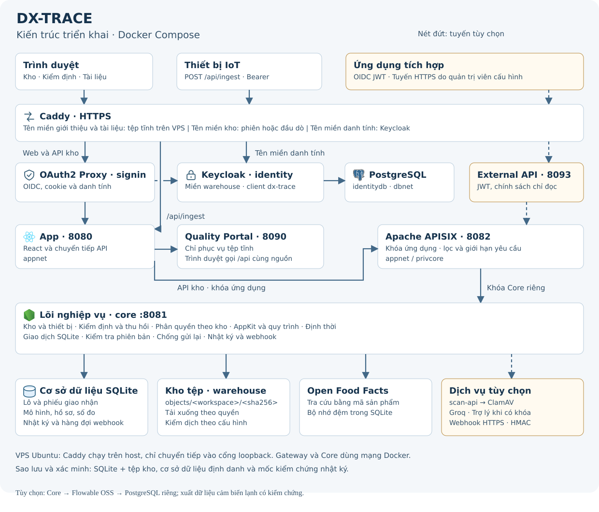

<div align="center">

[Tiếng Việt](README.md) · **English**

# DX-TRACE

Food traceability, warehouse operations and recall coordination.

[](https://github.com/ngochieu1762005/dx_trace/actions/workflows/ci.yml)
[](LICENSE)
[](https://github.com/ngochieu1762005/dx_trace/releases)

[Product](https://dxtrace.hieuds.com/en/) · [Application](https://app.dxtrace.hieuds.com/) · [Documentation](https://dxtrace.hieuds.com/docs/en/) · [API Reference](https://dxtrace.hieuds.com/docs/en/api-reference/)

</div>

## Start here

| Goal | Guide |
| --- | --- |
| Run the application locally | [Quick start](https://dxtrace.hieuds.com/docs/en/quickstart/) |
| Understand the system | [Architecture](#architecture) |
| Inspect the HTTP interface | [API reference](https://dxtrace.hieuds.com/docs/en/api-reference/) |

DX-TRACE is an open-source platform for warehouse traceability, food quality and recall coordination. It connects lots, shipments, storage conditions, incidents and reconciliation. The reusable headless Core supports declarative business applications and an independently deployed Quality Portal.

## Architecture



| Layer | Implementation |
| --- | --- |
| Identity | Keycloak + OAuth2 Proxy |
| Edge | Caddy / HTTPS |
| Presentation | React application and Quality Portal |
| Policy | Isolated API Gateway with distinct service credentials |
| Core | Node.js 24, domain rules, AppKit, process runtime, audit |
| Storage | SQLite and content-addressed attachments |
| Deployment | Docker Compose; optional scanner and external OIDC API |

## Platform capabilities

- Declarative AppKit v1 model installation and v2 atomic multi-model bundles.
- Model-generated forms, role-specific record scope, conditional validation and data-quality profiles.
- Finite-state workflows and a documented parallel/timer orchestration subset.
- Traceability by lot, QR and barcode; shipment reservation, quarantine and recall reconciliation.
- Optional device ingestion, scanning and signed webhook notifications.
- Audit-chain verification, external checkpoints, backup verification and release SBOMs.

## Quick start

```bash
git clone https://github.com/ngochieu1762005/dx_trace.git
cd dx_trace
npm install --global pnpm@11.25.0
pnpm install --frozen-lockfile
pnpm demo
```

Open the loopback address shown in the terminal. This local demo uses synthetic identity; it is not production SSO.

For real deployment, read [Docker Compose](docs/en/selfhost.md), [host Caddy](docs/en/ubuntu.md) and [operations](docs/en/operations.md). Never rerun setup on an existing deployment or delete production volumes.

## Build applications

```bash
node tools/dxtrace.mjs lint examples/maintenance/app.json
node tools/dxtrace.mjs bundle-plan examples/bundles/operations.json
```

See [AppKit tutorial](docs/en/app-tutorial.md), [manifest contract](docs/en/manifest-reference.md) and [API reference](docs/en/api-reference.md). The reference documents HTTP endpoints, authentication, parameters and integration examples.

## Evidence and limits

```bash
pnpm test
python3 -m unittest discover -s tests -p '*_test.py'
```

See [testing](docs/en/testing.md), [evidence](docs/en/evidence.md), [benchmark](docs/en/benchmark.md) and [acceptance](docs/en/acceptance.md). Main is not a published release. Core storage remains SQLite; PostgreSQL migration is an offline rehearsal. Workflow support is a subset, not full BPMN conformance. Production SSO, ClamAV and restore require deployment-specific acceptance.

## Documentation and project

[English documentation](docs/en/README.md) · [Vietnamese canonical documentation](docs/README.md) · [Contributing](docs/en/contributing.md) · [Security](docs/en/security.md) · [Authors](AUTHORS.md) · [License](LICENSE)

The English guides are separately authored summaries of the canonical technical material, with links to exact source. They are not complete line-by-line translations. The operational application UI is currently Vietnamese.

