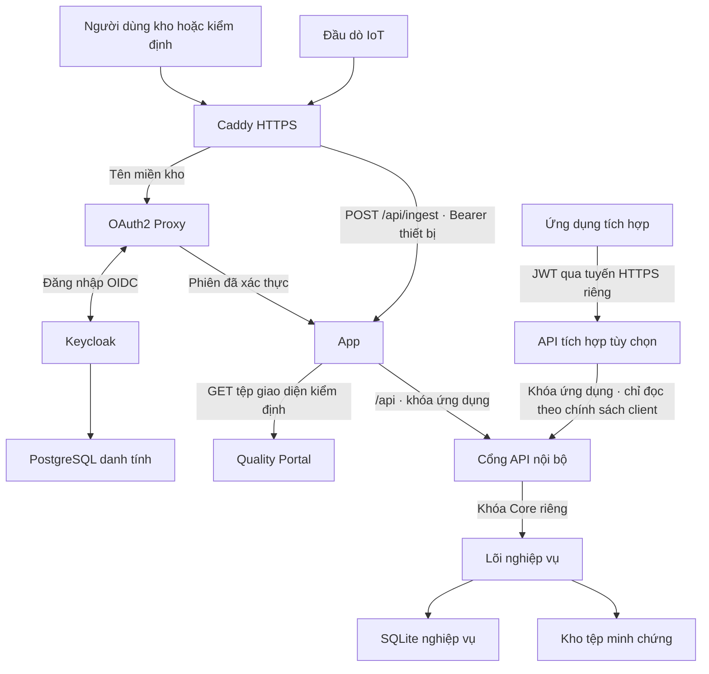

<!-- SPDX-FileCopyrightText: 2026 DX-TRACE contributors
SPDX-License-Identifier: MIT
DX-TRACE project authors: Đặng Nhật Minh, Nguyễn Ngọc Hiếu
-->
<div align="center">

**Tiếng Việt** · [English](README.en.md)


# DX-TRACE

Nền tảng DX-OS mã nguồn mở để xây ứng dụng số và kiểm chứng quyết định nghiệp vụ. Trace Portal, Quality Portal và Maintenance App dùng chung danh tính, dữ liệu, workflow và Evidence Engine.

[](https://github.com/ngochieu1762005/dx_trace/actions/workflows/ci.yml)
[](https://github.com/ngochieu1762005/dx_trace/releases)
[](LICENSE)
[](docs/SUPPLY-CHAIN.md)


[**Trang giới thiệu**](https://dxtrace.hieuds.com/) · [**Ứng dụng**](https://app.dxtrace.hieuds.com/) · [**Tài liệu**](https://dxtrace.hieuds.com/docs/) · [**Tham chiếu API**](https://dxtrace.hieuds.com/docs/api-reference/) · [**Cài đặt nhanh**](#quick-setup) · [**Kiến trúc hệ thống**](#architecture) · [**Hướng dẫn trình diễn**](docs/DEMO.md) · [**Minh chứng kỹ thuật**](docs/EVIDENCE.md)

</div>

DX-TRACE do **Đặng Nhật Minh** và **Nguyễn Ngọc Hiếu** cùng phát triển. Cả hai là sinh viên ngành Khoa học dữ liệu tại **Trường Đại học Khoa học và Công nghệ Hà Nội (USTH)**.

## Kiểm tra bản phát hành v0.2.0

Bản v0.2.0 dùng APISIX làm cổng API mặc định. Dịch vụ Flowable tùy chọn xử lý quy trình thẩm định. Có thể chạy thử kho trên máy cá nhân bằng Node.js 24. Để kiểm tra đăng nhập một lần và phân quyền giữa hai người, dùng bản triển khai Docker Compose với Keycloak.

1. Tải **tất cả tệp đính kèm** của [bản phát hành v0.2.0](https://github.com/ngochieu1762005/dx_trace/releases/tag/v0.2.0) vào cùng thư mục. Trên Linux, chạy `sha256sum -c SHA256SUMS`. Mỗi tệp trong bản kê phải có kết quả `OK`.
2. Giải nén `DX-TRACE-v0.2.0.tar.gz`. Từ thư mục vừa giải nén, chạy `bash scripts/verify-release.sh ../DX-TRACE-v0.2.0.tar.gz` với Node.js 24, pnpm 11.25.0 và cổng 8080 trống. Phép thử dựng bản cài ở thư mục mới, xóa nguồn tạm rồi kiểm tra web, API và vòng đời ứng dụng.
3. Đối chiếu kết quả với [lần chạy phát hành](https://github.com/ngochieu1762005/dx_trace/actions/runs/45970871898). Bằng chứng SSO của lần chạy này thuộc môi trường CI. Kết quả trên máy chủ triển khai cần ghi riêng theo [tiêu chí nghiệm thu](website/content/acceptance.vi.md).

## AppKit và minh chứng OLP 2026

[Cài ứng dụng bảo trì, nâng cấp và rollback](docs/demo-guide.md) · [Build và chạy ngoài source](docs/build-from-source.md) · [Đối chiếu 6 tiêu chí PoF](docs/olp-compliance.md) · [Nguồn trạng thái giữa Core và Flowable](docs/architecture.md)

## Evidence Engine · Business Decision Proof

Bản **v0.1.0** bổ sung hồ sơ quyết định nghiệp vụ: **ai quyết định, quyền nào được kiểm tra, phiên bản chính sách/quy trình, dữ liệu đầu vào và trạng thái trước–sau**. Snapshot được đóng dấu khi quyết định phát sinh; gói `recall-evidence.tar.gz` chứa manifest, quyết định, sự kiện, policy, BPMN, lineage, proof và chữ ký Ed25519 để kiểm tra offline.

Mở **Nhật ký → DX-TRACE Evidence Engine** để tải các quyết định đã ký trong đúng kho. Nguồn tin cậy phải là khóa công khai hoặc checkpoint nhận độc lập; hash hay khóa nằm trong chính gói bằng chứng không ngăn được việc viết lại toàn bộ gói. Giao diện có mẫu **RC-2026-001** và nút sửa kết quả kiểm định, được ghi nhãn **MÔ PHỎNG**. Kiểm chứng mẫu không thay thế nghiệm thu hệ thống thật.

[**Cấu hình ký, xuất và xác minh offline**](docs/BUSINESS-DECISION-PROOF.md) · [**10 kịch bản chịu lỗi và cách tái lập**](docs/FAULT-TOLERANCE.md) · [**H-P-D-I và bốn nguyên lý**](website/content/hdpi.md)


## Bắt đầu theo nhu cầu

| Bạn muốn | Mở tài liệu |
| --- | --- |
| Chạy thử trên máy cá nhân | [Cài đặt nhanh](#quick-setup) |
| Cài trên máy chủ | [Hướng dẫn tự triển khai](selfhost/README.md) |
| Hiểu đường đi của dữ liệu | [Kiến trúc hệ thống](#architecture) |
| Kiểm tra luồng nghiệp vụ | [Kịch bản kiểm định và thu hồi](docs/OPERATING-WORKFLOWS.md) |

DX-TRACE kết nối **lô hàng → giao nhận → điều kiện bảo quản → sự cố → thu hồi → đối soát** trong một quy trình thống nhất. Khi có lô hàng không đạt yêu cầu, hệ thống hỗ trợ xác định vị trí và lượng hàng liên quan, kiểm soát các quyết định phê duyệt, ghi nhận lịch sử thao tác và hỗ trợ truy xuất nguồn gốc bằng QR/mã vạch.

Đây không chỉ là giao diện quản lý kho: **DX-TRACE có lõi API headless**, mô hình nghiệp vụ có thể khai báo, ứng dụng thứ hai triển khai độc lập và hạ tầng danh tính dùng chung. Các khẳng định kỹ thuật đều được liên kết tới mã nguồn, kiểm thử hoặc tài liệu nghiệm thu; những hạng mục chưa xác minh được ghi rõ.

## H-P-D-I trong DX-TRACE

Một lô sữa chua đã giao đến hai cửa hàng thì bị phát hiện bảo quản sai nhiệt độ. Bốn thành phần H–P–D–I cùng xuất hiện trong cách kho xử lý lô này.

| Thành phần | Biểu hiện trong ứng dụng |
| --- | --- |
| **H · Human · Con người số** | Giao diện theo vai trò, QR, task inbox và thông báo; Evidence gắn người quyết định với quyền được kiểm tra. |
| **P · Process · Quy trình số** | BPMN kiểm định, cách ly, phê duyệt thu hồi và timer/SLA; lưu phiên bản quy trình trong bằng chứng. |
| **D · Data · Dữ liệu số** | Mã lô, dashboard, số đo, nguồn dữ liệu và snapshot đầu vào quyết định. |
| **I · Intelligence · Trí tuệ số** | Phát hiện vượt ngưỡng, tính phạm vi thu hồi và lượng còn phải thu để hỗ trợ người có quyền quyết định. |

Theo [đề thi PMNM OLP 2026 do VFOSSA công bố, mục 1 và 4](https://vfossa.vn/tin-tuc/de-thi-phan-mem-nguon-mo-olp-2026-798.html), DX-TRACE đối chiếu thêm bốn nguyên lý:

| Nguyên lý | Minh chứng trong repo | Giới hạn |
| --- | --- | --- |
| Phân tầng vòng đời dữ liệu | Lịch sử cảm biến có chỉ mục và archive tháng kèm manifest | Chưa tự động phân tầng/xóa hay bảo đảm WORM |
| Hội tụ IT/OT | HTTPS ingestion với khóa thiết bị, chống trùng, ngưỡng và cách ly | Bộ phát 12,4°C là fixture được ghi nhãn; chưa chứng nhận phần cứng |
| Quản trị nguồn gốc | Sensor lineage và gói Business Decision Proof | Chữ ký không tự chứng minh số đo phản ánh sự thật ngoài đời |
| Zero Trust + GitOps | APISIX, RBAC/tenant tại Core, Compose trong Git và kiểm CI | Chưa có bộ đồng bộ GitOps liên tục |

[Thực hành H-P-D-I với một lô hàng](website/content/hdpi.md) · [Chi tiết bốn nguyên lý](docs/DXOS-GOVERNANCE.md). Đây là bản đồ năng lực và giới hạn, không phải chứng nhận đáp ứng toàn bộ đề thi.

## Theo dấu một lô hàng

Một cửa hàng đã nhận một phần lô hàng thì kết quả kiểm định báo không đạt. Người trực kho cần biết **phần nào còn có thể chặn giao, phần nào đã tới cửa hàng và ai có quyền quyết định thu hồi**. Có thể lần theo cùng một mã lô qua các bước dưới đây trên nhánh `main`.

| Bước | Người thực hiện và thao tác | Kết quả cần đối chiếu |
| --- | --- | --- |
| 1 · Nhận hàng | Nhân viên kho chọn **Kho thực hành**, mở **Lô hàng**, ghi lại mã lô, lượng nhập và hạn dùng | Tra cứu lại đúng lô. Nếu nhiều lô cùng một sản phẩm, dùng mã lô để phân biệt. |
| 2 · Giao nhận | Tạo phiếu xuất cho điểm nhận, giữ hàng rồi xác nhận giao | Kiểm tra điểm đến, số lượng và trạng thái phiếu trước khi chuyển sang kiểm định. |
| 3 · Kiểm định | Trong Quality Portal, chọn lô của kho hiện tại và gửi phiếu. Người thẩm định khác người lập ghi kết quả **Không đạt** | Phiếu lưu lý do. Quyết định cách ly là một thao tác riêng của quản lý. |
| 4 · Khoanh vùng | Quản lý chọn **Cách ly & mở sự cố**, sau đó tra lại lô trong kho | Phiếu liên kết với sự cố. Lô bị chặn xuất mới và chặn xác nhận giao đối với phiếu đang giữ hàng. |
| 5 · Đối soát | Người có quyền duyệt thu hồi, ghi lượng trả của từng điểm nhận rồi xem nhật ký | Đối chiếu lượng đã giao với lượng đã thu về. Giữ mốc kiểm chứng riêng khi xuất nhật ký. |

[Hướng dẫn thao tác](docs/OPERATING-WORKFLOWS.md) · [Quyền trong Quality Portal](docs/QUALITY-PORTAL.md) · [Kiểm tra nhật ký độc lập](docs/AUDIT-EVIDENCE.md)

### Tự kiểm tra từ mã nguồn

Sau khi cài các gói phụ thuộc, chạy từng lệnh tại thư mục chứa `package.json`. Mỗi lệnh kiểm tra một ranh giới khác nhau của ứng dụng.

| Câu hỏi | Lệnh kiểm tra |
| --- | --- |
| Bộ nhận dạng xử lý dữ liệu quét thế nào? | `node --test tests/scan.test.mjs` |
| Phiếu không đạt có được cách ly đúng kho và đúng quyền? | `node --test tests/quality-portal.test.mjs` |
| Hai nhánh quy trình và bộ hẹn giờ chạy thế nào? | `node --test tests/process-platform.test.mjs tests/process-timer.test.mjs` |
| Có thể phát hiện thay đổi trong gói nhật ký đã xuất? | `node --test tests/audit-proof.test.mjs` |
| Bằng chứng quyết định có phát hiện sửa tệp, thay khóa và viết lại chuỗi? | `node --test tests/business-evidence.test.mjs` |
| Mẫu tương tác có phân biệt chữ ký manifest với dữ liệu bị sửa? | `node --test tests/evidence-demo.test.mjs` |

Kiểm tra camera bằng tem in và điện thoại qua HTTPS. Kiểm tra đăng nhập bằng hai tài khoản trên bản triển khai có Keycloak. Hai phép thử này cần thiết bị hoặc phiên đăng nhập thật. [Quy trình nghiệm thu](docs/ACCEPTANCE-2026.md)

## Quy trình liên thông trên nhánh main

**Việc cần làm → kiểm định → cách ly → thu hồi → đối soát → minh chứng.** Giao diện giữ đúng vùng kho khi chuyển giữa ứng dụng; người xử lý thấy các bước theo quyền và trạng thái thực tế.

| Thao tác | Kết quả |
| --- | --- |
| Mở **Việc cần làm** | Gom sự cố, phiếu chờ giao và hồ sơ có bước cần xử lý; ưu tiên việc quá hạn |
| Kiểm định **Không đạt** | Quản lý xác nhận cách ly, liên kết hoặc mở sự cố; chặn giao hàng tại Core |
| Xử lý **quy trình song song** | Hoàn tất từng nhánh theo vai trò, theo dõi timer và điều kiện hội tụ |
| Xuất **minh chứng nhật ký** | Kiểm tra chuỗi SHA-256 tại trình duyệt và đối chiếu bằng CLI với mốc đã giữ riêng |

[**Hướng dẫn quy trình**](docs/OPERATING-WORKFLOWS.md) · [**Kiểm chứng nhật ký**](docs/AUDIT-EVIDENCE.md) · [**Changelog**](CHANGELOG.md)

Các bổ sung này được đóng gói trong [DX-TRACE v0.1.0](https://github.com/ngochieu1762005/dx_trace/releases/tag/v0.1.0). Triển khai VPS và nghiệm thu SSO thực tế là bước riêng.

## Điểm nổi bật

| Năng lực | DX-TRACE triển khai như thế nào | Minh chứng |
| :--- | :--- | :--- |
| **Lõi API dùng chung** | Core API riêng, không phụ thuộc vào giao diện web hoặc Quality Portal | [Kiến trúc](docs/HEADLESS-CORE.md) · [Kiểm thử](tests/headless-core.test.mjs) |
| **Danh tính và đăng nhập một lần** | Keycloak + OAuth2 Proxy; danh tính dùng chung và phân quyền tại Core | [Cấu hình](selfhost/compose.yaml) · [Kiểm chứng 2 người dùng](docs/GATEWAY-AND-SSO.md) |
| **Cổng API cách ly** | Gateway chính sách nội bộ, hai khóa dịch vụ khác nhau, mạng Docker phân tách, kiểm soát request | [Cấu hình APISIX](selfhost/apisix/apisix.yaml) · [Bài kiểm](tests/api-gateway.test.mjs) |
| **Khai báo ứng dụng với AppKit** | Cài mô hình ứng dụng từ manifest, kế thừa biểu mẫu, quyền và workflow | [AppKit](docs/APPKIT.md) · [Ví dụ](examples/maintenance/app.json) |
| **Quy trình và trao đổi BPMN** | Quy trình máy trạng thái có kiểm tra quyền, chống tự duyệt; nhập/xuất tập con BPMN 2.0 | [Đặc tả BPMN](docs/BPMN.md) · [Bài kiểm](tests/bpmn.test.mjs) |
| **Cổng kiểm định chất lượng độc lập** | Frontend thứ hai chạy container riêng, dùng API lõi và phiên SSO cùng nguồn | [Quality Portal](docs/QUALITY-PORTAL.md) · [Mã nguồn](apps/quality-portal/) |
| **Minh chứng mã nguồn mở** | GitHub CI, Docker smoke test, kiểm tra bí mật, SPDX SBOM và quy trình phát hành có attestations | [CI](.github/workflows/ci.yml) · [Supply chain](docs/SUPPLY-CHAIN.md) |

### Phiên bản và mức độ xác minh

| Phạm vi | Tình trạng | Cách kiểm tra |
| --- | --- | --- |
| **Developer Platform v0.2.0** | OAuth2 v2, SDK, Evidence cho AppKit và App Studio | [Hướng dẫn API v2](docs/EXTERNAL-API-V2.md) |
| **Release v0.1.0** | AppKit CLI, APISIX, Flowable, SSO ba portal, Evidence Engine và outbox | [Ghi chú phát hành](docs/releases/RELEASE_NOTES_v0.1.0.md) |
| Release v0.0.7 | Gateway, workflow song song/timer và API OIDC tùy chọn; cần nghiệm thu VPS riêng | [Release v0.0.7](https://github.com/ngochieu1762005/dx_trace/releases/tag/v0.0.7) |
| **Triển khai thực tế** | Kiểm tra riêng đăng nhập một lần, vai trò, dữ liệu giữa hai kho và phục hồi trên cấu hình được triển khai | [Quy trình nghiệm thu](website/content/acceptance.vi.md) |

Khi nâng cấp hệ thống đang sử dụng, [hướng dẫn vận hành](selfhost/OPERATIONS.md) mô tả cách sao lưu, chọn đúng cấu hình Compose và đối chiếu dữ liệu sau nâng cấp.

<a id="contents"></a>
## Nội dung

- [Điểm nổi bật và phạm vi phiên bản](#điểm-nổi-bật)
- [Bài toán và tính năng](#features)
- [Kiến trúc hệ thống](#architecture)
- [Công nghệ sử dụng](#technologies)
- [Yêu cầu hệ thống](#requirements)
- [Cài đặt nhanh](#quick-setup)
- [Kiểm thử và minh chứng](#detailed-setup)
- [Nâng cấp và giới hạn](#changelog)
- [Đóng góp, giấy phép, liên hệ](#contribution)

<a id="introduction"></a>
<a id="features"></a>
## Bài toán và tính năng

Một lô sữa đã được phân phối đến nhiều cửa hàng. Đầu dò ghi nhận vượt ngưỡng bảo quản. DX-TRACE hỗ trợ cách ly lô, xác định phiếu chưa giao, phê duyệt thu hồi và đối soát số hàng trả tại từng điểm nhận. Hệ thống chặn đóng sự cố khi các phiếu liên quan chưa được xử lý hết.

| Phân hệ | Khả năng hiện có |
| --- | --- |
| Việc cần làm | Hàng đợi theo vai trò, việc gần hạn/quá hạn và liên kết đúng vùng kho |
| Tổng quan | Cảnh báo, chỉ số kho và thao tác nhanh quét mã, nhập lô, lập phiếu xuất |
| Lô hàng | Quản lý hạn dùng, vị trí, tồn; lọc và xuất CSV; gợi ý thứ tự FEFO khi chọn lô xuất |
| Giao nhận | Giữ hàng, giao, hủy và nhận trả theo số lượng; kiểm tra tồn tại máy chủ |
| Truy xuất | QR/mã vạch qua camera hoặc ảnh; đối chiếu lô, chọn nhiều kết quả, tạo tem và hồ sơ truy xuất |
| Tra sản phẩm | Open Food Facts; dùng thông tin tham khảo để điền nhanh lô mới, người nhập xác nhận lại |
| Thiết bị | Khóa riêng theo đầu dò, lịch sử nhiệt độ, phát hiện chuỗi số đo vượt ngưỡng |
| Sự cố & thu hồi | Cách ly, duyệt thu hồi, đối soát theo điểm nhận, đóng hồ sơ khi đủ điều kiện |
| Tài liệu và trợ lý | SOP, tệp đính kèm, tra cứu cục bộ; kết nối Groq tùy chọn |
| Đề xuất nội bộ | Quy trình nháp → gửi duyệt → phê duyệt/từ chối trong giao diện kho |
| Nghiệp vụ mở rộng | Mô hình JSON, biểu mẫu, API, điều kiện duyệt, phạm vi hồ sơ, tìm kiếm và phân trang |
| Quản trị | Thành viên, vai trò, nhật ký; API ledger, metrics và webhook có cấu hình |

**Kho thực hành / Kho vận hành** có nút chuyển ở đầu trang. Hai vùng giữ dữ liệu riêng, cùng tổ chức và quyền thành viên; chuyển kho không đặt lại dữ liệu. Ứng dụng phê duyệt độc lập và bộ màn hình diễn tập cũ đã được hợp nhất hoặc gỡ bỏ.

### Ví dụ dữ liệu mẫu

Kho thực hành mới có **64 lô, 184 phiếu giao nhận và 22 đối tác**. Trên Tổng quan, chọn **Mở hướng dẫn diễn tập** để theo dõi một lô dâu đang cách ly, lô sữa đang thu hồi hoặc lô tôm đã đối soát xong. [Hướng dẫn và số liệu mẫu](docs/DEMO.md#khám-phá-kho-mẫu-mở-rộng).

Trong bộ mẫu SUA-005: Long Biên đã nhận 30 hộp và trả 17; Tây Hồ nhận 20 chưa trả; Thanh Xuân có phiếu 12 hộp chưa giao. Tổng còn phải thu là **33 hộp**, còn phiếu giữ 12 hộp phải xử lý riêng. Các con số thay đổi khi người dùng thao tác. Kho thực hành là dữ liệu mô phỏng, không phải minh chứng triển khai tại doanh nghiệp.

### Mở rộng sang nghiệp vụ khác

**Từ v0.0.6:** có thêm [Quality Control Portal](docs/QUALITY-PORTAL.md) tại `/apps/quality/`, một frontend **chạy ở service/container riêng**, không chứa logic kho hoặc bí mật truy cập Core. Chủ không gian duyệt manifest AppKit; hai ứng dụng dùng chung phiên SSO, quyền, dữ liệu workflow và nhật ký. Kịch bản kiểm chứng hai người và bài kiểm thử tách tiến trình được công bố trong tài liệu. Việc tồn tại mã nguồn và CI không tự chứng minh một lần triển khai SSO thực tế.

Chọn **Nghiệp vụ mở rộng → Thư viện mẫu → Xem kế hoạch → Áp dụng mô hình** bằng tài khoản chủ không gian. Có mẫu bảo trì thiết bị, mua sắm, kiểm tra chất lượng và yêu cầu khách hàng. Mẫu mua sắm trên 5 triệu đồng yêu cầu chuyển cấp trước khi chủ không gian khác người tạo duyệt. [Cấu hình và giới hạn workflow](docs/PLATFORM.md).

<a id="architecture"></a>
## Kiến trúc hệ thống

[](docs/assets/architecture-current.svg)

Sơ đồ mô tả cấu hình Compose trên nhánh `main` và cách đặt Caddy trên VPS Ubuntu. Xem [bản đồ kiến trúc đầy đủ](website/content/architecture-map.md) để đối chiếu từng tuyến với cấu hình, dữ liệu và mã nguồn.

### Đường đi của yêu cầu



Khi mở **Cổng kiểm định**, App lấy tệp giao diện từ Quality Portal. Sau khi trang tải xong, trình duyệt gọi `/api` về App bằng phiên kho hiện tại. Các yêu cầu nghiệp vụ đi tiếp qua cổng API đến Core.

| Tuyến | Đường đi | Điểm phân quyền |
| --- | --- | --- |
| Web kho | Caddy → OAuth2 Proxy → App → cổng API → Core | Keycloak xác thực tài khoản. Core kiểm quyền theo kho và thao tác. |
| Cổng kiểm định | App lấy tệp từ `quality-portal:8090`. Trình duyệt gọi `/api` cùng tên miền kho. | Dùng cùng phiên đăng nhập. Core kiểm quyền lập phiếu, thẩm định và cách ly. |
| Đầu dò | `POST /api/ingest` qua Caddy → App → cổng API → Core | Core kiểm Bearer của thiết bị và xác định kho nhận số đo. |
| API tích hợp tùy chọn | Tuyến HTTPS riêng → `external-api` → cổng API → Core | JWT Keycloak và chính sách đọc theo client, mô hình. |
| Website và tài liệu | Caddy trên VPS phục vụ tệp tĩnh. Đường dẫn `/login` chuyển sang tên miền kho. | Nội dung công khai. |

`appnet` nối App với cổng API. `privcore` nối cổng API với Core. Khóa dịch vụ được thay ở cổng API trước khi yêu cầu đến Core. PostgreSQL nằm ở mạng `dbnet` phục vụ Keycloak. Trên VPS Ubuntu, Caddy chuyển yêu cầu đến cổng loopback 8180 cho OAuth2 Proxy, 8181 cho Keycloak và 8182 cho tuyến đầu dò của App. [Compose](selfhost/compose.yaml) · [Cấu hình Ubuntu](selfhost/compose.ubuntu-edge.yaml)

### Dữ liệu và giao dịch

Bốn migration SQL tạo **11 bảng nghiệp vụ**:

| Nhóm | Bảng | Nội dung |
| --- | --- | --- |
| Tổ chức | `workspaces`, `members`, `invitations` | Kho, thành viên và quyền theo email |
| Tích hợp | `device_keys`, `external_cache` | Hash khóa thiết bị, cache mã vạch |
| Cảm biến | `sensor_history` | Lịch sử số đo riêng, phân trang theo thiết bị |
| Kiểm toán | `audit_ledger`, `webhook_delivery` | Chuỗi hash lệnh và trạng thái giao webhook |
| Mở rộng | `platform_models`, `platform_records`, `platform_commands` | Định nghĩa mô hình, hồ sơ và kết quả yêu cầu để chống trùng |

Nghiệp vụ kho truyền thống vẫn nằm trong JSON của `workspaces`. Hồ sơ mở rộng được lưu từng dòng có chỉ mục; quyền được lọc trước khi đếm và phân trang. Cập nhật dùng hàng đợi theo workspace, kiểm tra revision/version và transaction. Tệp nằm trong `objects/<workspace>/<sha256>` ở volume `warehouse`.

### Các tích hợp

| Tích hợp | Dữ liệu gửi và điều kiện |
| --- | --- |
| Open Food Facts | Chỉ gửi mã sản phẩm để lấy tên, nhãn hiệu, lượng đóng gói; cache 24 giờ, timeout 12 giây. Không thay thế hồ sơ nguồn gốc của lô. |
| Groq | Tùy chọn: câu hỏi, thống kê, cảnh báo và SOP liên quan. Cần truyền `AI_API_KEY` vào môi trường Core; Compose mặc định chưa truyền biến này. |
| Quét tệp | Tùy chọn `FILE_SCAN_URL/TOKEN`; gửi byte tệp, yêu cầu kết quả sạch mới cho tải xuống. Không cấu hình thì tệp ở trạng thái cách ly. |
| Webhook | Tùy chọn HTTPS, một workspace mỗi worker; payload ledger ký HMAC, thử lại có giới hạn; bên nhận phải chống trùng. |

QR được giải mã ngay trong trình duyệt. [Danh mục API](docs/API.md) · [Webhook](docs/PLATFORM.md#nhật-ký-và-webhook).

<a id="applications"></a>
### Định hướng DX-OS Open-Core

Identity/SSO, biên API, dữ liệu có cấu trúc/phi cấu trúc và workflow được minh họa bằng vận hành kho và mô hình mở rộng. [Bảng đối chiếu yêu cầu](REQUIREMENTS.md) dẫn đến mã và kiểm thử; đây không phải xác nhận của ban tổ chức hay cam kết điểm thi.

<a id="technologies"></a>
## Công nghệ sử dụng

| Lớp | Công nghệ | Vai trò |
| --- | --- | --- |
| Giao diện | React / React DOM 19.2.6, Lucide React 1.31.0, CSS, Google Sans | Giao diện kho và biểu mẫu; Google Sans từ WOFF2 có sẵn, fallback hệ thống |
| QR / mã vạch | ZXing Browser 0.2.1, ZXing Library 0.23.0, qrcode 1.5.4 | Camera, ảnh và sinh tem |
| API | Node.js 24, TypeScript/ES modules, Zod 3.25.76 | HTTP, kiểm tra dữ liệu, quy tắc nghiệp vụ |
| Lưu trữ | `node:sqlite`, filesystem, `node:crypto` | SQLite WAL, đối tượng tệp, hash và HMAC |
| Danh tính | Keycloak 26.4.7, PostgreSQL 17, OAuth2 Proxy 7.12.0 | Đăng nhập và phiên OIDC |
| Triển khai | Caddy 2, Docker Compose v2 | HTTPS, định tuyến và dịch vụ độc lập |
| API Gateway nội bộ | Apache APISIX 3.21.0, `selfhost/apisix/apisix.yaml` | Tách khóa Core, giới hạn tuyến/headers/body và quota từng tiến trình |
| Supply chain | Syft / SPDX 2.3, GitHub Attestations | Kiểm kê phụ thuộc qua CI; xác minh provenance cho các release mới khi phát hành thành công |
| Build / CI | Vite 8.0.13, pnpm 11.25.0, GitHub Actions | Build tái lập theo lockfile và kiểm tra phát hành |

[Giao thức BPMN](docs/BPMN.md) · [AppKit](docs/APPKIT.md) · [Danh mục phụ thuộc và giấy phép](DEPENDENCIES.md) · [Bản đồ mã nguồn](docs/CODEBASE.md) · [Nguồn biểu trưng](docs/assets/LOGOS.md).

<a id="requirements"></a>
## Yêu cầu hệ thống

| Mục đích | CPU đề xuất | RAM | Dung lượng trống | Phần mềm |
| --- | --- | --- | --- | --- |
| Demo trên PC phòng máy | 2 nhân | 8 GB | 5 GB | Windows 10/11 hoặc Linux, Node.js 24, trình duyệt hiện đại |
| Chạy đủ dịch vụ cho đội | 4 nhân / vCPU | 16 GB | 30 GB SSD | Linux, Docker Engine, Compose v2, Node.js 24 để tạo cấu hình |

Đây là cấu hình khởi điểm để trình diễn, không phải mức tối thiểu đã đo tải. Dành thêm dung lượng cho tệp và bản sao lưu. Lần đầu cần Internet để tải thư viện/image; tra sản phẩm và AI cần Internet khi sử dụng. Camera trên điện thoại cần HTTPS và quyền camera.

<a id="quick-setup"></a>
## Cài đặt nhanh

### Chạy thử kho trên máy cá nhân

Mở [trang phát hành](https://github.com/ngochieu1762005/dx_trace/releases), chọn phiên bản cần chạy và tải **Source code (zip)**. Giải nén rồi mở terminal tại thư mục chứa `package.json`.

```bash
node -v
npx --yes pnpm@11.25.0 install --frozen-lockfile
npm run demo
```

Mở **http://127.0.0.1:8080/?area=training#overview**. Phiên demo dùng danh tính chủ kho cục bộ, không cần tài khoản Keycloak. Giữ terminal mở; Ctrl+C để dừng. Lần sau chạy lại `npm run demo`; dữ liệu nằm tại `selfhost/local-demo-data/`.

Demo chỉ bind loopback và không chứng minh SSO hoặc Core tách tiến trình. Nếu cổng 8080 đang dùng, dừng tiến trình chiếm cổng trước. Không công bố chế độ demo ra Internet.

### Dùng mã nguồn mới nhất

Để chạy từ nhánh phát triển mới nhất (có thể khác bản phát hành):

```bash
git clone https://github.com/ngochieu1762005/dx_trace.git
cd dx_trace
git rev-parse HEAD
npx --yes pnpm@11.25.0 install --frozen-lockfile
npm run demo
```

Ghi lại SHA khi trình diễn hoặc báo lỗi. Xem [kịch bản demo](docs/DEMO.md) để thử cả nghiệp vụ kho và AppKit. Không cần Keycloak ở chế độ local demo; kiểm SSO bằng bản Docker riêng.

### Cài máy chủ mới

Nếu máy chưa có reverse proxy chiếm 80/443, trỏ hai tên miền đến máy chủ rồi chạy từ gốc repository:

```bash
docker run --rm -v "$PWD/selfhost:/work" -w /work node:24-alpine node setup.mjs app.example.org id.example.org
cd selfhost
docker compose config --quiet
docker compose up -d --build
docker compose ps
```

Thay tên miền ví dụ bằng tên miền của bạn. Setup chỉ chạy lần đầu, tạo `.env` và từ chối ghi đè. Tạo tài khoản trong realm `warehouse`; mật khẩu bootstrap quản trị nằm trong `.env`, không phải tài khoản vận hành kho.

**Máy đã có Caddy:** dùng [hướng dẫn Ubuntu](selfhost/DEPLOY_SAAS_UBUNTU.md), không chạy cấu hình Docker mặc định cạnh tranh cổng 80/443. [Cấp tài khoản và phân quyền](selfhost/README.md).

<a id="detailed-setup"></a>
## Kiểm thử và minh chứng

| Kiểm tra sau khi cài | Cách thực hiện | Kết quả mong đợi |
| --- | --- | --- |
| Mở được kho | Đăng nhập bằng tài khoản kho được cấp và mở **Tổng quan** | Giao diện hiển thị tên không gian và dữ liệu theo quyền tài khoản |
| Dữ liệu thực hành tách riêng | Chuyển sang **Kho thực hành**, thực hiện một thao tác mẫu rồi trở lại **Kho vận hành** | Thao tác vừa thực hiện chỉ xuất hiện ở kho thực hành |
| Luồng kiểm định qua hai giao diện | Dùng hai tài khoản, lập phiếu kiểm định rồi thẩm định trên cùng lô | Người lập và người duyệt xuất hiện riêng trong lịch sử phiếu |
| Truy xuất theo mã lô | Quét QR của một tem lô hoặc nhập mã lô trực tiếp | Kết quả mở đúng hồ sơ lô và liệt kê các điểm đã nhận hàng |
| Ứng dụng và lõi đang chạy | Chạy `docker compose ps` tại thư mục `selfhost/` với đúng bộ tệp Compose đã triển khai | Các dịch vụ của cấu hình đang chạy và không lặp lại trạng thái khởi động |

Xem [hướng dẫn bắt đầu](https://dxtrace.hieuds.com/docs/quickstart/) để xử lý lỗi cài đặt trên máy cá nhân và [bảng nghiệm thu](docs/ACCEPTANCE-2026.md) để lưu kết quả khi triển khai.

Từ gốc repository sau khi cài phụ thuộc:

```bash
npm run build
npm test
python3 -m unittest discover -s tests -p '*_test.py'
```

[CI của v0.2.0](https://github.com/ngochieu1762005/dx_trace/actions/runs/45970856284) kiểm thử Node.js/Python và luồng **app → gateway-api → core** ở các mạng riêng, kiểm tra Quality Portal và tạo **SPDX 2.3 SBOM**. Kiểm thử tự động không thay thế kiểm tra camera thật, OIDC với người dùng thật, diễn tập phục hồi Keycloak hoặc benchmark toàn stack trên VPS. [Xem workflow](.github/workflows/ci.yml) · [SBOM và provenance](docs/SUPPLY-CHAIN.md).

Bài đo cục bộ 10.000 hồ sơ ban đầu, 1/10/25 client đồng thời, 15 giây mỗi mức ghi nhận 0 lỗi trong lần đo được công bố. Không quy đổi thành số người dùng thực: bài đo loại trừ TLS, gateway, Keycloak và mạng Internet. [Phương pháp và dữ liệu gốc](docs/BENCHMARK.md) · [Ma trận minh chứng](docs/EVIDENCE.md).

<a id="changelog"></a>
## Nâng cấp và giới hạn

**v0.0.6:** đã phát hành Quality Control Portal và AppKit; xem [ghi chú v0.0.6](docs/releases/RELEASE_NOTES_v0.0.6.md).

**Trong v0.2.0:** dùng `gateway-api` làm lớp chính sách giữa ứng dụng và Core, bảo vệ bằng khóa riêng và mạng Docker tách biệt; mở rộng CI và SBOM. **Sao lưu trước khi nâng cấp. Nếu chuyển từ cấu hình cũ chưa có khóa ứng dụng, bổ sung `DX_GATEWAY_APP_TOKEN` riêng**. Xem [hướng dẫn nâng cấp an toàn](docs/GATEWAY-AND-SSO.md) và [vận hành](selfhost/OPERATIONS.md).

**v0.0.5 có migration dữ liệu hồ sơ mở rộng.** Sao lưu trước khi triển khai; sau migration không chạy image cũ trên DB mới. Quay lui cần khôi phục bản sao lưu tương ứng. [Quy trình vận hành](selfhost/OPERATIONS.md) · [Ghi chú v0.0.5](docs/releases/RELEASE_NOTES_v0.0.5.md).

- Workflow JSON có điều kiện và vai trò; hỗ trợ xuất/nhập **tập con BPMN 2.0** qua API. Bộ thực thi hỗ trợ nhánh song song và bộ đếm giờ theo tập khai báo; mô hình BPMN tổng quát và thiết kế kéo thả còn ngoài phạm vi. [Chi tiết và giới hạn](docs/BPMN.md).
- SQLite và kho tệp cục bộ; chưa có HA, PostgreSQL nghiệp vụ hoặc object storage phân tán.
- JSON kho truyền thống vẫn có giới hạn 1,8 MB; payload từng hồ sơ/mô hình mở rộng giới hạn 512 KiB.
- Quét mã độc và AI là tích hợp tùy chọn; AI không tự quyết định thu hồi.
- Ledger chưa có neo hash bên ngoài, không chống được quản trị viên viết lại toàn bộ DB.

Xem [ma trận minh chứng](docs/EVIDENCE.md) để đối chiếu phạm vi từng bài kiểm và [lộ trình](ROADMAP.md) để theo dõi công việc phát triển.

<a id="contribution"></a>
## Đóng góp

Đọc [CONTRIBUTING](CONTRIBUTING.md), tạo issue có bước tái hiện và gửi PR kèm kiểm chứng. Với lỗ hổng, dùng [quy trình báo cáo riêng](SECURITY.md); không công khai bí mật hoặc dữ liệu kho.

<a id="license"></a>
## Giấy phép

Mã nguồn dự án dùng [MIT](LICENSE). Thư viện, biểu trưng và [phông chữ](public/fonts/google-sans/LICENSE.txt) có giấy phép riêng. Dữ liệu thực hành do dự án tạo; dữ liệu Open Food Facts mang nguồn và giấy phép ODbL theo kết quả API. Đơn vị triển khai chịu trách nhiệm quản lý dữ liệu vận hành của mình.

<a id="contact"></a>
## Liên hệ

[Người đóng góp](https://github.com/ngochieu1762005/dx_trace/graphs/contributors) · [Báo lỗi](https://github.com/ngochieu1762005/dx_trace/issues/new/choose) · [Lịch sử thay đổi](CHANGELOG.md).

## Tài liệu theo nhu cầu

| Mục đích | Tài liệu |
| --- | --- |
| Đánh giá và trình diễn | [Demo](docs/DEMO.md), [minh chứng](docs/EVIDENCE.md), [đối chiếu yêu cầu](REQUIREMENTS.md) |
| Phát triển và tích hợp | [API](docs/API.md), [AppKit](docs/APPKIT.md), [BPMN](docs/BPMN.md), [bản đồ mã](docs/CODEBASE.md) |
| Cài đặt và vận hành | [Self-host](selfhost/README.md), [Ubuntu](selfhost/DEPLOY_SAAS_UBUNTU.md), [backup/nâng cấp](selfhost/OPERATIONS.md) |
| Nguồn mở và duy trì | [Phụ thuộc](DEPENDENCIES.md), [SBOM và attestations](docs/SUPPLY-CHAIN.md), [thành phần thứ ba](THIRD_PARTY_NOTICES.md), [đóng góp](CONTRIBUTING.md), [ứng xử](CODE_OF_CONDUCT.md), [bảo mật](SECURITY.md), [lộ trình](ROADMAP.md) |

[Toàn bộ tài liệu](docs/README.md) · [↑ Mục lục](#contents)
