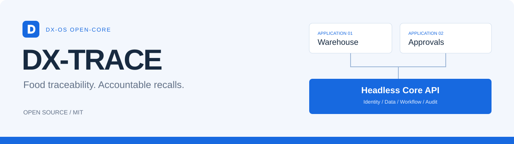
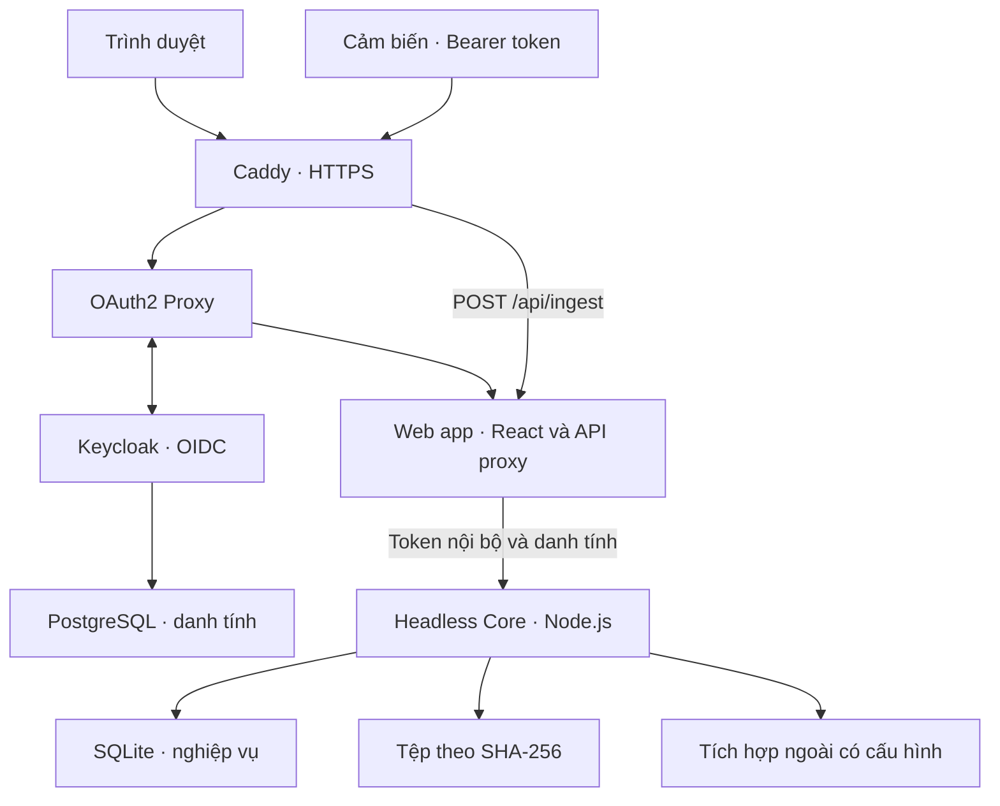

<div align="center">



**Truy xuất đến cùng. Thu hồi có kiểm soát.**

[](https://github.com/ngochieu1762005/dx_trace/actions/workflows/ci.yml)
[](https://github.com/ngochieu1762005/dx_trace/releases/latest)
[](LICENSE)
[](https://github.com/ngochieu1762005/dx_trace/issues)


[Cài đặt nhanh](#quick-setup) · [Kiến trúc](#architecture) · [API](docs/API.md) · [Tài liệu](docs/README.md) · [Minh chứng](docs/EVIDENCE.md) · [Tải v0.0.5](https://github.com/ngochieu1762005/dx_trace/releases/tag/v0.0.5)

</div>

DX-TRACE kết nối **lô hàng, giao nhận, điều kiện bảo quản và thu hồi** trong một quy trình thống nhất. Khi một lô gặp sự cố, người quản lý xác định được hàng đã đến đâu, còn nằm trong kho bao nhiêu, đã nhận trả bao nhiêu và ai đang xử lý.

Nền tảng theo định hướng **DX-OS Open-Core**: Core API chạy độc lập, giao diện dùng chung danh tính, quyền, dữ liệu và workflow. Ngoài nghiệp vụ kho, người quản trị có thể khai báo mô hình JSON để tạo biểu mẫu và quy trình mới mà không viết lại giao diện cho từng loại hồ sơ.

**Tài liệu hiện tại áp dụng cho v0.0.5.** Nhánh `main` có thể có sửa đổi sau phát hành; dùng tag để tái lập đúng mã nguồn. Các bản phát hành cũ giữ nguyên lịch sử tại [CHANGELOG](CHANGELOG.md).

| Trải nghiệm | Triển khai và kiểm chứng |
| --- | --- |
| [Website giới thiệu](https://dxtrace.hieuds.com/) | [Chạy trên PC](#quick-setup) |
| [Ứng dụng kho](https://app.dxtrace.hieuds.com/) | [Máy chủ Docker](selfhost/README.md) |
| [Dịch vụ danh tính demo](https://dxauth.hieuds.com/) | [Ubuntu có Caddy sẵn](selfhost/DEPLOY_SAAS_UBUNTU.md) |

Tài khoản demo do quản trị viên cấp; repository không chứa mật khẩu dùng chung. Khi tự triển khai, dùng tên miền và tài khoản của đơn vị bạn.

<a id="contents"></a>
## Nội dung

- [Bài toán và tính năng](#features)
- [System Architecture](#architecture)
- [Technologies Used](#technologies)
- [System Requirements](#requirements)
- [Quick Setup](#quick-setup)
- [Kiểm thử và minh chứng](#detailed-setup)
- [Nâng cấp và giới hạn](#changelog)
- [Đóng góp, giấy phép, liên hệ](#contribution)

<a id="introduction"></a>
<a id="features"></a>
## Bài toán và tính năng

Một lô sữa đã được phân phối đến nhiều cửa hàng. Đầu dò ghi nhận vượt ngưỡng bảo quản. DX-TRACE hỗ trợ cách ly lô, xác định phiếu chưa giao, phê duyệt thu hồi và đối soát số hàng trả tại từng điểm nhận. Hệ thống chặn đóng sự cố khi các phiếu liên quan chưa được xử lý hết.

| Phân hệ | Khả năng hiện có |
| --- | --- |
| Tổng quan | Cảnh báo, chỉ số kho và thao tác nhanh quét mã, nhập lô, lập phiếu xuất |
| Lô hàng | Quản lý hạn dùng, vị trí, tồn; lọc và xuất CSV; gợi ý thứ tự FEFO khi chọn lô xuất |
| Giao nhận | Giữ hàng, giao, hủy và nhận trả theo số lượng; kiểm tra tồn tại máy chủ |
| Truy xuất | QR/mã vạch qua camera hoặc ảnh; đối chiếu lô, chọn nhiều kết quả, tạo tem và hồ sơ truy xuất |
| Tra sản phẩm | Open Food Facts; dùng thông tin tham khảo để điền nhanh lô mới, người nhập xác nhận lại |
| Thiết bị | Khóa riêng theo đầu dò, lịch sử nhiệt độ, phát hiện chuỗi số đo vượt ngưỡng |
| Sự cố & thu hồi | Cách ly, duyệt thu hồi, đối soát theo điểm nhận, đóng hồ sơ khi đủ điều kiện |
| Tài liệu và trợ lý | SOP, tệp đính kèm, tra cứu cục bộ; kết nối Groq tùy chọn |
| Đề xuất nội bộ | Quy trình nháp → gửi duyệt → phê duyệt/từ chối trong giao diện kho |
| Nghiệp vụ mở rộng | Mô hình JSON, biểu mẫu, API, điều kiện duyệt, phạm vi hồ sơ, tìm kiếm và phân trang |
| Quản trị | Thành viên, vai trò, nhật ký; API ledger, metrics và webhook có cấu hình |

**Kho thực hành / Kho vận hành** có nút chuyển ở đầu trang. Hai vùng giữ dữ liệu riêng, cùng tổ chức và quyền thành viên; chuyển kho không đặt lại dữ liệu. Ứng dụng phê duyệt độc lập và bộ màn hình diễn tập cũ đã được hợp nhất hoặc gỡ bỏ.

### Ví dụ dữ liệu mẫu

Trong bộ mẫu SUA-005: Long Biên đã nhận 30 hộp và trả 17; Tây Hồ nhận 20 chưa trả; Thanh Xuân có phiếu 12 hộp chưa giao. Tổng còn phải thu là **33 hộp**, còn phiếu giữ 12 hộp phải xử lý riêng. Các con số thay đổi khi người dùng thao tác. Kho thực hành là dữ liệu mô phỏng, không phải minh chứng triển khai tại doanh nghiệp.

### Mở rộng sang nghiệp vụ khác

Chọn **Nghiệp vụ mở rộng → Thư viện mẫu → Xem kế hoạch → Áp dụng mô hình** bằng tài khoản chủ không gian. Có mẫu bảo trì thiết bị, mua sắm, kiểm tra chất lượng và yêu cầu khách hàng. Mẫu mua sắm trên 5 triệu đồng yêu cầu chuyển cấp trước khi chủ không gian khác người tạo duyệt. [Cấu hình và giới hạn workflow](docs/PLATFORM.md).

<a id="architecture"></a>
## 🏗️ System Architecture

### Biên truy cập và dịch vụ



| Dịch vụ | Trách nhiệm và dữ liệu |
| --- | --- |
| `gateway` | Caddy công bố 80/443 trong cấu hình Docker chuẩn; loại header danh tính không tin cậy. Khi dùng Caddy trên host, bỏ container này bằng override. |
| `signin` | Xác thực OIDC, quản lý cookie và chuyển danh tính đã xác minh đến `app:8080`. |
| `identity` / `identitydb` | Realm `warehouse`, client `dx-trace`; PostgreSQL chỉ lưu danh tính, không lưu lô hàng. |
| `app` | Phục vụ giao diện và chuyển API sang Core; không gắn volume kho. |
| `core` | API riêng ở cổng nội bộ 8081, yêu cầu `DX_CORE_TOKEN`, không phục vụ giao diện và không publish cổng host. |

Có **một giao diện kho thống nhất**. Đề xuất, thu hồi và nghiệp vụ mở rộng dùng chung Core; không mô tả chúng thành các ứng dụng frontend độc lập. [Ranh giới bảo mật và mô hình triển khai](docs/HEADLESS-CORE.md).

### Dữ liệu và giao dịch

Bốn migration SQL tạo **11 bảng nghiệp vụ**:

| Nhóm | Bảng | Nội dung |
| --- | --- | --- |
| Tổ chức | `workspaces`, `members`, `invitations` | Kho, thành viên và quyền theo email |
| Tích hợp | `device_keys`, `external_cache` | Hash khóa thiết bị, cache mã vạch |
| Cảm biến | `sensor_history` | Lịch sử số đo riêng, phân trang theo thiết bị |
| Kiểm toán | `audit_ledger`, `webhook_delivery` | Chuỗi hash lệnh và trạng thái giao webhook |
| Mở rộng | `platform_models`, `platform_records`, `platform_commands` | Định nghĩa mô hình, hồ sơ và kết quả yêu cầu để chống trùng |

Nghiệp vụ kho truyền thống vẫn nằm trong JSON của `workspaces`. Hồ sơ mở rộng được lưu từng dòng có chỉ mục; quyền được lọc trước khi đếm và phân trang. Cập nhật dùng hàng đợi theo workspace, kiểm tra revision/version và transaction. Tệp nằm trong `objects/<workspace>/<sha256>` ở volume `warehouse`.

### Các tích hợp

| Tích hợp | Dữ liệu gửi và điều kiện |
| --- | --- |
| Open Food Facts | Chỉ gửi mã sản phẩm để lấy tên, nhãn hiệu, lượng đóng gói; cache 24 giờ, timeout 12 giây. Không thay thế hồ sơ nguồn gốc của lô. |
| Groq | Tùy chọn: câu hỏi, thống kê, cảnh báo và SOP liên quan. Cần truyền `AI_API_KEY` vào môi trường Core; Compose mặc định chưa truyền biến này. |
| Quét tệp | Tùy chọn `FILE_SCAN_URL/TOKEN`; gửi byte tệp, yêu cầu kết quả sạch mới cho tải xuống. Không cấu hình thì tệp ở trạng thái cách ly. |
| Webhook | Tùy chọn HTTPS, một workspace mỗi worker; payload ledger ký HMAC, thử lại có giới hạn; bên nhận phải chống trùng. |

QR được giải mã ngay trong trình duyệt. [Danh mục API](docs/API.md) · [Webhook](docs/PLATFORM.md#nhật-ký-và-webhook).

<a id="applications"></a>
### Định hướng DX-OS Open-Core

Identity/SSO, biên API, dữ liệu có cấu trúc/phi cấu trúc và workflow được minh họa bằng vận hành kho và mô hình mở rộng. [Bảng đối chiếu yêu cầu](REQUIREMENTS.md) dẫn đến mã và kiểm thử; đây không phải xác nhận của ban tổ chức hay cam kết điểm thi.

<a id="technologies"></a>
## 🛠️ Technologies Used

| Lớp | Công nghệ | Vai trò |
| --- | --- | --- |
| Giao diện | React / React DOM 19.2.6, Lucide React 1.31.0, CSS, Be Vietnam Pro | Giao diện kho, biểu mẫu và biểu tượng; font qua Google Fonts, có fallback hệ thống |
| QR / mã vạch | ZXing Browser 0.2.1, ZXing Library 0.23.0, qrcode 1.5.4 | Camera, ảnh và sinh tem |
| API | Node.js 24, TypeScript/ES modules, Zod 3.25.76 | HTTP, kiểm tra dữ liệu, quy tắc nghiệp vụ |
| Lưu trữ | `node:sqlite`, filesystem, `node:crypto` | SQLite WAL, đối tượng tệp, hash và HMAC |
| Danh tính | Keycloak 26.4.7, PostgreSQL 17, OAuth2 Proxy 7.12.0 | Đăng nhập và phiên OIDC |
| Triển khai | Caddy 2, Docker Compose v2 | HTTPS, định tuyến và dịch vụ độc lập |
| Build / CI | Vite 8.0.13, pnpm 11.25.0, GitHub Actions | Build tái lập theo lockfile và kiểm tra phát hành |

[Giao thức BPMN](docs/BPMN.md) · [Danh mục phụ thuộc đầy đủ](docs/DEPENDENCIES.md) · [Bản đồ mã nguồn](docs/CODEBASE.md) · [Nguồn biểu trưng](docs/assets/LOGOS.md).

<a id="requirements"></a>
## 💻 System Requirements

| Mục đích | CPU đề xuất | RAM | Dung lượng trống | Phần mềm |
| --- | --- | --- | --- | --- |
| Demo trên PC phòng máy | 2 nhân | 8 GB | 5 GB | Windows 10/11 hoặc Linux, Node.js 24, trình duyệt hiện đại |
| Chạy đủ dịch vụ cho đội | 4 nhân / vCPU | 16 GB | 30 GB SSD | Linux, Docker Engine, Compose v2, Node.js 24 để tạo cấu hình |

Đây là cấu hình khởi điểm để trình diễn, không phải mức tối thiểu đã đo tải. Dành thêm dung lượng cho tệp và bản sao lưu. Lần đầu cần Internet để tải thư viện/image; tra sản phẩm và AI cần Internet khi sử dụng. Camera trên điện thoại cần HTTPS và quyền camera.

<a id="quick-setup"></a>
## 🚀 Quick Setup

### Chạy ngay trên máy cá nhân

Tải [ZIP v0.0.5](https://github.com/ngochieu1762005/dx_trace/releases/download/v0.0.5/DX-TRACE-v0.0.5.zip), giải nén và mở terminal tại thư mục chứa `package.json`:

```bash
node -v
npx --yes pnpm@11.25.0 install --frozen-lockfile
npm run demo
```

Mở **http://127.0.0.1:8080/?area=training#overview**. Phiên demo dùng danh tính chủ kho cục bộ, không cần tài khoản Keycloak. Giữ terminal mở; Ctrl+C để dừng. Lần sau chạy lại `npm run demo`; dữ liệu nằm tại `selfhost/local-demo-data/`.

Demo chỉ bind loopback và không chứng minh SSO hoặc Core tách tiến trình. Nếu cổng 8080 đang dùng, dừng tiến trình chiếm cổng trước. Không công bố chế độ demo ra Internet.

### Cài máy chủ mới

Nếu máy chưa có reverse proxy chiếm 80/443, trỏ hai tên miền đến máy chủ rồi chạy từ gốc repository:

```bash
node selfhost/setup.mjs app.example.org id.example.org
cd selfhost
docker compose config --quiet
docker compose up -d --build
docker compose ps
```

Thay tên miền ví dụ bằng tên miền của bạn. Setup chỉ chạy lần đầu, tạo `.env` và từ chối ghi đè. Tạo tài khoản trong realm `warehouse`; mật khẩu bootstrap quản trị nằm trong `.env`, không phải tài khoản vận hành kho.

**Máy đã có Caddy:** dùng [hướng dẫn Ubuntu](selfhost/DEPLOY_SAAS_UBUNTU.md), không chạy cấu hình Docker mặc định cạnh tranh cổng 80/443. [Cấp tài khoản và phân quyền](selfhost/README.md).

<a id="detailed-setup"></a>
## Kiểm thử và minh chứng

Từ gốc repository sau khi cài phụ thuộc:

```bash
npm run build
npm test
python3 -m unittest discover -s tests -p '*_test.py'
```

Mốc v0.0.5 có **40 kiểm thử Node.js và 3 kiểm thử Python**. CI kiểm thêm app/Core trong container. Các bài kiểm dùng dữ liệu thử, không thay thế kiểm tra camera thật, phiên OIDC hoặc diễn tập phục hồi Keycloak trên VPS.

Bài đo cục bộ 10.000 hồ sơ ban đầu, 1/10/25 client đồng thời, 15 giây mỗi mức ghi nhận 0 lỗi trong lần đo được công bố. Không quy đổi thành số người dùng thực: bài đo loại trừ TLS, gateway, Keycloak và mạng Internet. [Phương pháp và dữ liệu gốc](docs/BENCHMARK.md) · [Ma trận minh chứng](docs/EVIDENCE.md).

<a id="changelog"></a>
## Nâng cấp và giới hạn

**v0.0.5 có migration dữ liệu hồ sơ mở rộng.** Sao lưu trước khi triển khai; sau migration không chạy image cũ trên DB mới. Quay lui cần khôi phục bản sao lưu tương ứng. [Quy trình vận hành](selfhost/OPERATIONS.md) · [Ghi chú v0.0.5](docs/releases/RELEASE_NOTES_v0.0.5.md).

- Workflow JSON có điều kiện và vai trò; hỗ trợ xuất/nhập **tập con BPMN 2.0** qua API. Chưa có BPMN executor đầy đủ, nhánh song song hoặc trình thiết kế kéo thả. [Chi tiết và giới hạn](docs/BPMN.md).
- SQLite và kho tệp cục bộ; chưa có HA, PostgreSQL nghiệp vụ hoặc object storage phân tán.
- JSON kho truyền thống vẫn có giới hạn 1,8 MB; payload từng hồ sơ/mô hình mở rộng giới hạn 512 KiB.
- Quét mã độc và AI là tích hợp tùy chọn; AI không tự quyết định thu hồi.
- Ledger chưa có neo hash bên ngoài, không chống được quản trị viên viết lại toàn bộ DB.

Ưu tiên tiếp theo: SSO end-to-end tự động, đo toàn stack trên VPS cố định và thử nghiệm quy trình với người vận hành. Không coi các mục này là tính năng đã có.

<a id="contribution"></a>
## Đóng góp

Đọc [CONTRIBUTING](CONTRIBUTING.md), tạo issue có bước tái hiện và gửi PR kèm kiểm chứng. Với lỗ hổng, dùng [quy trình báo cáo riêng](SECURITY.md); không công khai bí mật hoặc dữ liệu kho.

<a id="license"></a>
## Giấy phép

Mã nguồn dự án dùng [MIT](LICENSE). Thư viện, biểu trưng và [phông chữ](public/fonts/google-sans/LICENSE.txt) có giấy phép riêng. Dữ liệu thực hành do dự án tạo; dữ liệu Open Food Facts mang nguồn và giấy phép ODbL theo kết quả API. Đơn vị triển khai chịu trách nhiệm quản lý dữ liệu vận hành của mình.

<a id="contact"></a>
## Liên hệ

Nguyễn Ngọc Hiếu và DX-TRACE contributors · [Người đóng góp](https://github.com/ngochieu1762005/dx_trace/graphs/contributors) · [Báo lỗi](https://github.com/ngochieu1762005/dx_trace/issues/new/choose) · [Lịch sử thay đổi](CHANGELOG.md).

[↑ Mục lục](#contents)
