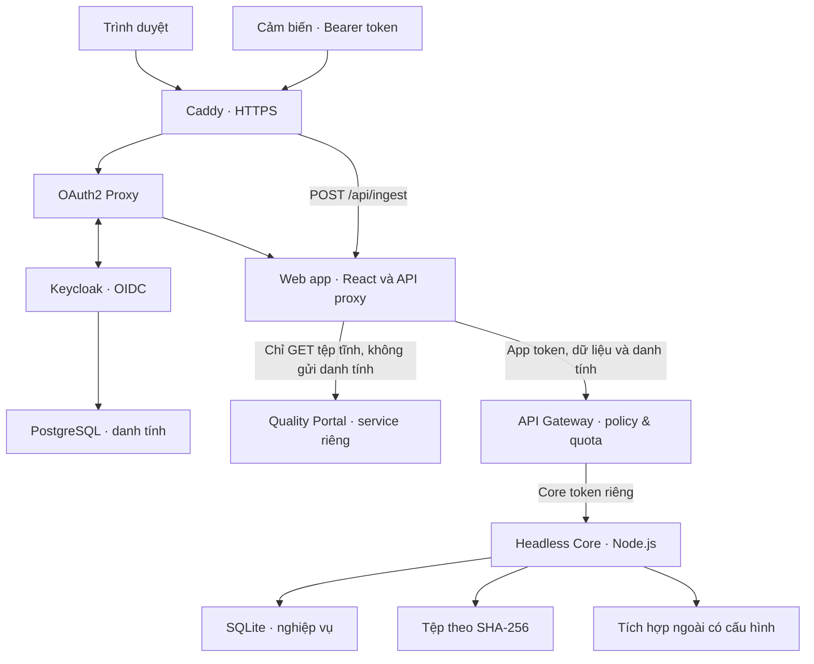

<div align="center">

**Tiếng Việt** · [English](README.en.md)


# DX-TRACE

Quản lý kho thực phẩm, truy xuất lô hàng và điều phối thu hồi.

[](https://github.com/ngochieu1762005/dx_trace/actions/workflows/ci.yml)
[](https://github.com/ngochieu1762005/dx_trace/releases)
[](LICENSE)
[](docs/SUPPLY-CHAIN.md)


[**Live Website**](https://dxtrace.hieuds.com/) · [**Ứng dụng**](https://app.dxtrace.hieuds.com/) · [**Tài liệu**](https://dxtrace.hieuds.com/docs/) · [**API Reference**](https://dxtrace.hieuds.com/docs/api-reference/) · [**Quick Start**](#quick-setup) · [**System Architecture**](#architecture) · [**Demo Guide**](docs/DEMO.md) · [**Technical Evidence**](docs/EVIDENCE.md)

</div>

## Bắt đầu theo nhu cầu

| Bạn muốn | Mở tài liệu |
| --- | --- |
| Chạy thử trên máy cá nhân | [Cài đặt nhanh](#quick-setup) |
| Cài trên máy chủ | [Hướng dẫn tự triển khai](selfhost/README.md) |
| Hiểu đường đi của dữ liệu | [Kiến trúc hệ thống](#architecture) |
| Kiểm tra luồng nghiệp vụ | [Kịch bản kiểm định và thu hồi](docs/OPERATING-WORKFLOWS.md) |

DX-TRACE kết nối **lô hàng → giao nhận → điều kiện bảo quản → sự cố → thu hồi → đối soát** trong một quy trình thống nhất. Khi có lô hàng không đạt yêu cầu, hệ thống hỗ trợ xác định vị trí và lượng hàng liên quan, kiểm soát các quyết định phê duyệt, ghi nhận lịch sử thao tác và hỗ trợ truy xuất nguồn gốc bằng QR/mã vạch.

Đây không chỉ là giao diện quản lý kho: **DX-TRACE có lõi API headless**, mô hình nghiệp vụ có thể khai báo, ứng dụng thứ hai triển khai độc lập và hạ tầng danh tính dùng chung. Các khẳng định kỹ thuật đều được liên kết tới mã nguồn, kiểm thử hoặc tài liệu nghiệm thu; những hạng mục chưa xác minh được ghi rõ.

## Quy trình liên thông trên nhánh main

**Việc cần làm → kiểm định → cách ly → thu hồi → đối soát → minh chứng.** Giao diện giữ đúng vùng kho khi chuyển giữa ứng dụng; người xử lý thấy các bước theo quyền và trạng thái thực tế.

| Thao tác | Kết quả |
| --- | --- |
| Mở **Việc cần làm** | Gom sự cố, phiếu chờ giao và hồ sơ có bước cần xử lý; ưu tiên việc quá hạn |
| Kiểm định **Không đạt** | Quản lý xác nhận cách ly, liên kết hoặc mở sự cố; chặn giao hàng tại Core |
| Xử lý **quy trình song song** | Hoàn tất từng nhánh theo vai trò, theo dõi timer và điều kiện hội tụ |
| Xuất **minh chứng nhật ký** | Kiểm tra chuỗi SHA-256 tại trình duyệt và đối chiếu bằng CLI với mốc đã giữ riêng |

[**Hướng dẫn quy trình**](docs/OPERATING-WORKFLOWS.md) · [**Kiểm chứng nhật ký**](docs/AUDIT-EVIDENCE.md) · [**Changelog**](CHANGELOG.md)

Các bổ sung trên thuộc `main` sau v0.0.7; chưa nằm trong archive của tag v0.0.7. Triển khai VPS và nghiệm thu SSO thực tế là bước riêng.

## Điểm nổi bật

| Năng lực | DX-TRACE triển khai như thế nào | Minh chứng |
| :--- | :--- | :--- |
| **Reusable Headless Core** | Core API riêng, không phụ thuộc vào giao diện web hoặc Quality Portal | [Kiến trúc](docs/HEADLESS-CORE.md) · [Kiểm thử](tests/headless-core.test.mjs) |
| **Identity / SSO** | Keycloak + OAuth2 Proxy; danh tính dùng chung và phân quyền tại Core | [Cấu hình](selfhost/compose.yaml) · [Kiểm chứng 2 người dùng](docs/GATEWAY-AND-SSO.md) |
| **Isolated API Gateway** | Gateway chính sách nội bộ, hai khóa dịch vụ khác nhau, mạng Docker phân tách, kiểm soát request | [Gateway](selfhost/api-gateway.mjs) · [Bài kiểm](tests/api-gateway.test.mjs) |
| **Declarative AppKit** | Cài mô hình ứng dụng từ manifest, kế thừa biểu mẫu, quyền và workflow | [AppKit](docs/APPKIT.md) · [Ví dụ](examples/maintenance/app.json) |
| **Workflow / BPMN interchange** | Quy trình máy trạng thái có kiểm tra quyền, chống tự duyệt; nhập/xuất tập con BPMN 2.0 | [Đặc tả BPMN](docs/BPMN.md) · [Bài kiểm](tests/bpmn.test.mjs) |
| **Independent Quality Portal** | Frontend thứ hai chạy container riêng, dùng API lõi và phiên SSO cùng nguồn | [Quality Portal](docs/QUALITY-PORTAL.md) · [Mã nguồn](apps/quality-portal/) |
| **Open-source evidence** | GitHub CI, Docker smoke test, kiểm tra bí mật, SPDX SBOM và quy trình phát hành có attestations | [CI](.github/workflows/ci.yml) · [Supply chain](docs/SUPPLY-CHAIN.md) |

### Phiên bản và mức độ xác minh

| Phạm vi | Tình trạng | Cách kiểm tra |
| --- | --- | --- |
| **Release v0.0.7** | Gateway, workflow song song/timer và API OIDC tùy chọn; cần nghiệm thu VPS riêng | [Release v0.0.7](https://github.com/ngochieu1762005/dx_trace/releases/tag/v0.0.7) |
| **Nhánh main** | Thêm quy trình kiểm định–cách ly, bảng việc cần làm, giao diện tác vụ song song và minh chứng nhật ký độc lập | [Lịch sử nâng cấp](https://github.com/ngochieu1762005/dx_trace/pull/17) · [CI main](https://github.com/ngochieu1762005/dx_trace/actions/workflows/ci.yml?query=branch%3Amain) |
| **VPS / triển khai thực tế** | Chưa xác nhận bằng minh chứng công khai rằng cấu hình main mới đã được rollout và kiểm tra SSO end-to-end | [Danh sách nghiệm thu](https://github.com/ngochieu1762005/dx_trace/issues/20) |
| **Nghiệm thu tiếp theo** | SSO trên VPS, phục hồi toàn stack, camera thật và đo tải qua HTTPS; API OIDC đọc-only đã có ở v0.0.7 | [Workflow](https://github.com/ngochieu1762005/dx_trace/issues/18) · [API](https://github.com/ngochieu1762005/dx_trace/issues/19) |

> **Lưu ý khi tái lập:** Release `v0.0.6` và mã `main` hiện không hoàn toàn giống nhau. Tài liệu và bài kiểm về Gateway mới áp dụng cho `main`; tag `v0.0.6` không chứa những thay đổi đó. Trên VPS đang hoạt động, không chạy lại `setup.mjs` hoặc nâng cấp Compose khi chưa sao lưu và bổ sung khóa `DX_GATEWAY_APP_TOKEN`. Xem [quy trình chuyển đổi an toàn](docs/GATEWAY-AND-SSO.md).

**Dự án được duy trì bởi [Nguyễn Ngọc Hiếu](AUTHORS.md).** Phần giới thiệu dành cho người dùng; các giới hạn kỹ thuật và kết quả thực nghiệm được công bố trong [tài liệu](docs/README.md), [bảng đối chiếu DX-OS](REQUIREMENTS.md) và [ma trận minh chứng](docs/EVIDENCE.md).

### Nâng cấp v0.0.7 — mã nguồn đã kiểm thử, nghiệm thu VPS đang thực hiện

| Nâng cấp | Trạng thái mã nguồn | Điều kiện để công bố đã nghiệm thu |
| --- | --- | --- |
| **Executable Parallel Process** | Bổ sung fork/join tối đa 5 nhánh, userTask theo vai trò, timer được lưu vào hồ sơ và xử lý bởi Core; vẫn là **tập con thực thi**, chưa hỗ trợ toàn bộ BPMN XML | [Đặc tả và giới hạn](docs/PROCESS-RUNTIME.md) · [Unit tests](tests/process-platform.test.mjs) |
| **External API v1** | Resource server tùy chọn cho JWT Keycloak RS256, danh sách client/model, quota và nhật ký; mặc định tắt, chỉ đọc | [Hướng dẫn OAuth client](docs/EXTERNAL-API.md) · [Tests](tests/external-api.test.mjs) |
| **Reproducible acceptance** | Thêm công cụ kiểm SSO thật, bài đo HTTPS và thử phục hồi Keycloak+SQLite cô lập | [Bảng nghiệm thu](docs/ACCEPTANCE-2026.md) · Cần chạy trên VPS/staging với dữ liệu thật |

**Lưu ý:** Các phần mới đã merge từ [PR #21](https://github.com/ngochieu1762005/dx_trace/pull/21) và thuộc mã nguồn v0.0.7. CI đã kiểm tra nhưng chưa xác nhận đầy đủ trên VPS. Không bật API bên ngoài khi chưa thiết lập chính sách và kiểm thử xác thực thật.

<a id="contents"></a>
## Nội dung

- [Điểm nổi bật và phạm vi phiên bản](#điểm-nổi-bật)
- [Bài toán và tính năng](#features)
- [System Architecture](#architecture)
- [Technologies Used](#technologies)
- [System Requirements](#requirements)
- [Quick Setup](#quick-setup)
- [Kiểm thử và minh chứng](#detailed-setup)
- [Nâng cấp và giới hạn](#changelog)
- [Đóng góp, giấy phép, liên hệ](#contribution)

<a id="introduction"></a>
<a id="features"></a>
## Bài toán và tính năng

Một lô sữa đã được phân phối đến nhiều cửa hàng. Đầu dò ghi nhận vượt ngưỡng bảo quản. DX-TRACE hỗ trợ cách ly lô, xác định phiếu chưa giao, phê duyệt thu hồi và đối soát số hàng trả tại từng điểm nhận. Hệ thống chặn đóng sự cố khi các phiếu liên quan chưa được xử lý hết.

| Phân hệ | Khả năng hiện có |
| --- | --- |
| Việc cần làm | Hàng đợi theo vai trò, việc gần hạn/quá hạn và liên kết đúng vùng kho |
| Tổng quan | Cảnh báo, chỉ số kho và thao tác nhanh quét mã, nhập lô, lập phiếu xuất |
| Lô hàng | Quản lý hạn dùng, vị trí, tồn; lọc và xuất CSV; gợi ý thứ tự FEFO khi chọn lô xuất |
| Giao nhận | Giữ hàng, giao, hủy và nhận trả theo số lượng; kiểm tra tồn tại máy chủ |
| Truy xuất | QR/mã vạch qua camera hoặc ảnh; đối chiếu lô, chọn nhiều kết quả, tạo tem và hồ sơ truy xuất |
| Tra sản phẩm | Open Food Facts; dùng thông tin tham khảo để điền nhanh lô mới, người nhập xác nhận lại |
| Thiết bị | Khóa riêng theo đầu dò, lịch sử nhiệt độ, phát hiện chuỗi số đo vượt ngưỡng |
| Sự cố & thu hồi | Cách ly, duyệt thu hồi, đối soát theo điểm nhận, đóng hồ sơ khi đủ điều kiện |
| Tài liệu và trợ lý | SOP, tệp đính kèm, tra cứu cục bộ; kết nối Groq tùy chọn |
| Đề xuất nội bộ | Quy trình nháp → gửi duyệt → phê duyệt/từ chối trong giao diện kho |
| Nghiệp vụ mở rộng | Mô hình JSON, biểu mẫu, API, điều kiện duyệt, phạm vi hồ sơ, tìm kiếm và phân trang |
| Quản trị | Thành viên, vai trò, nhật ký; API ledger, metrics và webhook có cấu hình |

**Kho thực hành / Kho vận hành** có nút chuyển ở đầu trang. Hai vùng giữ dữ liệu riêng, cùng tổ chức và quyền thành viên; chuyển kho không đặt lại dữ liệu. Ứng dụng phê duyệt độc lập và bộ màn hình diễn tập cũ đã được hợp nhất hoặc gỡ bỏ.

### Ví dụ dữ liệu mẫu

Trong bộ mẫu SUA-005: Long Biên đã nhận 30 hộp và trả 17; Tây Hồ nhận 20 chưa trả; Thanh Xuân có phiếu 12 hộp chưa giao. Tổng còn phải thu là **33 hộp**, còn phiếu giữ 12 hộp phải xử lý riêng. Các con số thay đổi khi người dùng thao tác. Kho thực hành là dữ liệu mô phỏng, không phải minh chứng triển khai tại doanh nghiệp.

### Mở rộng sang nghiệp vụ khác

**Từ v0.0.6:** có thêm [Quality Control Portal](docs/QUALITY-PORTAL.md) tại `/apps/quality/`, một frontend **chạy ở service/container riêng**, không chứa logic kho hoặc bí mật truy cập Core. Chủ không gian duyệt manifest AppKit; hai ứng dụng dùng chung phiên SSO, quyền, dữ liệu workflow và nhật ký. Kịch bản kiểm chứng hai người và bài kiểm thử tách tiến trình được công bố trong tài liệu. Việc tồn tại mã nguồn và CI không tự chứng minh một lần triển khai SSO thực tế.

Chọn **Nghiệp vụ mở rộng → Thư viện mẫu → Xem kế hoạch → Áp dụng mô hình** bằng tài khoản chủ không gian. Có mẫu bảo trì thiết bị, mua sắm, kiểm tra chất lượng và yêu cầu khách hàng. Mẫu mua sắm trên 5 triệu đồng yêu cầu chuyển cấp trước khi chủ không gian khác người tạo duyệt. [Cấu hình và giới hạn workflow](docs/PLATFORM.md).

<a id="architecture"></a>
## 🏗️ System Architecture

[](docs/assets/architecture-current.svg)

Sơ đồ thể hiện các dịch vụ và đường đi chính. Đầu dò dùng Bearer token qua tuyến `/api/ingest`; không sử dụng phiên người dùng. API đối tác đọc-only là profile tùy chọn, cần cấu hình Keycloak và tuyến reverse proxy riêng. Các bước nghiệp vụ mới: [quy trình liên thông](docs/OPERATING-WORKFLOWS.md).

### Biên truy cập và dịch vụ



| Dịch vụ | Trách nhiệm và dữ liệu |
| --- | --- |
| `gateway` | Caddy công bố 80/443 trong cấu hình Docker chuẩn; loại header danh tính không tin cậy. Khi dùng Caddy trên host, bỏ container này bằng override. |
| `signin` | Xác thực OIDC, quản lý cookie và chuyển danh tính đã xác minh đến `app:8080`. |
| `identity` / `identitydb` | Realm `warehouse`, client `dx-trace`; PostgreSQL chỉ lưu danh tính, không lưu lô hàng. |
| `app` | Phục vụ giao diện và chuyển API đến Gateway; chỉ nối appnet, không gắn volume kho. |
| `gateway-api` | Gateway chính sách nội bộ ở 8082; kiểm khóa app, giới hạn lưu lượng, lọc header, thay khóa Core; không publish cổng host. |
| `core` | API riêng ở cổng nội bộ 8081, yêu cầu `DX_CORE_TOKEN`, không phục vụ giao diện và không publish cổng host. |

Trên nhánh `main` sau v0.0.6, App → Gateway → Core dùng hai khóa và hai mạng Docker khác nhau; xem [sơ đồ, kiểm thử OIDC thực và cách nâng cấp VPS](docs/GATEWAY-AND-SSO.md). **Đây chưa phải nội dung của tag v0.0.6.**

Có **một giao diện kho thống nhất** và **Quality Control Portal chạy riêng** từ v0.0.6. Đề xuất, thu hồi và nghiệp vụ mở rộng nằm trong giao diện kho; Portal chất lượng là frontend độc lập dùng cùng Core. [Ranh giới bảo mật và mô hình triển khai](docs/HEADLESS-CORE.md).

### Dữ liệu và giao dịch

Bốn migration SQL tạo **11 bảng nghiệp vụ**:

| Nhóm | Bảng | Nội dung |
| --- | --- | --- |
| Tổ chức | `workspaces`, `members`, `invitations` | Kho, thành viên và quyền theo email |
| Tích hợp | `device_keys`, `external_cache` | Hash khóa thiết bị, cache mã vạch |
| Cảm biến | `sensor_history` | Lịch sử số đo riêng, phân trang theo thiết bị |
| Kiểm toán | `audit_ledger`, `webhook_delivery` | Chuỗi hash lệnh và trạng thái giao webhook |
| Mở rộng | `platform_models`, `platform_records`, `platform_commands` | Định nghĩa mô hình, hồ sơ và kết quả yêu cầu để chống trùng |

Nghiệp vụ kho truyền thống vẫn nằm trong JSON của `workspaces`. Hồ sơ mở rộng được lưu từng dòng có chỉ mục; quyền được lọc trước khi đếm và phân trang. Cập nhật dùng hàng đợi theo workspace, kiểm tra revision/version và transaction. Tệp nằm trong `objects/<workspace>/<sha256>` ở volume `warehouse`.

### Các tích hợp

| Tích hợp | Dữ liệu gửi và điều kiện |
| --- | --- |
| Open Food Facts | Chỉ gửi mã sản phẩm để lấy tên, nhãn hiệu, lượng đóng gói; cache 24 giờ, timeout 12 giây. Không thay thế hồ sơ nguồn gốc của lô. |
| Groq | Tùy chọn: câu hỏi, thống kê, cảnh báo và SOP liên quan. Cần truyền `AI_API_KEY` vào môi trường Core; Compose mặc định chưa truyền biến này. |
| Quét tệp | Tùy chọn `FILE_SCAN_URL/TOKEN`; gửi byte tệp, yêu cầu kết quả sạch mới cho tải xuống. Không cấu hình thì tệp ở trạng thái cách ly. |
| Webhook | Tùy chọn HTTPS, một workspace mỗi worker; payload ledger ký HMAC, thử lại có giới hạn; bên nhận phải chống trùng. |

QR được giải mã ngay trong trình duyệt. [Danh mục API](docs/API.md) · [Webhook](docs/PLATFORM.md#nhật-ký-và-webhook).

<a id="applications"></a>
### Định hướng DX-OS Open-Core

Identity/SSO, biên API, dữ liệu có cấu trúc/phi cấu trúc và workflow được minh họa bằng vận hành kho và mô hình mở rộng. [Bảng đối chiếu yêu cầu](REQUIREMENTS.md) dẫn đến mã và kiểm thử; đây không phải xác nhận của ban tổ chức hay cam kết điểm thi.

<a id="technologies"></a>
## 🛠️ Technologies Used

| Lớp | Công nghệ | Vai trò |
| --- | --- | --- |
| Giao diện | React / React DOM 19.2.6, Lucide React 1.31.0, CSS, Google Sans | Giao diện kho và biểu mẫu; Google Sans từ WOFF2 có sẵn, fallback hệ thống |
| QR / mã vạch | ZXing Browser 0.2.1, ZXing Library 0.23.0, qrcode 1.5.4 | Camera, ảnh và sinh tem |
| API | Node.js 24, TypeScript/ES modules, Zod 3.25.76 | HTTP, kiểm tra dữ liệu, quy tắc nghiệp vụ |
| Lưu trữ | `node:sqlite`, filesystem, `node:crypto` | SQLite WAL, đối tượng tệp, hash và HMAC |
| Danh tính | Keycloak 26.4.7, PostgreSQL 17, OAuth2 Proxy 7.12.0 | Đăng nhập và phiên OIDC |
| Triển khai | Caddy 2, Docker Compose v2 | HTTPS, định tuyến và dịch vụ độc lập |
| API Gateway nội bộ | Node.js 24, `selfhost/api-gateway.mjs` | Tách khóa Core, giới hạn tuyến/headers/body và quota từng tiến trình |
| Supply chain | Syft / SPDX 2.3, GitHub Attestations | Kiểm kê phụ thuộc qua CI; xác minh provenance cho các release mới khi phát hành thành công |
| Build / CI | Vite 8.0.13, pnpm 11.25.0, GitHub Actions | Build tái lập theo lockfile và kiểm tra phát hành |

[Giao thức BPMN](docs/BPMN.md) · [AppKit](docs/APPKIT.md) · [Danh mục phụ thuộc và giấy phép](DEPENDENCIES.md) · [Bản đồ mã nguồn](docs/CODEBASE.md) · [Nguồn biểu trưng](docs/assets/LOGOS.md).

<a id="requirements"></a>
## 💻 System Requirements

| Mục đích | CPU đề xuất | RAM | Dung lượng trống | Phần mềm |
| --- | --- | --- | --- | --- |
| Demo trên PC phòng máy | 2 nhân | 8 GB | 5 GB | Windows 10/11 hoặc Linux, Node.js 24, trình duyệt hiện đại |
| Chạy đủ dịch vụ cho đội | 4 nhân / vCPU | 16 GB | 30 GB SSD | Linux, Docker Engine, Compose v2, Node.js 24 để tạo cấu hình |

Đây là cấu hình khởi điểm để trình diễn, không phải mức tối thiểu đã đo tải. Dành thêm dung lượng cho tệp và bản sao lưu. Lần đầu cần Internet để tải thư viện/image; tra sản phẩm và AI cần Internet khi sử dụng. Camera trên điện thoại cần HTTPS và quyền camera.

<a id="quick-setup"></a>
## 🚀 Quick Setup

### Chạy ngay trên máy cá nhân

Tải [ZIP v0.0.6](https://github.com/ngochieu1762005/dx_trace/releases/download/v0.0.6/DX-TRACE-v0.0.6.zip), giải nén và mở terminal tại thư mục chứa `package.json`:

```bash
node -v
npx --yes pnpm@11.25.0 install --frozen-lockfile
npm run demo
```

Mở **http://127.0.0.1:8080/?area=training#overview**. Phiên demo dùng danh tính chủ kho cục bộ, không cần tài khoản Keycloak. Giữ terminal mở; Ctrl+C để dừng. Lần sau chạy lại `npm run demo`; dữ liệu nằm tại `selfhost/local-demo-data/`.

Demo chỉ bind loopback và không chứng minh SSO hoặc Core tách tiến trình. Nếu cổng 8080 đang dùng, dừng tiến trình chiếm cổng trước. Không công bố chế độ demo ra Internet.

### Dùng mã nguồn mới nhất

Để chạy từ nhánh phát triển mới nhất (có thể khác bản phát hành):

```bash
git clone https://github.com/ngochieu1762005/dx_trace.git
cd dx_trace
git rev-parse HEAD
npx --yes pnpm@11.25.0 install --frozen-lockfile
npm run demo
```

Ghi lại SHA khi trình diễn hoặc báo lỗi. Xem [kịch bản demo](docs/DEMO.md) để thử cả nghiệp vụ kho và AppKit. Không cần Keycloak ở chế độ local demo; kiểm SSO bằng bản Docker riêng.

### Cài máy chủ mới

Nếu máy chưa có reverse proxy chiếm 80/443, trỏ hai tên miền đến máy chủ rồi chạy từ gốc repository:

```bash
node selfhost/setup.mjs app.example.org id.example.org
cd selfhost
docker compose config --quiet
docker compose up -d --build
docker compose ps
```

Thay tên miền ví dụ bằng tên miền của bạn. Setup chỉ chạy lần đầu, tạo `.env` và từ chối ghi đè. Tạo tài khoản trong realm `warehouse`; mật khẩu bootstrap quản trị nằm trong `.env`, không phải tài khoản vận hành kho.

**Máy đã có Caddy:** dùng [hướng dẫn Ubuntu](selfhost/DEPLOY_SAAS_UBUNTU.md), không chạy cấu hình Docker mặc định cạnh tranh cổng 80/443. [Cấp tài khoản và phân quyền](selfhost/README.md).

<a id="detailed-setup"></a>
## Kiểm thử và minh chứng

Từ gốc repository sau khi cài phụ thuộc:

```bash
npm run build
npm test
python3 -m unittest discover -s tests -p '*_test.py'
```

CI của bản v0.0.6 kiểm thử Node.js/Python và các container app/Core/Quality Portal. CI trên `main` đã mở rộng sang **app → gateway-api → core** ở các mạng riêng, kiểm tra Quality Portal và tạo **SPDX 2.3 SBOM**. Kiểm thử tự động không thay thế kiểm tra camera thật, OIDC với người dùng thật, diễn tập phục hồi Keycloak hoặc benchmark toàn stack trên VPS. [Xem workflow](.github/workflows/ci.yml) · [SBOM và provenance](docs/SUPPLY-CHAIN.md).

Bài đo cục bộ 10.000 hồ sơ ban đầu, 1/10/25 client đồng thời, 15 giây mỗi mức ghi nhận 0 lỗi trong lần đo được công bố. Không quy đổi thành số người dùng thực: bài đo loại trừ TLS, gateway, Keycloak và mạng Internet. [Phương pháp và dữ liệu gốc](docs/BENCHMARK.md) · [Ma trận minh chứng](docs/EVIDENCE.md).

<a id="changelog"></a>
## Nâng cấp và giới hạn

**v0.0.6:** đã phát hành Quality Control Portal và AppKit; xem [ghi chú v0.0.6](docs/releases/RELEASE_NOTES_v0.0.6.md).

**Sau v0.0.6, trên `main`:** thêm `gateway-api` làm lớp chính sách giữa ứng dụng và Core, bảo vệ bằng khóa riêng và mạng Docker tách biệt; mở rộng CI và SBOM. **Nâng cấp VPS đang chạy cần tạo khóa `DX_GATEWAY_APP_TOKEN` mới và sao lưu trước khi dựng lại container**. Xem [hướng dẫn nâng cấp an toàn](docs/GATEWAY-AND-SSO.md) và [vận hành](selfhost/OPERATIONS.md).

**v0.0.5 có migration dữ liệu hồ sơ mở rộng.** Sao lưu trước khi triển khai; sau migration không chạy image cũ trên DB mới. Quay lui cần khôi phục bản sao lưu tương ứng. [Quy trình vận hành](selfhost/OPERATIONS.md) · [Ghi chú v0.0.5](docs/releases/RELEASE_NOTES_v0.0.5.md).

- Workflow JSON có điều kiện và vai trò; hỗ trợ xuất/nhập **tập con BPMN 2.0** qua API. Chưa có BPMN executor đầy đủ, nhánh song song hoặc trình thiết kế kéo thả. [Chi tiết và giới hạn](docs/BPMN.md).
- SQLite và kho tệp cục bộ; chưa có HA, PostgreSQL nghiệp vụ hoặc object storage phân tán.
- JSON kho truyền thống vẫn có giới hạn 1,8 MB; payload từng hồ sơ/mô hình mở rộng giới hạn 512 KiB.
- Quét mã độc và AI là tích hợp tùy chọn; AI không tự quyết định thu hồi.
- Ledger chưa có neo hash bên ngoài, không chống được quản trị viên viết lại toàn bộ DB.

Ưu tiên tiếp theo: kiểm tra SSO hai ứng dụng với tài khoản Keycloak thật, khôi phục backup lên môi trường tách biệt, đo toàn stack có TLS/gateway, mở rộng BPMN timer/parallel và mô hình API client bên ngoài. [BPMN #18](https://github.com/ngochieu1762005/dx_trace/issues/18) · [API #19](https://github.com/ngochieu1762005/dx_trace/issues/19) · [VPS #20](https://github.com/ngochieu1762005/dx_trace/issues/20). Đây là **công việc đang mở**, không phải các tính năng đã nghiệm thu.

<a id="contribution"></a>
## Đóng góp

Đọc [CONTRIBUTING](CONTRIBUTING.md), tạo issue có bước tái hiện và gửi PR kèm kiểm chứng. Với lỗ hổng, dùng [quy trình báo cáo riêng](SECURITY.md); không công khai bí mật hoặc dữ liệu kho.

<a id="license"></a>
## Giấy phép

Mã nguồn dự án dùng [MIT](LICENSE). Thư viện, biểu trưng và [phông chữ](public/fonts/google-sans/LICENSE.txt) có giấy phép riêng. Dữ liệu thực hành do dự án tạo; dữ liệu Open Food Facts mang nguồn và giấy phép ODbL theo kết quả API. Đơn vị triển khai chịu trách nhiệm quản lý dữ liệu vận hành của mình.

<a id="contact"></a>
## Liên hệ

[Nguyễn Ngọc Hiếu — người duy trì](AUTHORS.md) · [Người đóng góp](https://github.com/ngochieu1762005/dx_trace/graphs/contributors) · [Báo lỗi](https://github.com/ngochieu1762005/dx_trace/issues/new/choose) · [Lịch sử thay đổi](CHANGELOG.md).

## Tài liệu theo nhu cầu

| Mục đích | Tài liệu |
| --- | --- |
| Đánh giá và trình diễn | [Demo](docs/DEMO.md), [minh chứng](docs/EVIDENCE.md), [đối chiếu yêu cầu](REQUIREMENTS.md) |
| Phát triển và tích hợp | [API](docs/API.md), [AppKit](docs/APPKIT.md), [BPMN](docs/BPMN.md), [bản đồ mã](docs/CODEBASE.md) |
| Cài đặt và vận hành | [Self-host](selfhost/README.md), [Ubuntu](selfhost/DEPLOY_SAAS_UBUNTU.md), [backup/nâng cấp](selfhost/OPERATIONS.md) |
| Nguồn mở và duy trì | [Phụ thuộc](DEPENDENCIES.md), [SBOM và attestations](docs/SUPPLY-CHAIN.md), [thành phần thứ ba](THIRD_PARTY_NOTICES.md), [đóng góp](CONTRIBUTING.md), [ứng xử](CODE_OF_CONDUCT.md), [bảo mật](SECURITY.md), [lộ trình](ROADMAP.md) |

[Toàn bộ tài liệu](docs/README.md) · [↑ Mục lục](#contents)
