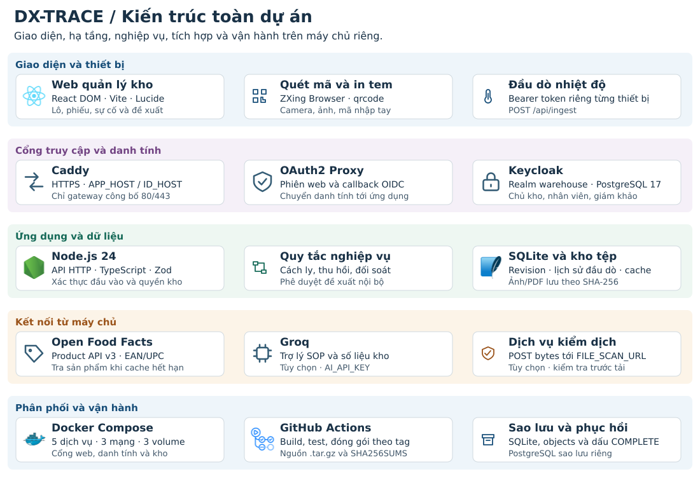
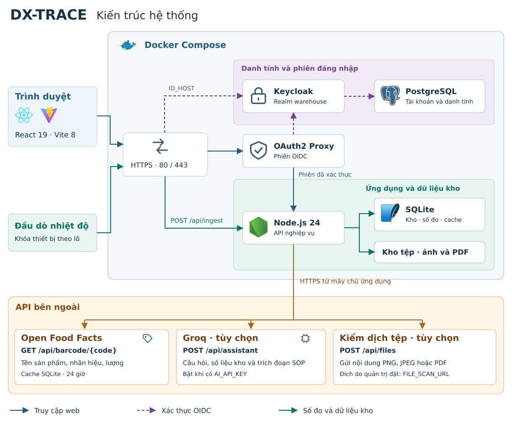
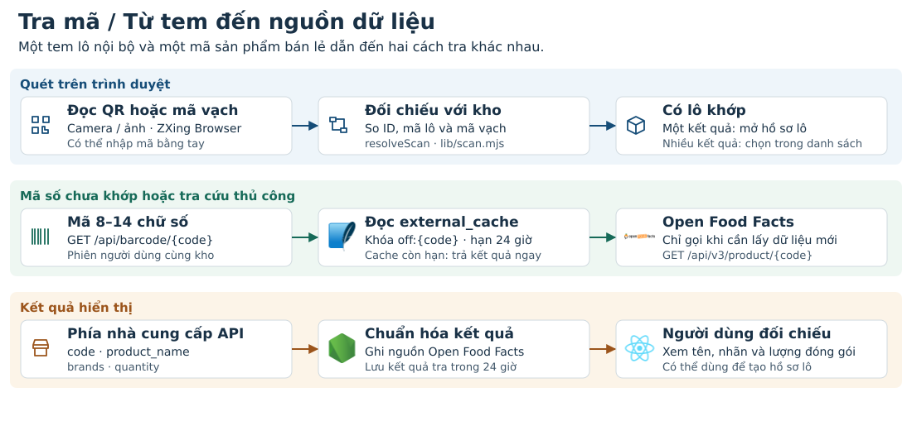
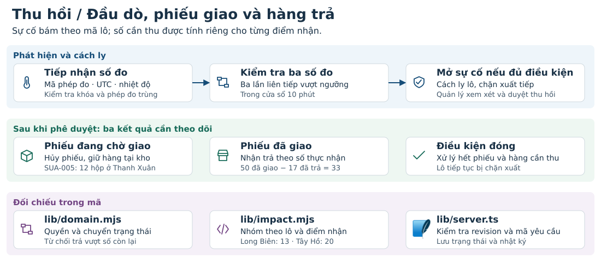
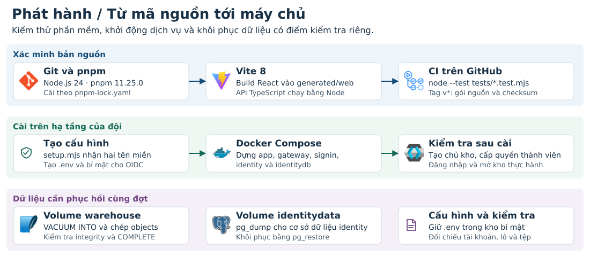
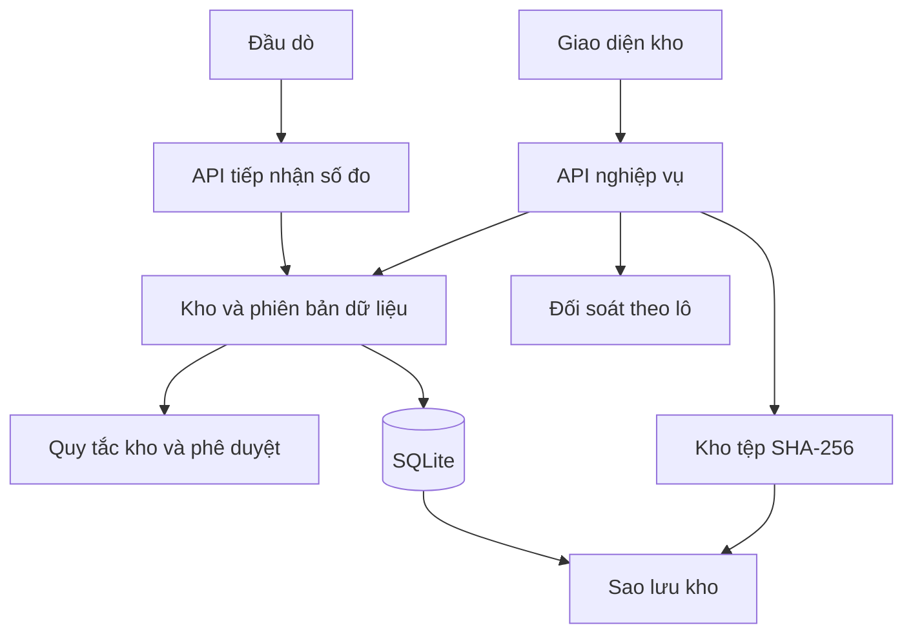

# DX-TRACE

**Truy xuất lô thực phẩm và điều phối thu hồi** · Phiên bản 0.0.1 · [MIT License](LICENSE)

[Dựng kho trên máy chủ](#quick-setup) · [Xem kiến trúc](#architecture) · [Diễn tập SUA-005](#features) · [Tra cứu API](docs/API.md)

<a id="contents"></a>

## 📋 Table of Contents

- [Introduction](#introduction)
- [System Architecture](#architecture)
- [Technologies Used](#technologies)
- [Features](#features)
- [System Requirements](#requirements)
- [Headless Core & Separate Apps](docs/HEADLESS-CORE.md)
- [Quick Setup](#quick-setup)
- [Detailed Setup](#detailed-setup)
- [Changelog](#changelog)
- [Contribution](#contribution)
- [License](#license)
- [Contact](#contact)

<a id="introduction"></a>

## 🌟 Introduction

DX-TRACE giúp đội vận hành kho thực phẩm xác định phạm vi ảnh hưởng khi một lô hàng gặp sự cố. Từ mã lô, người phụ trách tra được nhà cung cấp, phiếu xuất và từng điểm nhận để quyết định dừng giao, cách ly hoặc thu hồi. Mỗi lần trả hàng được ghi theo số lượng thực nhận, nên kho có thể theo dõi phần còn thiếu cho đến khi đối soát xong.

Ví dụ, khi một lô sữa đã đến hai điểm nhận, người quản lý có thể xem số phải thu tại từng nơi và những phiếu chưa giao cần hủy. Cùng một hồ sơ lô liên kết số đo nhiệt độ, chứng từ và lịch sử xử lý.

<a id="architecture"></a>

## 🏗️ System Architecture

### Bản đồ toàn dự án



| Câu hỏi | Điểm bắt đầu trong mã |
| --- | --- |
| Một tài khoản được vào kho nào và được làm gì? | [Ngữ cảnh người dùng và workspace](lib/server.ts), [quyền thực hiện lệnh](lib/domain.mjs). |
| Ai có quyền đổi đề xuất từ đã gửi thành đã duyệt? | [Định nghĩa và điều kiện chuyển bước](lib/workflow.mjs). Cùng một phiên có thể mở cả Đề xuất nội bộ lẫn Truy xuất. |
| Vì sao hai cửa hàng nhận cùng lô nhưng có số phải thu khác nhau? | [Tính tác động theo từng phiếu](lib/impact.mjs), [bảng đối soát](app/impact.tsx). |
| Mất kết nối sau khi bấm nhận trả thì sao? | Máy chủ đối chiếu mã yêu cầu, nội dung và revision trước khi ghi. [Xử lý đồng thời và gửi lại](lib/server.ts). |
| Số đo và ảnh minh chứng được lưu ở đâu? | [Schema SQLite](drizzle/), [giao dịch và kho tệp](selfhost/runtime.mjs), [công cụ sao lưu](selfhost/backup.mjs). |

### Triển khai và ranh giới xác thực

**Bản triển khai mới:** `core` là máy chủ API headless riêng, chỉ sử dụng mạng Docker nội bộ và giữ volume kho; `app` chỉ phục vụ web, chuyển API tới `core`. Giao diện kho và [ứng dụng phê duyệt độc lập](/apps/approvals/index.html) dùng chung SSO và dữ liệu. [Đọc kiến trúc và giới hạn xác minh](docs/HEADLESS-CORE.md).


DX-TRACE chạy trên một máy chủ với hai tên miền: một cho kho, một cho đăng nhập. Caddy là dịch vụ duy nhất công bố cổng ra ngoài. Điểm cần đọc trên sơ đồ là chỗ hai luồng tách nhau: nhân viên vào kho bằng phiên OIDC, còn đầu dò gửi nhiệt độ bằng khóa thiết bị gắn với một lô hàng.



### Khi quét mã vạch, yêu cầu đi đâu?



ZXing giải mã ảnh ngay trên trình duyệt. Nếu mã khớp lô trong kho, giao diện mở hồ sơ hoặc danh sách lô để chọn. Với mã sản phẩm chưa khớp, hoặc khi người dùng tra cứu thủ công, trình duyệt gọi **`GET /api/barcode/{code}`** bằng phiên đăng nhập hiện tại.

1. API nhận mã gồm **8–14 chữ số** và tra bảng SQLite `external_cache` theo khóa `off:{code}`. Nếu kết quả còn hạn, máy chủ trả dữ liệu ngay.
2. Khi cần tra bên ngoài, máy chủ gọi **`GET https://world.openfoodfacts.org/api/v3/product/{code}?fields=code,product_name,brands,quantity`** với thời gian chờ 12 giây.
3. Khi tìm thấy, DX-TRACE trả mã vạch, tên, nhãn hiệu, lượng đóng gói, nguồn và giấy phép ODbL. Kết quả được lưu 24 giờ. Người dùng có thể dùng thông tin đó khi nhập lô; nhà cung cấp và hành trình giao hàng vẫn lấy từ hồ sơ kho.

### Các kết nối ra ngoài từ API nghiệp vụ

| API nội bộ | Đích mà máy chủ gọi | Điều kiện và kết quả |
| --- | --- | --- |
| `GET /api/barcode/{code}` | Open Food Facts Product API v3 | Tra khi chưa có cache hợp lệ. Chỉ gửi mã và danh sách trường cần lấy. |
| `POST /api/assistant` | `POST https://api.groq.com/openai/v1/chat/completions` | Khi có `AI_API_KEY`, gửi câu hỏi cùng ngữ cảnh kho và SOP. Khi chưa cấu hình, ứng dụng tra cứu bằng quy tắc cục bộ. |
| `POST /api/files` | `POST {FILE_SCAN_URL}` | Nếu cấu hình dịch vụ quét, gửi nội dung tệp tới URL của quản trị viên. Chỉ tệp được xác nhận sạch mới được tải xuống. |

Các nhãn dưới tên dịch vụ trong hình là **tuyến phía DX-TRACE**. Danh mục dưới đây gồm cả các tuyến chỉ xử lý trong kho. [Xem danh mục API](docs/API.md) · [Đối chiếu bộ định tuyến](app/api/%5B...path%5D/route.ts).

### Biên truy cập và nơi lưu dữ liệu

| Thành phần trong Compose | Kết nối | Trách nhiệm |
| --- | --- | --- |
| `gateway` · Caddy | `edge`, `appnet` | Nhận HTTPS, loại bỏ header danh tính do client gửi, chuyển yêu cầu web tới `signin`. Tuyến `POST /api/ingest` đi thẳng tới ứng dụng để kiểm tra khóa đầu dò. Chứng chỉ được lưu trong volume `tls`. |
| `signin` · OAuth2 Proxy | `edge`, `appnet` | Xác thực phiên qua Keycloak, chuyển tiếp danh tính đã xác minh đến `app:8080`. |
| `identity` và `identitydb` | Keycloak nối `edge` với `dbnet`; PostgreSQL chỉ thuộc `dbnet` | Keycloak quản lý realm `warehouse`. PostgreSQL lưu dữ liệu danh tính trong `identitydata`. API của kho kiểm tra vai trò thành viên trên từng yêu cầu nghiệp vụ. |
| `app` · Node.js 24 | `appnet`, `corenet` | Phục vụ giao diện đã build và chuyển tiếp các yêu cầu API được xác thực tới lõi. Không gắn dữ liệu kho. |
| `core` · Node.js 24 | `corenet` | Máy chủ API headless riêng; chỉ dịch vụ này gắn volume `warehouse` chứa SQLite và các tệp đính kèm. Không mở cổng ra host. |

### Lần theo một sự cố từ đầu dò đến phiếu trả



1. **Nhận số đo.** Đầu dò gửi mã phép đo, nhiệt độ và thời gian UTC. API xác thực khóa, tìm lô tương ứng và kiểm tra số đo trùng. Ba lần đo liên tiếp vượt ngưỡng trong cửa sổ 10 phút có thể tạo sự cố và cách ly lô.
2. **Xác định nơi phải thu.** Trong kho thực hành, SUA-005 có 50 hộp đã giao và 12 hộp đang chờ giao. Hàm `recallImpact` nhóm các phiếu theo điểm nhận. Sau khi Long Biên trả 17 hộp, màn hình hiển thị Long Biên còn 13 và Tây Hồ còn 20. Phiếu 12 hộp tại kho được xử lý riêng bằng thao tác hủy.
3. **Đối soát trước khi đóng.** Mỗi lần nhận trả, máy chủ kiểm tra quyền, trạng thái phiếu và số còn phải thu. Mã yêu cầu giúp tránh ghi hai lần khi nhân viên gửi lại. Kho chỉ đóng được sự cố khi đã xử lý hết các phiếu liên quan.

Để kiểm tra tuyến mạng, xem [Caddyfile](selfhost/Caddyfile) và [Compose](selfhost/compose.yaml). Để theo dõi một lần ghi từ API xuống dữ liệu, xem [xử lý yêu cầu](app/api/%5B...path%5D/route.ts), [quy tắc kho](lib/domain.mjs) và [phép tính đối soát](lib/impact.mjs).

### Vòng đời bản phát hành và dữ liệu



Một tag phiên bản xác định **mã nguồn**; bản sao lưu xác định **trạng thái kho tại một thời điểm**. Muốn dựng lại hệ thống đang vận hành, cần cả hai, kèm cấu hình tên miền, bí mật OIDC và dữ liệu danh tính. [Hướng dẫn phục hồi trên máy chủ mới](selfhost/README.md).

<a id="technologies"></a>

## 🛠️ Technologies Used

### Các mô-đun cùng tham gia một lần nhận trả

Khi nhân viên bấm **Nhận trả**, giao diện gửi mã phiếu, số hộp thực nhận và mã yêu cầu. API xác định người dùng thuộc kho nào, kiểm tra quyền và gọi quy tắc nhận trả. Sau khi ghi thành công, giao diện tải lại hồ sơ. Tổng **33 hộp còn phải thu** trong ví dụ SUA-005 được tính từ các phiếu của lô.



### Frontend, QR và diễn tập

| Thư viện hoặc công nghệ | Nơi sử dụng | Vai trò |
| --- | --- | --- |
| React và React DOM 19.2.6 | [Điểm vào giao diện](selfhost/ui/main.jsx), [bảng điều hành](app/console.tsx) | Gắn ứng dụng vào trang, quản lý màn hình, biểu mẫu, bảng lọc và trạng thái yêu cầu. |
| Lucide React 1.31.0 | [Điều hướng](app/console.tsx), [màn hình quét](app/scanner.tsx) | Bộ biểu tượng dùng chung cho thao tác kho, camera và trạng thái sự cố. |
| ZXing Browser 0.2.1 | [Scanner](app/scanner.tsx), [xử lý nội dung tem](lib/scan.mjs) | Giải mã ảnh hoặc luồng camera; đối chiếu kết quả với mã lô và mã vạch sản phẩm. |
| qrcode 1.5.4 | [Tạo tem](app/scanner.tsx) | Sinh tem PNG chứa định danh lô để in hoặc quét lại. |
| CSS Grid, SVG, Google Sans | [CSS](app/globals.css), [tổng quan kho mẫu](app/training-overview.tsx) | Căn các hàng cảnh báo, vẽ biểu đồ nhiệt độ và hiển thị tiếng Việt bằng phông tự lưu trữ. |
| HTML và JavaScript | [Bộ diễn tập](public/demo/scenarios.js) | Bốn kịch bản tương tác có thể làm lại. Kho thực hành có lưu trạng thái sử dụng [bộ dữ liệu mẫu riêng](lib/demo.mjs). |

### Backend và lõi nghiệp vụ

| Thành phần | Trách nhiệm trong mã |
| --- | --- |
| Node.js 24, TypeScript, JavaScript ES modules | [Máy chủ HTTP](selfhost/server.mjs) phục vụ giao diện và chuyển yêu cầu API đến [bộ định tuyến](app/api/%5B...path%5D/route.ts). |
| Zod 3.25.76 | Kiểm tra đầu vào theo từng tuyến, gồm câu hỏi tra cứu, email, vai trò và tham số phân trang. Các điều kiện tồn và thu hồi được kiểm tra tiếp ở tầng nghiệp vụ. |
| Xử lý kho và vai trò | [domain.mjs](lib/domain.mjs) xử lý nhập lô, giữ hàng, giao, hủy, nhận trả, sự cố và số đo. [workflow.mjs](lib/workflow.mjs) định nghĩa bước nháp, gửi duyệt, duyệt hoặc từ chối của ứng dụng đề xuất. |
| Tổng hợp tác động | [impact.mjs](lib/impact.mjs) nhóm phiếu theo điểm nhận. Phiếu hủy được loại khỏi tổng; phiếu giao một phần trả vẫn giữ số còn phải thu. |
| Cô lập kho và ghi đồng thời | [server.ts](lib/server.ts) xác định workspace, đối chiếu mã yêu cầu khi gửi lại và cập nhật theo revision để phát hiện ghi đồng thời. |
| Ngữ cảnh yêu cầu | [AsyncLocalStorage](selfhost/runtime.mjs) gắn danh tính của phiên với yêu cầu đang xử lý. |

### Dữ liệu, tệp và lịch sử cảm biến

SQLite chạy qua `node:sqlite`. Hai migration SQL tạo **sáu bảng** dưới đây. PostgreSQL thuộc dịch vụ danh tính Keycloak, sử dụng volume riêng.

| Bảng SQLite | Nội dung |
| --- | --- |
| `workspaces` | Trạng thái nghiệp vụ của từng kho và revision. Lô, phiếu, sự cố, SOP và nhật ký nằm trong trạng thái này. |
| `members` | Liên kết tài khoản với kho và vai trò. |
| `invitations` | Email và quyền được cấp trước lần đăng nhập đầu tiên. |
| `device_keys` | Giá trị băm của khóa đầu dò, thiết bị tương ứng và trạng thái hiệu lực. |
| `sensor_history` | Lịch sử số đo; chỉ mục theo kho, thiết bị và thời gian phục vụ truy vấn phân trang. |
| `external_cache` | Kết quả tra mã vạch và thời điểm hết hạn bộ nhớ đệm. |

Ảnh và PDF nằm trên hệ thống tệp theo kho và SHA-256. API chỉ cho tải xuống khi trạng thái kiểm dịch là `clean`. Số đo mới và cập nhật trạng thái kho được ghi theo giao dịch. [Schema ban đầu](drizzle/0000_watery_mad_thinker.sql) · [Migration lịch sử nhiệt độ](drizzle/0001_sensor_history.sql) · [Bộ lưu trữ](selfhost/runtime.mjs).

### Infrastructure, SSO và phân quyền

| Dịch vụ Compose | Công nghệ | Nhiệm vụ |
| --- | --- | --- |
| `gateway` | Caddy 2 | HTTPS, định tuyến web và tuyến thiết bị; loại bỏ header danh tính từ phía client. |
| `signin` | OAuth2 Proxy 7.12.0 | Phiên web, cookie và callback OIDC. |
| `identity` | Keycloak 26.4.7 | Đăng nhập cho realm warehouse. |
| `identitydb` | PostgreSQL 17 | Lưu tài khoản và cấu hình realm trên mạng nội bộ. |
| `app` | Node.js 24 và SQLite | Chạy API, phục vụ giao diện, đọc và ghi dữ liệu kho. |

[Cấu hình Compose](selfhost/compose.yaml) · [Realm](selfhost/realm.json) · [Cổng HTTPS](selfhost/Caddyfile)

### Dịch vụ ngoài và điều kiện kích hoạt

| Tích hợp | Khi được gọi | Cách hoạt động |
| --- | --- | --- |
| Open Food Facts | Người dùng tra mã vạch sản phẩm | Gửi mã sản phẩm, trả thông tin có ghi nguồn; cache kết quả 24 giờ. |
| Tra cứu SOP / Groq | Người dùng hỏi trợ lý nghiệp vụ | Mặc định tìm trong SOP và thống kê của kho. Khi ứng dụng được cấp `AI_API_KEY`, bộ kết nối có thể gửi câu hỏi và ngữ cảnh đến Groq. |
| Bộ kiểm dịch tệp | Khi tải lên và ứng dụng được cấu hình `FILE_SCAN_URL` | Gửi nội dung tệp tới dịch vụ quét. Tệp chờ kiểm dịch bị hạn chế tải xuống. |

Compose mặc định không khai báo dịch vụ Groq hoặc máy quét tệp. Nếu dùng các tích hợp tùy chọn, quản trị viên cần truyền biến môi trường tương ứng vào container ứng dụng. [Xử lý tích hợp trong API](app/api/%5B...path%5D/route.ts).

### Build, kiểm thử, vận hành và phát hành

| Công việc | Công cụ và đầu ra |
| --- | --- |
| Cài thư viện | pnpm 11.25.0 và lockfile khóa các phiên bản. [Danh mục phụ thuộc trực tiếp, gián tiếp và gói theo nền tảng](docs/DEPENDENCIES.md). |
| Build web và image | Vite 8.0.13 đóng gói React; Dockerfile nhiều giai đoạn dựng ứng dụng Node. [Build](selfhost/build.mjs) · [Dockerfile](selfhost/Dockerfile). |
| Kiểm thử | `node:test`, `node:assert/strict`; kiểm tra quy tắc kho, phạm vi thu hồi, giải mã PNG và tích hợp HTTP. Bài kiểm thử PNG dùng thêm pngjs và ZXing Library qua các gói đã khóa. [Danh sách tệp kiểm thử](docs/CODEBASE.md#tests). |
| Sao lưu | SQLite `VACUUM INTO`, kiểm tra toàn vẹn và đối chiếu tệp đính kèm. PostgreSQL của Keycloak sao lưu riêng bằng `pg_dump`. [Công cụ sao lưu](selfhost/backup.mjs). |
| CI và release | GitHub Actions chạy build và test. Với tag dạng `v*`, Git, SHA-256 và GitHub CLI tạo bản nguồn nén cùng checksum. [Workflow](.github/workflows/release.yml). |

**[Tra cứu toàn bộ mã nguồn theo tệp](docs/CODEBASE.md)** · **[Tra cứu phiên bản từng thư viện](docs/DEPENDENCIES.md)**

<a id="features"></a>

## ✨ Features

| Màn hình | Công việc |
| --- | --- |
| Lô hàng và đối tác | Khai báo nhà cung cấp, điểm nhận, số lượng nhập, đơn vị, hạn dùng và ngưỡng nhiệt độ. |
| Giao nhận | Lập phiếu giữ hàng, xác nhận giao, hủy phiếu chưa giao và ghi nhận trả từng phần. |
| Truy xuất | Tìm lô bằng QR hoặc mã vạch, xem đường đi từ nhà cung cấp đến điểm nhận, in hồ sơ và tải tem QR. |
| Thiết bị | Gắn đầu dò với một lô, cấp hoặc thu hồi khóa gửi số đo, xem lịch sử nhiệt độ. |
| Sự cố & thu hồi | Cách ly, duyệt thu hồi, đối soát từng điểm nhận và đóng hồ sơ. |
| Công cụ & quản trị | Tra quy trình SOP, quản lý đề xuất nội bộ, xem nhật ký và phân quyền thành viên. |

Lô hết hạn hoặc bị cách ly sẽ bị chặn xuất. Thu hồi chỉ hoàn tất sau khi xử lý hết phiếu đang giữ và hàng đã giao. Đóng sự cố vẫn giữ lô ở trạng thái chặn xuất. Mã QR chứa định danh lô; người quét cần quyền truy cập kho để xem hồ sơ.

### Diễn tập thu hồi lô SUA-005

Mở **Kho thực hành → Tổng quan** và chọn **Truy xuất lô** ở thẻ **SUA-005**. Khi mới khởi tạo, lô sữa chua dâu này có số đo gần nhất là **10,8 °C**, vượt giới hạn bảo quản **8 °C**. Các con số sau cùng thuộc một lô, đơn vị là hộp.

| Điểm nhận | Đã giao | Đã trả | Còn phải thu | Chờ giao |
| --- | ---: | ---: | ---: | ---: |
| Long Biên | 30 | 17 | 13 | 0 |
| Tây Hồ | 20 | 0 | 20 | 0 |
| Thanh Xuân | 0 | 0 | 0 | 12 |
| **Tổng** | **50** | **17** | **33** | **12** |

1. Tại **Truy xuất**, đối chiếu nhà cung cấp, vị trí kho và các phiếu xuất của SUA-005.
2. Mở **Sự cố & thu hồi**. Hủy phiếu 12 hộp đang chờ giao và ghi nhận hàng trả theo từng phiếu đã giao.
3. Theo dõi số còn phải thu sau mỗi lần nhận. Khi tất cả phiếu đã được xử lý, người có quyền quản lý có thể đóng sự cố.
4. Mở **Nhật ký** để đối chiếu người thực hiện và thời điểm cập nhật.

Kho thực hành ban đầu có 16 lô, 40 phiếu giao nhận và 4 đầu dò với 32 số đo mẫu. Thao tác trong kho này được lưu giữa các lần đăng nhập. Để tập lại một kịch bản từ đầu, vào **Công cụ & quản trị → Hướng dẫn sử dụng → Mở 4 kịch bản diễn tập**. Các kịch bản tương tác này có nút **Làm lại**. Kho vận hành sử dụng vùng dữ liệu riêng.

<a id="requirements"></a>

## 💻 System Requirements

| Mục đích | CPU | RAM | Dung lượng trống | Phần mềm |
| --- | --- | --- | --- | --- |
| PC phòng máy, một người chạy demo | 2 nhân trở lên | 8 GB | 5 GB | Windows 10/11 hoặc Ubuntu, Node.js 24, trình duyệt Chrome/Edge/Firefox |
| Máy chạy đủ dịch vụ cho đội | 4 nhân hoặc 4 vCPU | 16 GB | 30 GB SSD | Linux, Node.js 24, Docker Engine và Compose v2 |

Đây là cấu hình đề xuất để trình diễn với dữ liệu mẫu. Dành thêm dung lượng khi lưu nhiều ảnh, PDF hoặc bản sao lưu. Lần đầu cần Internet để tải các thư viện.

<a id="quick-setup"></a>

## 🚀 Quick Setup

### A. Tải về và chạy trên PC phòng máy

1. Cài **Node.js 24.x** (kèm npm). Giải nén ZIP. Mở thư mục **DX-TRACE** chứa `package.json`. Trên Windows, gõ `cmd` vào thanh địa chỉ của File Explorer rồi nhấn Enter. Trên Ubuntu, chọn **Open in Terminal** tại thư mục này.
2. Kiểm tra phiên bản rồi chạy lần lượt các lệnh dưới đây. Lệnh cuối tự build giao diện và mở máy chủ trên chính PC.

   ```sh
   node -v
   npx --yes pnpm@11.25.0 install --frozen-lockfile
   npm run demo
   ```

3. Khi terminal in **Mở kho thực hành**, mở [DX-TRACE trên PC này](http://127.0.0.1:8080/?area=training#overview). Trang tổng quan ban đầu có **16 lô**; chọn **Truy xuất lô** tại SUA-005 để kiểm tra hành trình phân phối. Phiên demo dùng sẵn quyền chủ kho cục bộ.
4. Giữ cửa sổ terminal mở trong khi trình bày. Nhấn **Ctrl+C** để dừng. Những lần sau chỉ cần mở lại terminal trong thư mục dự án và chạy `npm run demo`. Các thao tác đã thực hiện được lưu tại `selfhost/local-demo-data/`.

Nếu gặp `EADDRINUSE`, dừng tiến trình đang dùng cổng 8080 rồi chạy lại. Chế độ này chỉ lắng nghe tại `127.0.0.1`. Để nhiều người truy cập bằng tài khoản riêng, triển khai theo cách B.

### B. Dựng server cho nhiều người và đăng nhập bằng Keycloak

1. **Lấy mã nguồn.** Giải nén gói ZIP và mở terminal tại thư mục `DX-TRACE/` chứa `package.json`.
2. **Tạo cấu hình.** Thay hai tên miền ví dụ bằng tên miền đã trỏ về máy chủ. Chạy một lần từ thư mục gốc.

   ```sh
   node selfhost/setup.mjs kho.example.org id.example.org
   ```

3. **Dựng hệ thống.**

   ```sh
   cd selfhost
   docker compose config --quiet
   docker compose up -d --build
   docker compose ps
   ```

4. **Đăng nhập lần đầu.** Tại trang quản trị danh tính, dùng username `admin` và mật khẩu khởi tạo trong `selfhost/.env`. Tạo tài khoản chủ kho ở realm **warehouse**, đặt mật khẩu và xác minh email. Dùng tài khoản vừa tạo để mở kho.

| Địa chỉ sau khi thay tên miền | Mục đích |
| --- | --- |
| `https://id.example.org/admin/` | Quản trị tài khoản Keycloak. |
| `https://kho.example.org/` | Đăng nhập kho vận hành. |
| `https://kho.example.org/?area=training#overview` | Trình diễn bằng dữ liệu mẫu. |

<a id="detailed-setup"></a>

## 📖 Detailed Setup

| Thành phần | Hướng dẫn |
| --- | --- |
| Triển khai, DNS, HTTPS, tài khoản, sao lưu, phục hồi | [Sổ tay máy chủ riêng](selfhost/README.md) |
| Giao diện, điều hướng, camera, quy trình nhận trả | [Frontend](app/README.md) |
| API, kho thực hành, điều kiện đóng sự cố | [Backend và nghiệp vụ](lib/README.md) |
| Kiến trúc lõi và minh chứng cho đề thi | [Đối chiếu yêu cầu](REQUIREMENTS.md) |

### Phát triển và kiểm thử

Dùng **Node.js 24** và **pnpm 11.25.0** để đồng bộ với Dockerfile và CI. Chạy từ thư mục chứa `package.json`.

```sh
npm install --global pnpm@11.25.0
pnpm install --frozen-lockfile
node selfhost/build.mjs
node --test tests/*.test.mjs
```

Bước build tạo giao diện trong `selfhost/generated/web/`. Node.js 24 chạy API TypeScript trực tiếp. Bài kiểm thử HTTP khởi tạo máy chủ tạm trên cổng 38469, kiểm tra phân quyền, xử lý đồng thời và đọc lại tệp sau phục hồi. Các bài còn lại kiểm tra tồn kho, đối soát nhận trả, cảnh báo nhiệt độ và giải mã tem PNG. Muốn kiểm tra toàn bộ luồng đăng nhập và HTTPS, chạy bộ Docker Compose theo [hướng dẫn triển khai](selfhost/README.md).

### Phạm vi tích hợp

- **Cảm biến.** Ba số đo liên tiếp vượt ngưỡng của lô trong khoảng 10 phút có thể tạo sự cố. Lịch sử số đo mới được lưu riêng. Khi cần sao lưu đầy đủ, dùng bản sao cơ sở dữ liệu và kho tệp.
- **Mã vạch.** Tra cứu thông tin sản phẩm từ Open Food Facts theo giấy phép ODbL. Nguồn gốc và điểm nhận của từng lô lấy từ phiếu nhập, xuất của kho.
- **Tệp.** API nhận PNG, JPEG và PDF đến 5 MB, kiểm tra định dạng và tính SHA-256. Việc tải xuống phụ thuộc vào kết quả kiểm dịch.
- **Tra cứu SOP.** Chế độ mặc định tìm trong tài liệu và cảnh báo của kho. Khi bật bộ kết nối sinh văn bản, câu hỏi cùng ngữ cảnh liên quan được gửi đến nhà cung cấp đã cấu hình.
- **Quy mô.** Trạng thái kho có giới hạn kích thước; cập nhật dùng số phiên bản để phát hiện ghi đồng thời. Trước khi triển khai cảm biến tần suất cao, cần đo tải với số thiết bị và chu kỳ gửi dự kiến.

<a id="changelog"></a>

## 📝 Changelog

**0.0.1 là bản phát hành đầu tiên của DX-TRACE.** Từ thư mục gốc, chạy `node -p "require('./package.json').version"` để kiểm tra bản đang dùng. [Xem lịch sử thay đổi](CHANGELOG.md).

**Cập nhật máy chủ.** Sao lưu kho và cơ sở dữ liệu danh tính theo sổ tay triển khai. Đọc changelog của phiên bản đích, giữ cấu hình `selfhost/.env` cùng các volume hiện có, rồi chạy lại `docker compose up -d --build` trong thư mục `selfhost/`. Kiểm tra đăng nhập, số liệu một lô và một tệp đính kèm sau khi cập nhật.

**Theo dõi bản phát hành.** Workflow xử lý tag dạng `v*` và tạo gói nguồn kèm `SHA256SUMS` khi bước kiểm thử thành công. [Quy trình phát hành](.github/workflows/release.yml).

<a id="contribution"></a>

## 🤝 Contribution

Mỗi bản sửa cần nêu được bước tái hiện và cách kiểm tra kết quả. Khi thay quy tắc tồn kho hoặc thu hồi, bổ sung trường hợp kiểm thử cho số lượng trước và sau thao tác. [Hướng dẫn đóng góp](CONTRIBUTING.md).

<a id="license"></a>

## 📄 License

### Code License

Mã nguồn của đội được phân phối theo [giấy phép MIT](LICENSE). Phông chữ có [giấy phép đi kèm](public/fonts/google-sans/LICENSE.txt).

### Data License

Kho thực hành dùng dữ liệu mô phỏng do dự án tạo. Dữ liệu sản phẩm tra từ Open Food Facts qua mã vạch có nguồn và giấy phép ODbL riêng. Dữ liệu vận hành do từng đơn vị nhập được lưu trong kho của đơn vị đó.

<a id="contact"></a>

## 📧 Contact

### Team Members

**Nguyễn Ngọc Hiếu** · Trưởng nhóm DX-TRACE, ngành Khoa học dữ liệu, Trường Đại học Khoa học và Công nghệ Hà Nội (USTH).

### Bug Reports and Suggestions

Khi báo lỗi cho đội, dùng [mẫu báo lỗi](.github/ISSUE_TEMPLATE/bug_report.md) và gửi kèm phiên bản, vai trò tài khoản, bước tái hiện và kết quả mong đợi. Với lỗi thu hồi, ghi rõ mã lô mẫu và số đã giao, đã trả, còn phải thu để người tiếp nhận đối chiếu được.

[↑ Quay lại mục lục](#contents)
