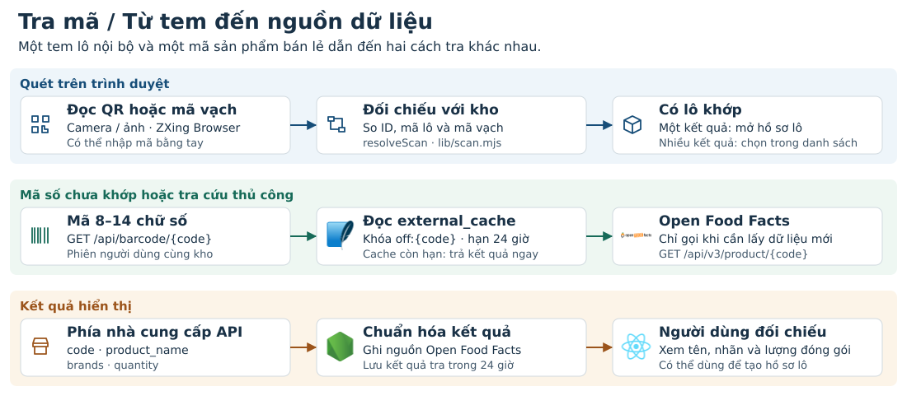

# Giao diện vận hành

Giao diện React phục vụ hai nhóm thao tác chính: xử lý hàng trong kho và truy vết một lô đã phân phối. Mỗi màn hình phản ánh dữ liệu do API trả về cho người dùng và kho đang chọn.

| Tệp | Khi nào cần mở |
| --- | --- |
| [console.tsx](console.tsx) | Điều hướng, tìm kiếm, phân trang, biểu mẫu và các thao tác giao nhận. |
| [impact.tsx](impact.tsx) | Số đã giao, đã trả, còn phải thu và chờ giao tại từng điểm nhận. |
| [scanner.tsx](scanner.tsx) | Đọc tem bằng camera hoặc ảnh, tạo tem QR. |
| [globals.css](globals.css) | Kiểu hiển thị, các cột trên tổng quan, bảng cuộn và bố cục màn hình nhỏ. |

## Điểm vào và luồng giao diện

Khi camera trả về một chuỗi, scanner giao việc chọn lô cho resolveScan. Mở hồ sơ nếu có đúng một kết quả; hiển thị bộ chọn nếu một mã ứng với nhiều lô. Kiểm tra nhánh tra sản phẩm ngoài kho khi thay đổi màn hình quét.

[Kiến trúc toàn dự án](../README.md#architecture) · [Danh mục API](../docs/API.md)

## Theo một thao tác từ giao diện đến dữ liệu

1. Người dùng chọn **Nhận trả** trên một phiếu đã giao. Biểu mẫu gửi số lượng thực nhận kèm mã yêu cầu.
2. API kiểm tra phiên, vai trò, trạng thái thu hồi và số lượng còn lại của phiếu.
3. Khi lưu thành công, giao diện lấy lại trạng thái kho. Phần đối soát tính lại tổng số theo từng điểm nhận và theo lô.

Khi sửa biểu mẫu, giữ nguyên mã yêu cầu cho lần gửi lại của cùng một thao tác. Khi thêm liên kết điều hướng, kiểm tra tham số kho thực hành và mã lô; ví dụ đường dẫn tổng quan là `/?area=training#overview`. Các hộp thoại sửa dữ liệu cần xử lý cả lỗi API và trường hợp người dùng bấm gửi liên tiếp.

## Kiểm tra trực quan

- Mở cùng một lô từ danh sách, cảnh báo và tem QR; cả ba đường dẫn phải dẫn tới cùng hồ sơ.
- So sánh số đã trả trên tổng quan với số trong **Sự cố & thu hồi** sau khi xác nhận nhận trả.
- Thu hẹp cửa sổ, kiểm tra menu di động, cuộn bảng và đọc các mô tả dài.
- Đăng nhập bằng tài khoản chỉ xem để kiểm tra các nút nghiệp vụ theo vai trò.

[Quay lại tổng quan](../README.md)
