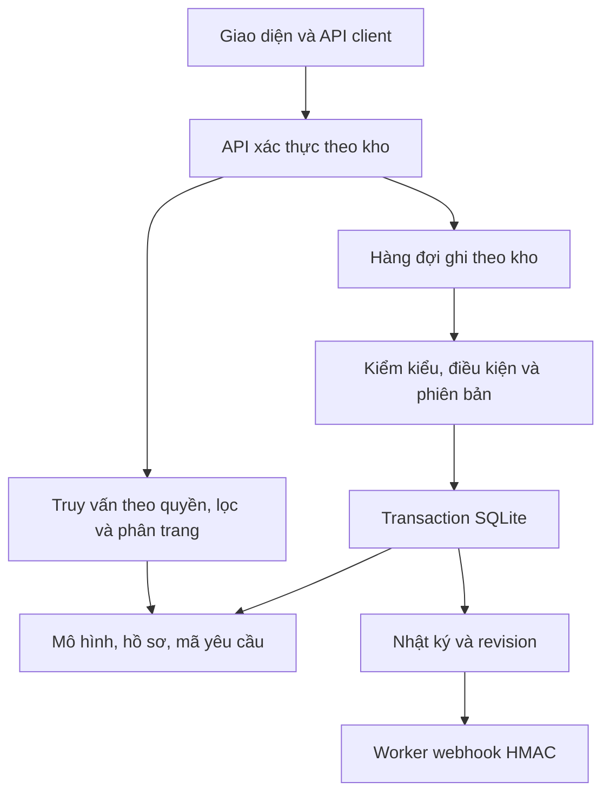

<!-- SPDX-FileCopyrightText: 2026 DX-TRACE contributors
SPDX-License-Identifier: MIT
DX-TRACE project authors: Đặng Nhật Minh, Nguyễn Ngọc Hiếu
-->
# Ma trận minh chứng kỹ thuật

Bản ứng viên v0.2.0 dùng commit `00990ecd`. [CI đúng commit](https://github.com/ngochieu1762005/dx_trace/actions/runs/45970856284) và [lần chạy phát hành](https://github.com/ngochieu1762005/dx_trace/actions/runs/45970871898) ghi kết quả dựng, cài sạch và tích hợp. Các phép đo có ngày, phiên bản và môi trường riêng.

| Năng lực | Mã / tài liệu | Minh chứng | Giới hạn |
| --- | --- | --- | --- |
| Core độc lập với giao diện | `selfhost/core-server.mjs`, `selfhost/server.mjs` | Job container CI kiểm app → core và từ chối thiếu token | Không kiểm SSO Keycloak end-to-end |
| Mô hình tạo biểu mẫu và hồ sơ | `lib/platform.mjs`, `app/platform.tsx` | `tests/platform.test.mjs`, đã kiểm trên trình duyệt: áp dụng mẫu mua sắm, tạo hồ sơ 20 triệu và tìm kiếm có/không có kết quả | JSON editor; chưa có trình thiết kế kéo thả |
| Thay đổi mô hình an toàn | plan/apply + lịch sử phiên bản | Kiểm schema không tương thích, version cũ và workflow đang chạy | Không có đổi tên trường tự động giữ dữ liệu |
| Phân quyền hồ sơ | `lib/platform-store.ts` | SQL lọc theo quyền trước đếm/phân trang; kiểm người khác và không gian khác | Vai cố định, chưa có scope theo đơn vị/nhóm được giao |
| Workflow theo dữ liệu | `examples/purchase/model.json` | 20 triệu bị chặn duyệt trực tiếp, chuyển cấp rồi owner duyệt | Finite-state engine; không phải BPMN |
| Chuyển dữ liệu cũ | `selfhost/migrate-platform.mjs` | Kiểm cả hai vùng kho, chạy lại, rollback khi có xung đột | Quay lui cần bản sao lưu trước nâng cấp |
| Vượt giới hạn lưu hồ sơ trong JSON | bảng `platform_records` | 1.000 hồ sơ lớn hơn tổng 1,8 MB, workspace JSON không tăng theo số hồ sơ | Kho truyền thống chưa được tách toàn bộ |
| Chống cập nhật đè và yêu cầu trùng | version + idempotency + hàng đợi theo kho | `platform-api`, `platform-storage`, `workspace-queue` tests | Hàng đợi trong một process; không tuyên bố HA |
| Nhật ký và webhook | ledger SHA-256, HMAC + persistent retries | Kiểm phát hiện sửa payload, retry, ký đúng body | Không có neo hash bên ngoài; không bảo đảm thứ tự giao |
| Sao lưu/khôi phục | [Quy trình vận hành](../selfhost/OPERATIONS.md), `backup.mjs`, `verify-backup.mjs` | API dựng lại server từ bản sao lưu, hồ sơ/ledger còn nguyên | PostgreSQL Keycloak phải sao lưu riêng |
| Chức năng kho | domain, impact, scanner, inventory-view | Các test nghiệp vụ, thu hồi, đối chiếu mã và CSV trong `tests/` | Camera thật cần kiểm trên từng thiết bị |
| Hiệu năng | `tools/benchmark-platform.mjs` | [Kết quả và phạm vi đo](BENCHMARK.md) | Không đo SSO/TLS/gateway, không so trực tiếp với hệ thống khác |

## Ứng dụng độc lập và ranh giới chịu lỗi trong v0.2.0

| Hạng mục | Mã / tài liệu | Kiểm chứng tự động | Chưa được chứng minh |
| --- | --- | --- | --- |
| Frontend ứng dụng thứ hai chạy riêng | [Quality Portal](QUALITY-PORTAL.md), `apps/quality-portal/server.mjs` | `tests/quality-portal.test.mjs` spawn 3 process, route CSP, deny path traversal | Browser test trên VPS thật |
| Dùng lại Core sau cài AppKit | `manifest.json`, `lib/appkit.mjs`, `lib/platform.mjs` | Plan/install, ID/entrypoint, quyền khác tổ chức, dữ liệu và ledger dùng chung | Không có plugin chạy mã ngoài hoặc app store |
| Phân tách người lập và duyệt | `examples/quality/model.json` | Người lập bị 403, tài khoản quản lý khác duyệt thành công | Chưa kiểm TOTP/Keycloak E2E tự động |
| Cô lập sự cố frontend | `selfhost/compose.yaml`, `selfhost/server.mjs` | Tắt quality-portal, API kho và hồ sơ chất lượng vẫn hoạt động | Không phải HA ở tầng Core/DB |
| CI container nhiều dịch vụ | `.github/workflows/ci.yml`, `selfhost/container-smoke.mjs` | Build image, thử App+Gateway+Core+Quality, cấm App gọi trực tiếp Core | Chỉ thành minh chứng khi workflow PR đã đạt; chưa kiểm Keycloak end-to-end hoặc khôi phục production |

**Các bài kiểm thử mới phải được đánh giá theo kết quả GitHub Actions của commit tương ứng, không được tự nhận đạt trước khi CI xanh.**

## Năng lực mới trong v0.0.7 — nghiệm thu VPS còn mở

| Hạng mục | Mã | Bằng chứng có thể kiểm | Chưa có bằng chứng |
| --- | --- | --- | --- |
| Parallel fork/join & timer persisted | `lib/process-runtime.mjs`, `lib/platform.mjs`, `selfhost/process-timer.mjs` | `tests/process-runtime.test.mjs`, `tests/process-platform.test.mjs`, `tests/process-timer.test.mjs`; CI theo SHA | Không phải full BPMN XML interpreter; chưa thử workflow phức tạp trên VPS |
| OAuth external API read-only | `selfhost/external-api.mjs`, Compose optional profile | `tests/external-api.test.mjs`; JWT giả lập được ký RS256, kiểm scope/audience và client ACL | Chưa tạo client Keycloak thật và chưa kiểm token production |
| Authenticated TLS latency | `tools/benchmark-live.mjs` | `tests/benchmark-live.test.mjs` xác minh logic, chống redirect 302 | Chưa chạy trên VPS với cookie Keycloak thật |
| Isolated restore | `tools/restore-drill.sh` | CI kiểm cú pháp, script dùng network none & temporary containers | Chưa chạy với SQLite/Keycloak backups thật, chưa nghiệm thu staging |
| Acceptance checklist | [ACCEPTANCE-2026](ACCEPTANCE-2026.md) | Bảng kết quả trống mặc định | Phải điền SHA, ngày, status, bằng chứng thật sau khi chạy |

## Cách kiểm tra độc lập

```bash
npm run build
npm test
python3 -m unittest discover -s tests -p '*_test.py'
node tools/benchmark-platform.mjs --records 10000 --seconds 15 --levels 1,10,25 --out /tmp/dxtrace-load.json
```

Script tải chỉ tạo dữ liệu trong thư mục tạm riêng, chạy server loopback và tự dọn. Không nhận URL VPS hay đường dẫn DB vận hành. Node.js 24 là yêu cầu. Kết quả tùy CPU, I/O và mức tải máy lúc chạy.

## Kiến trúc lưu trữ hồ sơ mở rộng



Các thay đổi kho truyền thống và hồ sơ mở rộng dùng chung hàng đợi ghi theo workspace. Revision trong DB vẫn bảo vệ xung đột ngoài process; version hồ sơ vẫn từ chối quyết định dựa trên dữ liệu cũ. Khi quá 100 lượt đang xử lý/chờ trong một kho, trả 503 để người gọi thử lại với cùng mã yêu cầu.

## Cần bổ sung trước khi công bố triển khai quy mô lớn

- Đo toàn stack có TLS/gateway/Keycloak trên VPS cấu hình cố định và thời gian đủ dài.
- Tự động hóa kiểm thử trình duyệt/SSO, kiểm camera trên điện thoại thật.
- Diễn tập lỗi đĩa, phục hồi toàn bộ dịch vụ và sao lưu ngoài máy.
- Ghi nhận hiệu quả thực tế tại kho với sự đồng ý của đơn vị thử nghiệm.

## Bằng chứng bổ sung từ v0.0.6

- [BPMN](BPMN.md): chuyển đổi XML ↔ quy trình khai báo, kiểm soát vai trò/điều kiện trong runtime; kiểm thử `tests/bpmn.test.mjs` và `tests/platform-api.test.mjs`. Không phải engine BPMN tổng quát.
- [AppKit](APPKIT.md): cài ứng dụng khai báo theo manifest, mô hình và quyền dùng chung; kiểm thử `tests/appkit.test.mjs`, `tests/appkit-api.test.mjs`, gồm cài app qua HTTP, phân quyền, chống trùng và cách ly workspace. Không chạy mã ngoài.
- App/landing dùng Google Sans WOFF2 có sẵn; theme Keycloak dùng Segoe UI/Arial. Logo xanh #1967D2. Kiểm hồi quy tại `tests/branding.test.mjs`.
- Các thay đổi này được phát hành trong v0.0.6. Kiểm chứng theo commit và kết quả CI tương ứng; không ghép số liệu main vào báo cáo của tag cũ. Xem [hướng dẫn kiểm thử](TESTING.md).


## Gateway tách khóa và kiểm chứng OIDC (v0.2.0)

| Hạng mục | Bằng chứng trong repository | Bằng chứng cần thu thập sau deploy |
| --- | --- | --- |
| Khóa riêng của App/Gateway và Gateway/Core | `selfhost/api-gateway.mjs`, `selfhost/compose.yaml`, `tests/api-gateway.test.mjs` | Xác nhận hai khóa khác nhau, không tiết lộ giá trị |
| Chống bypass Core | CI ở `.github/workflows/ci.yml`, `selfhost/container-smoke.mjs` | Screenshot hoặc output đã ẩn IP nội bộ từ job thành công |
| OIDC và RBAC thật | `selfhost/verify-oidc.mjs`, `tests/verify-oidc.test.mjs` | Chạy script bằng hai phiên Keycloak, ghi PASS/FAIL và commit SHA, tuyệt đối không ghi cookie |
| Hướng dẫn rollback | [Gateway and SSO](GATEWAY-AND-SSO.md), [Vận hành](../selfhost/OPERATIONS.md) | Diễn tập trên máy test và ghi thời gian phục hồi |

**Lưu ý:** Source code và test giả lập chỉ chứng minh logic. Không báo cáo Keycloak hoặc VPS đã kiểm thành công khi chưa thực sự chạy.
## Liên thông nghiệp vụ — v0.2.0

| Năng lực | Minh chứng có thể chạy lại | Phạm vi |
| --- | --- | --- |
| Phiếu kiểm định → cách ly → chặn giao | `tests/quality-portal.test.mjs` | HTTP qua app và Core tách tiến trình; sai vai trò/tổ chức/vùng kho, concurrent replay và sự cố đã mở |
| Task theo quyền và trạng thái | `tests/task-view.test.mjs` + tests process runtime hiện có | Chiếu task lên UI không thay thế kiểm quyền Core |
| Minh chứng hash chain | `tests/audit-proof.test.mjs` | Sửa payload, viết lại toàn chuỗi, cắt ngắn trước mốc và checkpoint khác kho |
| Giữ vùng kho | `tests/audit-proof.test.mjs` + quality HTTP test | Giữ query/hash trong liên kết, phân tách API thực hành/vận hành |

Các bài kiểm trên không tự xác nhận giao diện camera, trình duyệt SSO hay VPS của người triển khai. [Hướng dẫn tái hiện quy trình](OPERATING-WORKFLOWS.md).
