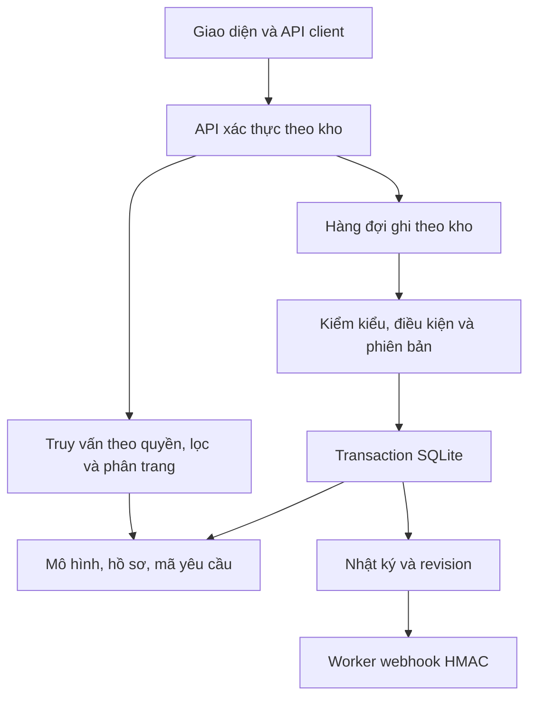

# Ma trận minh chứng kỹ thuật

Tài liệu phân biệt mã đã có, bài kiểm tự động và việc cần xác nhận trên môi trường triển khai. Số bài kiểm không phải phần trăm độ bao phủ hay cam kết không có lỗi.

| Năng lực | Mã / tài liệu | Minh chứng | Giới hạn |
| --- | --- | --- | --- |
| Core độc lập với giao diện | `selfhost/core-server.mjs`, `selfhost/server.mjs` | Job container CI kiểm app → core và từ chối thiếu token | Không kiểm SSO Keycloak end-to-end |
| Mô hình tạo biểu mẫu và hồ sơ | `lib/platform.mjs`, `app/platform.tsx` | `tests/platform.test.mjs`, đã kiểm trên trình duyệt: áp dụng mẫu mua sắm, tạo hồ sơ 20 triệu và tìm kiếm có/không có kết quả | JSON editor; chưa có trình thiết kế kéo thả |
| Thay đổi mô hình an toàn | plan/apply + lịch sử phiên bản | Kiểm schema không tương thích, version cũ và workflow đang chạy | Không có đổi tên trường tự động giữ dữ liệu |
| Phân quyền hồ sơ | `lib/platform-store.ts` | SQL lọc theo quyền trước đếm/phân trang; kiểm người khác và không gian khác | Vai cố định, chưa có scope theo đơn vị/nhóm được giao |
| Workflow theo dữ liệu | `examples/purchase/model.json` | 20 triệu bị chặn duyệt trực tiếp, chuyển cấp rồi owner duyệt | Finite-state engine; không phải BPMN |
| Chuyển dữ liệu cũ | `selfhost/migrate-platform.mjs` | Kiểm cả hai vùng kho, chạy lại, rollback khi có xung đột | Quay lui cần bản sao lưu trước nâng cấp |
| Vượt giới hạn lưu hồ sơ trong JSON | bảng `platform_records` | 1.000 hồ sơ lớn hơn tổng 1,8 MB, workspace JSON không tăng theo số hồ sơ | Kho truyền thống chưa được tách toàn bộ |
| Chống cập nhật đè và yêu cầu trùng | version + idempotency + hàng đợi theo kho | `platform-api`, `platform-storage`, `workspace-queue` tests | Hàng đợi trong một process; không tuyên bố HA |
| Nhật ký và webhook | ledger SHA-256, HMAC + persistent retries | Kiểm phát hiện sửa payload, retry, ký đúng body | Không có neo hash bên ngoài; không bảo đảm thứ tự giao |
| Sao lưu/khôi phục | `backup.mjs`, `verify-backup.mjs` | API dựng lại server từ bản sao lưu, hồ sơ/ledger còn nguyên | PostgreSQL Keycloak phải sao lưu riêng |
| Chức năng kho | domain, impact, scanner, inventory-view | Các test nghiệp vụ, thu hồi, đối chiếu mã và CSV trong `tests/` | Camera thật cần kiểm trên từng thiết bị |
| Hiệu năng | `tools/benchmark-platform.mjs` | [Kết quả và phạm vi đo](BENCHMARK.md) | Không đo SSO/TLS/gateway, không so trực tiếp với hệ thống khác |

## Cách kiểm tra độc lập

```bash
npm run build
npm test
python3 -m unittest discover -s tests -p '*_test.py'
node tools/benchmark-platform.mjs --records 10000 --seconds 15 --levels 1,10,25 --out /tmp/dxtrace-load.json
```

Script tải chỉ tạo dữ liệu trong thư mục tạm riêng, chạy server loopback và tự dọn. Không nhận URL VPS hay đường dẫn DB vận hành. Node.js 24 là yêu cầu. Kết quả tùy CPU, I/O và mức tải máy lúc chạy.

## Kiến trúc lưu trữ hồ sơ mở rộng



Các thay đổi kho truyền thống và hồ sơ mở rộng dùng chung hàng đợi ghi theo workspace. Revision trong DB vẫn bảo vệ xung đột ngoài process; version hồ sơ vẫn từ chối quyết định dựa trên dữ liệu cũ. Khi quá 100 lượt đang xử lý/chờ trong một kho, trả 503 để người gọi thử lại với cùng mã yêu cầu.

## Cần bổ sung trước khi công bố triển khai quy mô lớn

- Đo toàn stack có TLS/gateway/Keycloak trên VPS cấu hình cố định và thời gian đủ dài.
- Tự động hóa kiểm thử trình duyệt/SSO, kiểm camera trên điện thoại thật.
- Diễn tập lỗi đĩa, phục hồi toàn bộ dịch vụ và sao lưu ngoài máy.
- Ghi nhận hiệu quả thực tế tại kho với sự đồng ý của đơn vị thử nghiệm.
