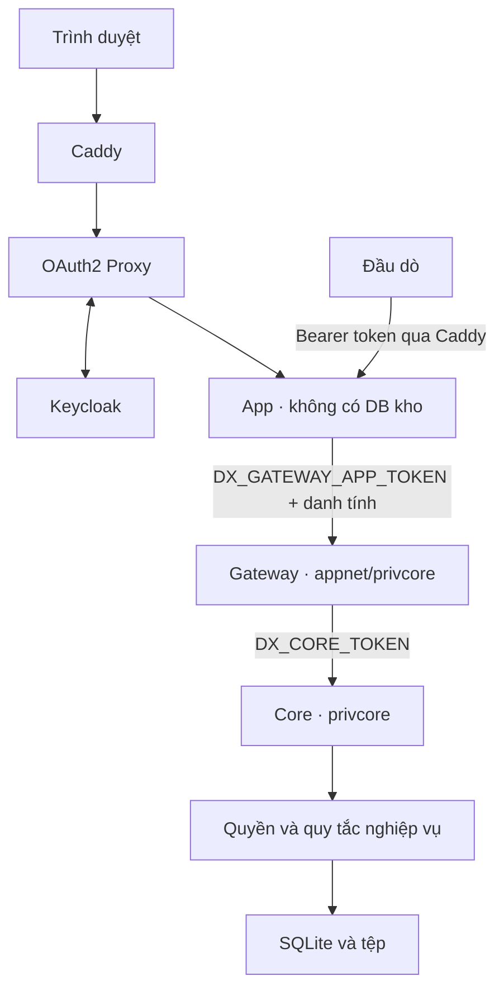

<!-- SPDX-FileCopyrightText: 2026 DX-TRACE contributors
SPDX-License-Identifier: MIT
DX-TRACE project authors: Đặng Nhật Minh, Nguyễn Ngọc Hiếu
-->
# Kiến trúc Headless Core

Áp dụng cho kiến trúc từ v0.0.7 và nhánh main. Các nâng cấp liên thông nghiệp vụ sau v0.0.7 được ghi riêng trong Changelog; AppKit/BPMN có từ v0.0.6. [Tổng quan](../README.md#architecture) · [API](API.md) · [Vận hành](../selfhost/OPERATIONS.md).

## Phân tách trách nhiệm

| Lớp | Mã / dịch vụ | Trách nhiệm |
| --- | --- | --- |
| Biên truy cập | Caddy, OAuth2 Proxy | HTTPS, định tuyến, phiên OIDC và header danh tính đã xác minh |
| Danh tính | Keycloak, PostgreSQL | Realm `warehouse`, client `dx-trace`, tài khoản và xác thực |
| Trình bày | `selfhost/server.mjs`, React | Giao diện thống nhất; chỉ nối appnet, không gắn volume kho |
| Gateway chính sách | `selfhost/apisix/apisix.yaml` | Apache APISIX mặc định; khóa app/Core riêng, giới hạn tuyến và tần suất |
| Lõi | `selfhost/core-server.mjs`, router API, `lib/` | Kiểm quyền theo kho, quy tắc, workflow, giao dịch, tệp và tích hợp |
| Dữ liệu | SQLite, filesystem | Một volume `warehouse` chỉ gắn ở Core |

Ba tiến trình `app`, `gateway-api` và `core` chạy riêng trong Docker, với appnet và privcore tách biệt. Các phân hệ Kho, Đề xuất nội bộ và Nghiệp vụ mở rộng nằm trong cùng frontend. Đường dẫn `/apps/approvals/` cũ chuyển về `/#requests`, không còn là ứng dụng độc lập để chứng minh tái sử dụng Core.

## Ranh giới tin cậy



1. Caddy bỏ header danh tính/token nội bộ do client gửi. OAuth2 Proxy cung cấp danh tính sau xác thực.
2. App chỉ kết nối appnet và dùng `DX_GATEWAY_APP_TOKEN` để gọi Gateway. Gateway giữ `DX_CORE_TOKEN` riêng và chỉ gọi Core trên privcore. Hai khóa phải khác nhau, không công bố cổng nội bộ. Caddy vẫn xử lý HTTPS và OAuth2 Proxy vẫn xác thực danh tính.
3. Core xác định thành viên bằng danh tính, email và workspace trong DB. Vai trò ứng dụng không tự lấy từ vai trò quản trị Keycloak.
4. Ngoại lệ OIDC là `POST /api/ingest`: Caddy đưa đến app, Core kiểm khóa đầu dò và ánh xạ workspace từ khóa đó. Tham số vùng kho không cho thiết bị đổi kho.
5. API ghi kiểm Origin khi có và từ chối `Sec-Fetch-Site: cross-site`. Các lệnh nghiệp vụ dùng mã yêu cầu chống trùng; không đưa token Core vào JavaScript frontend.

`database: true` ở `/api/health` cho biết runtime có DB binding; không thay thế integrity check, kiểm tra SSO hay kiểm tra nghiệp vụ.

## Cô lập kho và mô hình dữ liệu

Một danh tính thành viên hiện thuộc một tổ chức. Người chưa có lời mời sẽ được tạo kho riêng khi đăng nhập lần đầu; vì vậy cần mời email trước lần đăng nhập đầu nếu muốn dùng chung kho. Hai vùng thực hành/vận hành chọn dữ liệu riêng qua `area=training`, dùng chung thành viên của tổ chức.

Kho truyền thống lưu JSON trong `workspaces`, lịch sử cảm biến lưu bảng riêng. Từ v0.0.5, mô hình/hồ sơ mở rộng ở `platform_models/records/commands`. Các thao tác dùng chung hàng đợi theo workspace; DB revision vẫn kiểm xung đột ngoài process. Chưa có chứng minh HA hoặc hỗ trợ nhiều writer Core trong vận hành.

Tệp lưu theo SHA-256; metadata nằm trong kho. Tệp chưa có kết quả quét sạch bị chặn tải xuống. Ledger ghi lệnh thành công và webhook đọc ledger; thay đổi thành viên/cấu hình không nằm toàn bộ trong sổ lệnh này.

## Các loại workflow

- **Flowable OSS (overlay tùy chọn):** quy trình thẩm định độc lập, PostgreSQL riêng, fork/join, timer và phê duyệt; không tự chuyển trạng thái nghiệp vụ kho. [API](NATIVE-REVIEW.md).

- **Nghiệp vụ kho / đề xuất nội bộ:** quy tắc trong `domain.mjs` và `workflow.mjs`.
- **Nghiệp vụ mở rộng:** định nghĩa JSON, plan/apply, kiểu trường, vai trò, phạm vi đọc, điều kiện và version. [PLATFORM](PLATFORM.md) mô tả chi tiết.

Đây là máy trạng thái hữu hạn có **BPMN 2.0 interchange cho tập con được định nghĩa** ([đặc tả](BPMN.md)), chưa có BPMN executor tổng quát, nhánh song song, lịch tác vụ tự động hoặc designer kéo thả. Tái sử dụng hiện được thể hiện qua bốn mô hình dùng cùng API/lưu trữ/phân quyền, không phải nền tảng triển khai tùy ý mọi ứng dụng.

## Cách kiểm chứng

```bash
npx --yes pnpm@11.25.0 install --frozen-lockfile
npm run build
npm test
python3 -m unittest discover -s tests -p '*_test.py'
```

`tests/headless-core.test.mjs` kiểm hai tiến trình, token Core, không phục vụ UI từ Core và chuyển hướng đường dẫn cũ. `tests/platform-api.test.mjs` kiểm cách ly, quyền, xung đột, ledger và phục hồi. Job container CI dựng image và kiểm app → Gateway → Core trên mạng tách biệt; từ app không thể kết nối Core trực tiếp. Danh tính trong unit test là header mô phỏng; dùng [script kiểm thực tế](GATEWAY-AND-SSO.md) sau triển khai để kiểm OIDC/TLS bằng hai tài khoản thật.

## Demo cục bộ và giới hạn

`npm run demo` dùng backend cùng tiến trình, danh tính thử và loopback để chạy được trên PC không Docker. Không dùng chế độ này làm bằng chứng SSO hay phân tách dịch vụ.

Caddy là biên HTTPS; Gateway nội bộ có policy hạn chế nhưng chưa có cổng tự đăng ký API client bên ngoài, quota phân tán hoặc quản trị policy nâng cao. Có truy vết cảm biến và xuất dữ liệu lạnh kiểm checksum; chưa có lakehouse, lineage toàn hệ thống, GitOps tự phục hồi, quét mã độc mặc định, object storage phân tán hoặc PostgreSQL cho nghiệp vụ. AI là tích hợp tùy chọn, không phải thành phần bắt buộc của Core.

## Đóng gói ứng dụng khai báo

`lib/appkit.mjs` và `GET/POST /api/apps` cho phép cài một mô hình nghiệp vụ theo manifest có phiên bản, không chạy mã ngoài. Các mẫu bảo trì và mua sắm được đóng gói trong `examples/*/app.json`, kế thừa SSO, quyền, workflow, transaction và audit. Giới hạn và cách tái tạo: [AppKit](APPKIT.md).
