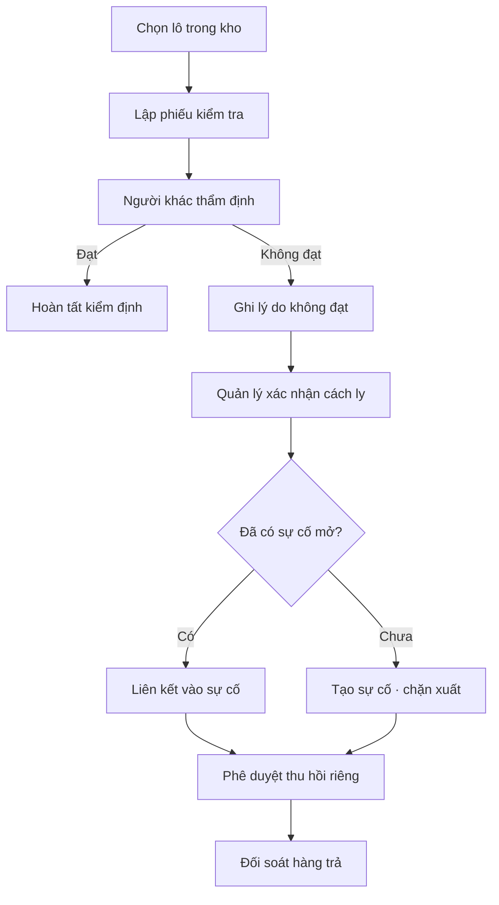

<!-- SPDX-FileCopyrightText: 2026 DX-TRACE contributors
SPDX-License-Identifier: MIT
DX-TRACE project authors: Đặng Nhật Minh, Nguyễn Ngọc Hiếu
-->
# Quy trình vận hành liên thông

Phạm vi: v0.2.0. Giữ nguyên dữ liệu và hai vùng **Kho thực hành / Kho vận hành**; không nạp lại dữ liệu khi nâng cấp.

## 1. Từ kiểm định không đạt đến cách ly

Trong Quality Portal, chọn lô từ danh sách của kho hiện tại. Sau khi gửi thẩm định, một người khác có vai trò quản lý/chủ không gian ghi quyết định. Với phiếu không đạt, quản lý chọn **Cách ly & mở sự cố**, nhập lý do và mức ưu tiên.

Core kiểm quyền, phiên bản phiếu, trạng thái `rejected`, mã lô và phạm vi kho. Việc liên kết phiếu, cách ly lô, lưu kết quả chống gửi trùng và ghi ledger nằm trong một transaction SQLite. Nếu lô có sự cố mở, hệ thống liên kết phiếu vào sự cố đó; mức ưu tiên và quyết định của sự cố cũ được giữ nguyên. Không tự động phê duyệt thu hồi hoặc xóa dữ liệu.

Phiếu cũ chỉ có mã lô vẫn được đọc. Muốn liên kết, mã đó phải khớp chính xác một lô hiện có. Không suy đoán lô từ tên sản phẩm, mã vạch hoặc dữ liệu kho khác. Một phiếu chỉ liên kết một lần. Khi có xung đột phiên bản, tải lại trước khi quyết định.

Bài kiểm [quality-portal.test.mjs](../tests/quality-portal.test.mjs) kiểm khác người duyệt, sai vai trò, khác tổ chức, khác vùng kho, gửi lại cùng khóa, tranh chấp phiên bản, liên kết sự cố đang mở và chặn cả xuất mới lẫn giao phiếu đã giữ.

## 2. Việc cần làm

Mục **Việc cần làm** hiện sẵn trong điều hướng. Người dùng nhìn thấy các việc theo quyền:

- Quản lý/chủ không gian: sự cố đang mở và đề xuất chờ duyệt.
- Người thao tác kho: phiếu đã giữ hàng chờ giao.
- Hồ sơ mở rộng: bước đang hoạt động mà người dùng được thực hiện, có xét điều kiện dữ liệu và cấm tự duyệt.

Sự cố và hồ sơ quá hạn được ưu tiên. Liên kết tới hồ sơ giữ nguyên vùng kho. Danh sách xét tối đa 200 hồ sơ mở rộng gần hạn nhất, phân trang phần hiển thị 25 mục; nếu còn dữ liệu, giao diện ghi rõ giới hạn và dẫn đến danh sách đầy đủ. Đây là danh sách hỗ trợ điều phối, không thay thế kiểm quyền khi ghi tại Core.

## 3. Workflow song song trên giao diện

Chủ không gian chọn mẫu **Bảo trì · kiểm tra song song** trong Nghiệp vụ mở rộng, xem kế hoạch rồi áp dụng. Mẫu có mã riêng `maintenance_parallel`, không thay thế mô hình bảo trì cũ.

Nhân viên kho tạo hồ sơ và hoàn tất bước `intake`. Quy trình tách hai nhánh: một quản lý khác người tạo xử lý `quality_review`; nhánh còn lại chờ timer 60 giây rồi chủ không gian xử lý `owner_signoff`. Chỉ khi cả hai nhánh hoàn tất, hồ sơ chuyển `done`. Giao diện hiển thị bước đang chờ, mốc timer và lịch sử, chỉ cung cấp nút cho người được phép.

Đây là runtime JSON giới hạn một fork/join, không phải trình thiết kế BPMN tổng quát. Xem [đặc tả runtime](PROCESS-RUNTIME.md).

## 4. Chuẩn bị minh chứng

Mở **Nhật ký**, kiểm chuỗi rồi tải gói sự kiện và mốc đối chiếu. Giữ mốc ngoài máy chủ để kiểm tra lần xuất sau bằng [công cụ xác minh độc lập](AUDIT-EVIDENCE.md). Đối với cuộc trình diễn, ghi SHA mã nguồn, vai trò tài khoản, vùng kho và kết quả từng bước; không sử dụng dữ liệu mẫu làm bằng chứng vận hành tại doanh nghiệp.
