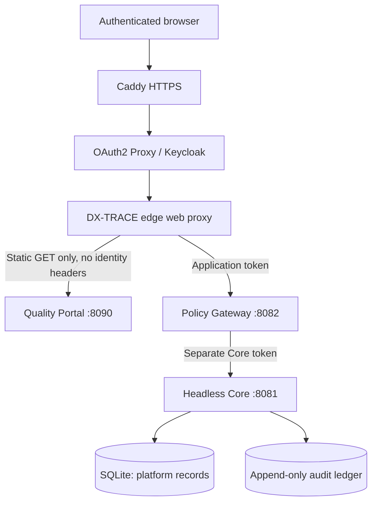

# Quality Control Portal — independent DX-OS application

> Frontend độc lập có từ **v0.0.6**. Phần liên thông kiểm định–cách ly dưới đây thuộc **main sau v0.0.7**, chưa có trong archive v0.0.7.

## Purpose and architecture

This is a second, independently served frontend for inspecting product batches.
It reuses the existing DX-TRACE Core and has **no database connection, Core
service token, business logic write permission, or Keycloak client secret**.
The application package consists of a static UI service and an AppKit manifest.
All record and workflow decisions remain in Core.



The frontend is an independently deployed Node.js process and Docker service
(`quality-portal`), even though it intentionally shares the **same external
origin** and authenticated session as the main warehouse UI. Its static assets
are routed at `/apps/quality/`; its browser code calls the same-origin
`/api/apps` and `/api/models/quality/*` endpoints.

This is **not** a general executable plugin system or a BPMN engine.
The business process still uses the documented DX-TRACE finite-state workflow
and optional BPMN subset interchange.

## Run from source

Requirements: Node.js 24, a clean checkout of tag v0.0.6 or a documented later commit.
To serve the static frontend by itself:

```sh
PORT=8090 BIND_ADDRESS=127.0.0.1 node apps/quality-portal/server.mjs
curl -i http://127.0.0.1:8090/apps/quality/
curl -i http://127.0.0.1:8090/apps/quality/.env
```

The first GET should return HTML; the second must return 404. The standalone
service has **no API or demo credentials**. To perform business operations,
run it behind the DX-TRACE authenticated web proxy.

For a new Docker Compose installation:

```sh
cd selfhost
docker compose config --quiet
docker compose up -d --build
docker compose ps
```

Use the full stack with Keycloak, OAuth2 Proxy, gateway and HTTPS according
to [self-hosting](../selfhost/README.md) for an actual SSO demo.
`quality-portal` has no published host port and joins `appnet` only.
The Core remains on `privcore`, its volume is not mounted into the portal,
and the main frontend still does not mount the warehouse volume.

On a host using the Ubuntu/Windows Caddy overlay, the same application route
is available through the authenticated `app` edge. Existing production stacks
must be rebuilt and deployed from the new commit. **Merging this PR does not
automatically update a running VPS.**

## Demonstration (two genuine users)

1. Log in as the warehouse owner, visit `/apps/quality/`, and click
   **Kiểm tra kế hoạch và cài ứng dụng**. The client calls
   `POST /api/apps/plan` before `POST /api/apps/install`, using its own
   idempotency key. Installation is rejected for non-owner roles.
2. Log in as staff with `warehouse` role. Create the record
   `LOT-QA-001`, then transition **Bản nháp → Chờ thẩm định**.
3. Verify the creator cannot approve their own record. Log in with
   a **different** manager account and approve it.
4. Open **Nghiệp vụ mở rộng** in the warehouse UI. The installed app appears
   via the AppKit manifest and links back to `/apps/quality/`. Both UIs
   access the **same persisted record**, shared roles, audit ledger and model.
5. Stop only the frontend: `docker compose stop quality-portal`.
   The portal returns a 503, but the warehouse and Core API remain operational.
   Restore with `docker compose start quality-portal`.

Do not claim this proves a full Keycloak OIDC E2E test: the automated test
uses request identities in a controlled loopback environment. A real
two-account Keycloak demonstration remains a manual acceptance step.

## Automated acceptance

```sh
node --test tests/quality-portal.test.mjs tests/appkit.test.mjs
npm test
```

`tests/quality-portal.test.mjs` starts **three separate Node processes**:
`quality-portal`, `app`, and `core`. It verifies static routing, CSP,
private Core token, anonymous denial, manifest installation, user separation,
second-actor approval, tenant isolation, audit verification and failure
isolation when the portal process is stopped.

The CI container job builds the production image and starts all three
processes on an isolated Docker network. Neither test alone demonstrates
performance, production hardening, persistent SSO or browser compatibility.

## Safety boundaries and limitations

- The portal never receives the Core internal token or user identity headers;
  all API requests pass via the authenticated same-origin edge.
- No UI HTML is taken from business data: dynamic content uses `textContent`,
  not `innerHTML`; a strict Content Security Policy is applied.
- The AppKit manifest may specify only a vetted same-origin
  `/apps/{id}/` entrypoint, never remote JavaScript or arbitrary paths.
- Role, tenant, version and anti-self-approval checks are applied in Core.
  Client-side button visibility is for usability, **not authorization**.
- The record's `lot` field is a reference string, **not** a validated foreign
  key to the warehouse inventory. The quality decision does **not**
  automatically quarantine stock or authorize a recall.
- The core still uses SQLite and the existing finite-state engine. This
  upgrade does not claim APISIX, Flowable, high availability or multi-region
  operation.

## Source map

| Role | Path |
| --- | --- |
| Static server | `apps/quality-portal/server.mjs` |
| Independent frontend | `apps/quality-portal/index.html`, `app.js`, `styles.css` |
| Application manifest | `apps/quality-portal/manifest.json` |
| Manifest boundary and discovery | `lib/appkit.mjs`, `lib/platform.mjs` |
| Reverse proxy boundary | `selfhost/server.mjs` |
| Deployment | `selfhost/compose.yaml`, `selfhost/Dockerfile` |
| Tests | `tests/quality-portal.test.mjs`, `selfhost/container-smoke.mjs` |

## Kiểm định gắn với kho hiện tại

Cổng giữ `?area=training` xuyên suốt các API và liên kết khi người dùng chọn kho thực hành. Phiếu mới chọn mã lô từ dữ liệu kho, có tìm kiếm, lọc trạng thái và phân trang 25 mục. Hồ sơ không đạt cung cấp **Cách ly & mở sự cố** cho manager/owner; cần xác nhận lý do. Ghi phiếu, trạng thái lô, liên kết sự cố, kết quả idempotency và ledger trong một transaction. Sự cố đã mở được tái sử dụng; không tự phê duyệt thu hồi.

Đọc [quy trình liên thông](OPERATING-WORKFLOWS.md) để thực hiện kiểm thử hai người. Lịch sử phiếu và liên kết ngược đến sự cố/lô nằm ngay trong cổng. Các dữ liệu và phiên bản mô hình cũ được giữ nguyên.
