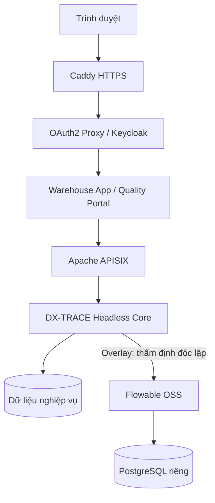

# Chuyển đổi Apache APISIX và Flowable OSS

**Trạng thái main (chưa phát hành):** Apache APISIX 3.21.0 là gateway mặc định trong Compose. Overlay Flowable OSS 7.2.0 thực thi quy trình thẩm định độc lập; nghiệp vụ kho và AppKit hiện hữu vẫn dùng runtime cũ. CI tích hợp PR #35 đã đạt; nghiệm thu VPS chưa xác nhận. [English](en/third-party-core-migration.md).

## Kiến trúc mục tiêu



| Thành phần | Bản mặc định hiện tại | Phương án chuyển đổi |
| --- | --- | --- |
| API Gateway | APISIX standalone mặc định | Node gateway giữ cho kiểm thử cũ |
| Workflow | Engine cũ cho kho/AppKit | Overlay Flowable REST cho thẩm định độc lập |
| SSO | Keycloak + OAuth2 Proxy | Giữ nguyên |
| Dữ liệu nghiệp vụ | SQLite và kho tệp | Giữ nguyên; PostgreSQL mới chỉ phục vụ Flowable |

Flowable điều phối hồ sơ thẩm định độc lập qua API; chưa điều phối toàn bộ hồ sơ kho. Quyền theo kho, chống tự duyệt, audit và tính toàn vẹn giao dịch vẫn thuộc Core. Các API công khai và sơ đồ kiến trúc hiện hành chưa thay đổi.

## Kiểm thử trên môi trường cô lập

Cần Docker Compose 2.24.4 trở lên. Tạo tệp `.env` riêng theo hướng dẫn cài đặt; thêm hai bí mật ngẫu nhiên tối thiểu 32 ký tự `DX_FLOWABLE_DB_PASSWORD` và `DX_FLOWABLE_API_PASSWORD`. Không tái sử dụng khóa Core hoặc gateway, không commit bí mật.

Tại thư mục `selfhost`:

```sh
docker compose -p dxtrace-migration -f compose.yaml -f compose.third-party.yaml --profile migration-test config --quiet
docker compose -p dxtrace-migration -f compose.yaml -f compose.third-party.yaml up -d --build core gateway-api flowable
docker compose -p dxtrace-migration -f compose.yaml -f compose.third-party.yaml --profile migration-test run --rm migration-smoke
docker compose -p dxtrace-migration -f compose.yaml -f compose.third-party.yaml down
```

Chỉ chạy trên môi trường thử nghiệm có project name riêng. Không xóa volume production. Kịch bản kiểm engine thật, API thẩm định, app độc lập, IT/OT và lineage. Không chạy trên production. [CI PR #35](https://github.com/ngochieu1762005/dx_trace/actions/runs/45645226792).

## Điều kiện chuyển sang vận hành

- Kiểm chứng APISIX: xác thực, nguồn header, rate limit, kích thước request/response, chuyển hướng và tương thích API.
- Ánh xạ phiên bản model, workspace, process instance và task vào Flowable; giữ kiểm quyền tại Core.
- Dùng outbox bền vững, đối soát retry không rõ kết quả, chống khởi tạo trùng và giữ audit.
- Hoàn tất hoặc di chuyển quy trình cũ đang chạy trước khi tắt timer worker; không chạy lại phê duyệt lịch sử.
- Nghiệm thu cô lập tenant, mất kết nối, khởi động lại, sao lưu/khôi phục, rollback và SSO trên VPS.
- Cập nhật SBOM, giấy phép, digest image và tài liệu phát hành trước khi chuyển mặc định.

## Nguồn và giấy phép

[Apache APISIX](https://github.com/apache/apisix) 3.21.0 và [Flowable OSS](https://github.com/flowable/flowable-engine) 7.2.0 dùng Apache-2.0. PostgreSQL 17 dùng PostgreSQL License. Tag image đã chạy trong CI tích hợp PR #35; chưa khóa digest và chưa xác nhận production.

[Cấu hình triển khai](../selfhost/compose.third-party.yaml) · [CI tích hợp](../.github/workflows/third-party-core.yml) · [Kiến trúc hiện tại](HEADLESS-CORE.md).
