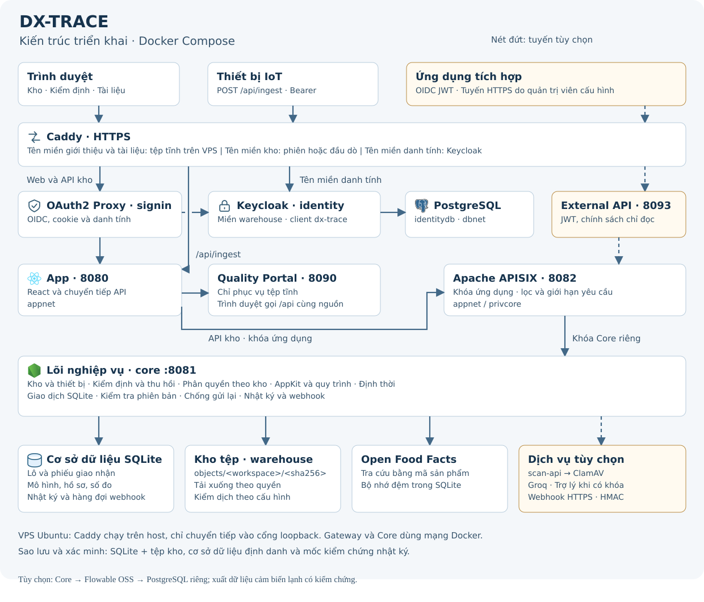

# System map

## Request path

Caddy and OAuth2 Proxy authenticate at the edge. The presentation App sends a request to the internal Gateway with its own service credential. Gateway forwards to Core using a separate credential. Core enforces role, workspace, workflow and version checks and persists changes with audit evidence.

## Storage and optional services

Keycloak has its own PostgreSQL identity database. Core uses SQLite and content-addressed files. Optional external OIDC API, scanner and webhook have explicit configuration and trust boundaries. Quality Portal is a separate frontend, not a database client.

## Full source and translation status

This English edition is a curated guide, not a line-for-line translation. For exact implementation details, see the [canonical source](../../website/content/architecture-map.md).
