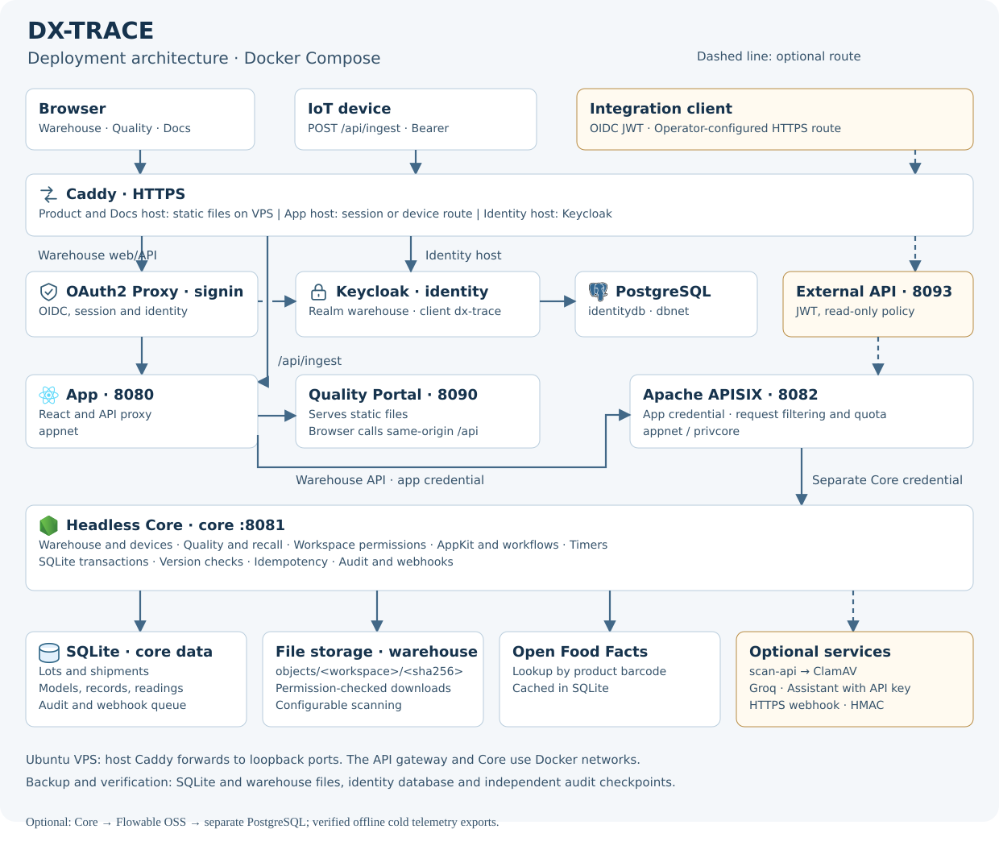

# DX-TRACE documentation

DX-TRACE v0.2.0 uses Apache APISIX as its default Compose gateway. The optional Flowable service runs independent reviews. [Integration guide](third-party-core-migration.md).

DX-TRACE is an MIT-licensed open-core platform for food supply-chain traceability, quality control and coordinated recalls. The same headless core serves a warehouse application and an independently deployed Quality Portal.

## Explore the platform

- [Quick start](quickstart.md): run a local training workspace.
- [Architecture](architecture-map.md): understand trust boundaries and shared services.
- [Build an application](app-tutorial.md): use declarative AppKit manifests.
- [API reference](api-reference.md): integrate with the core.

## Current scope

Core storage remains SQLite; the PostgreSQL tool supports an offline verified migration rehearsal, not a running PostgreSQL Core. BPMN is a documented subset. Production SSO, malware scanning and recovery require deployment-specific acceptance. Main-branch features may be newer than published releases.

## Choose a starting point

| Task | Guide | Completion check |
| --- | --- | --- |
| Understand a real warehouse decision | [HDPI case](hdpi.md) | Explain why a reservation and delivered stock need different actions. |
| Receive a lot | [Warehouse operations](warehouse-guide.md) | Trace the lot back to its supplier and forward to its destination. |
| Connect a sensor | [Ingestion](sensor-guide.md) | Resending the same sample represents one measurement. |
| Build a Core client | [Application tutorial](app-tutorial.md) and [API conventions](api-auth.md) | A second authorised user processes a record and the history identifies the actor. |
| Hand over a server | [Deployment checks](deployment-checklist.md) and [recovery](backup-restore.md) | Sign in through a browser and read an existing record in a separate restored environment. |

## Full source and translation status

This English edition is a curated guide, not a line-for-line translation. For exact implementation details, see the [canonical source](../../website/content/intro.md).
