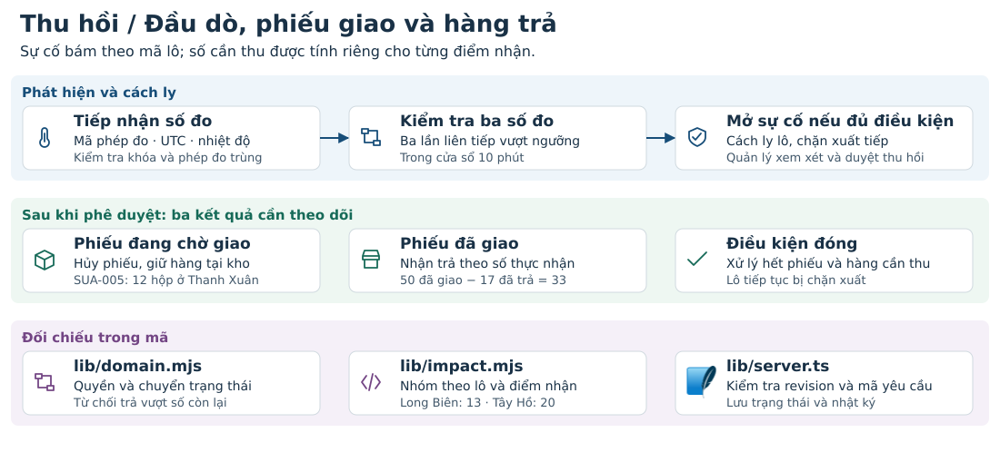

# API và quy tắc nghiệp vụ

| Thành phần | Trách nhiệm |
| --- | --- |
| [Bộ định tuyến HTTP](../app/api/%5B...path%5D/route.ts) | Xác thực yêu cầu, đọc tham số, kiểm tra đầu vào và ánh xạ sang lệnh. |
| [server.ts](server.ts) | Xác định kho, tải trạng thái, kiểm tra mã yêu cầu và lưu theo phiên bản. |
| [domain.mjs](domain.mjs) | Kiểm tra quyền và điều kiện nghiệp vụ trước khi cập nhật lô, phiếu hoặc sự cố. |
| [impact.mjs](impact.mjs) | Tổng hợp các phiếu theo lô và điểm nhận. |
| [workflow.mjs](workflow.mjs) | Định nghĩa trạng thái, vai trò và chuyển bước của đề xuất nội bộ. |
| [demo.mjs](demo.mjs) | Khởi tạo và bổ sung dữ liệu cho kho thực hành. |

## Ranh giới giữa lệnh và báo cáo

Lệnh nhận trả cập nhật phiếu; báo cáo tác động đọc các phiếu của cùng lô và nhóm theo điểm nhận. Khi sửa cách tính, đối chiếu cả số tổng của lô lẫn số dư tại mỗi cửa hàng.

[Kiến trúc toàn dự án](../README.md#architecture) · [Danh mục API](../docs/API.md)

## Các đường dẫn tích hợp

| Phương thức | Đường dẫn | Ý nghĩa |
| --- | --- | --- |
| GET | `/api/state?area=training` | Trạng thái kho thực hành của tài khoản đang đăng nhập. |
| GET | `/api/impact/{lotId}?area=training` | Đối soát một lô theo ID nội bộ, kèm số phiên bản và từng điểm nhận. |
| POST | `/api/shipments/{id}/return` | Ghi số lượng nhận trả cho một phiếu đã giao trong đợt thu hồi được duyệt. |
| POST | `/api/incidents/{id}/approve` | Phê duyệt thu hồi theo quyền quản lý. |
| GET | `/api/platform` | Danh mục ứng dụng và định nghĩa workflow. |
| POST | `/api/ingest` | Nhận nhiệt độ, mã phép đo và thời gian UTC, xác thực qua khóa thiết bị. |

Các ví dụ có `{id}` dùng ID bản ghi. Để thao tác trong kho thực hành, giữ `area=training` trên cả yêu cầu đọc và ghi. Lệnh nghiệp vụ gửi bằng POST với phiên cùng nguồn và header `Idempotency-Key`. Nếu mất kết nối sau khi bấm lưu, gửi lại cùng khóa và nội dung để tránh ghi hai lần. Với đầu dò, mã phép đo đảm nhiệm việc phát hiện bản gửi trùng.

## Đối soát thu hồi

Giữ bốn đại lượng riêng cho từng lô: đã giao, đã nhận trả, còn phải thu và đang giữ trên phiếu chưa giao. Phiếu hủy không tham gia phép tính. Số còn phải thu bằng số đã giao trừ số đã nhận trả. Một phiếu giao 30 hộp và nhận lại 17 hộp còn 13 hộp phải thu; phiếu giữ 12 hộp ở kho được xử lý bằng thao tác hủy trước khi đóng sự cố.

Trạng thái sự cố đi từ chờ duyệt đến đã phê duyệt rồi đóng. API từ chối nhận trả vượt số còn lại và từ chối đóng khi còn phiếu chờ giao hoặc số hàng cần thu. Khi sửa các quy tắc này, kiểm tra đồng thời dữ liệu phiếu, tổng hợp theo điểm nhận và nhật ký của thao tác.

[Hướng dẫn kết nối cảm biến](../selfhost/README.md) · [Kiểm thử và đóng góp](../CONTRIBUTING.md)
