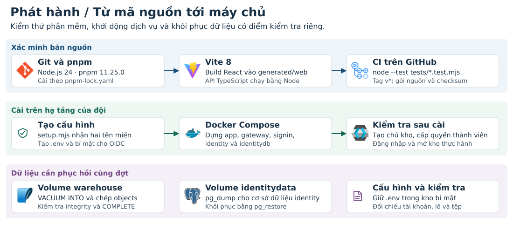

# Triển khai DX-TRACE trên máy chủ riêng

Tài liệu dành cho người cài đặt kho lần đầu hoặc tiếp quản một máy chủ đang vận hành. Các lệnh cài đặt bắt đầu từ thư mục gốc của DX-TRACE. Sau bước chuyển vào `selfhost/`, chạy các lệnh Docker Compose tại thư mục đó. Bản triển khai tách hai tiến trình: web proxy và [API headless nội bộ](../docs/HEADLESS-CORE.md).

## Sơ đồ cài đặt và phục hồi



Khi chuyển máy chủ, kiểm tra riêng ba phần: dịch vụ đăng nhập, dữ liệu kho và nội dung tệp. Một bản build mới có thể chạy trước khi bất kỳ dữ liệu sản xuất nào được phục hồi.

[Kiến trúc toàn dự án](../README.md#architecture) · [Danh mục API](../docs/API.md)

## 1. Chuẩn bị

| Thành phần | Yêu cầu |
| --- | --- |
| Máy chủ | Docker Engine, Docker Compose v2 và Node.js để chạy trình tạo cấu hình. Container ứng dụng dùng Node.js 24. |
| DNS | Hai tên miền khác nhau cùng trỏ về máy chủ, ví dụ `kho.example.org` cho web và `id.example.org` cho đăng nhập. |
| Mạng | Cổng TCP 80 và 443 đến Caddy. Máy chủ cần tải được image và các gói phụ thuộc ở lần dựng đầu tiên. |
| Lưu trữ | Volume bền vững cho dữ liệu kho, tài khoản và chứng chỉ TLS. Dành vị trí riêng để giữ bản sao lưu. |

## 2. Khởi động lần đầu

Thay hai tên miền ví dụ bằng tên miền thực. Tham số thứ nhất là web kho, tham số thứ hai là máy chủ danh tính.

```sh
node selfhost/setup.mjs kho.example.org id.example.org
cd selfhost
docker compose config --quiet
docker compose up -d --build
docker compose ps
```

Trình thiết lập tạo `.env` với quyền đọc/ghi cho chủ sở hữu và từ chối ghi đè tệp đã tồn tại. Nếu máy đã có cấu hình, giữ tệp hiện tại rồi chạy từ bước kiểm tra Compose. Dùng `https://kho.example.org` để mở kho và `https://id.example.org/admin/` để mở trang quản trị danh tính.

| Biến trong `.env` | Công dụng |
| --- | --- |
| `APP_HOST`, `ID_HOST` | Tên miền ứng dụng và danh tính, dùng khi cấu hình HTTPS, issuer và callback. |
| `ADMIN_PASSWORD` | Mật khẩu khởi tạo của quản trị viên Keycloak có username `admin`. |
| `DB_PASSWORD` | Mật khẩu PostgreSQL của dịch vụ danh tính. |
| `OIDC_CLIENT_SECRET` | Bí mật dùng chung giữa OAuth2 Proxy và OIDC client `dx-trace`. |
| `COOKIE_SECRET` | Khóa bảo vệ cookie phiên đăng nhập. |
| `DX_CORE_TOKEN` | Mật mã nội bộ ủy quyền cho web chuyển tiếp API tới core. Cần thêm khi nâng cấp từ bản `.env` cũ. |

Giữ bản sao `.env` trong kho bí mật của đơn vị. Nếu cập nhật từ bản trước, tạo thêm `DX_CORE_TOKEN` có ít nhất 32 ký tự ngẫu nhiên (ví dụ 64 ký tự hex) rồi mới khởi động lại Compose. `core` không khai báo cổng public, chỉ phục vụ web trong mạng Docker.
 Việc thay mật khẩu quản trị sau khi Keycloak đã khởi tạo được thực hiện trong Keycloak.

## 3. Tạo chủ kho và tài khoản giám khảo

1. Đăng nhập trang quản trị danh tính bằng `admin`. Chọn realm **warehouse**.
2. Trong **Users → Add user**, tạo tài khoản chủ kho có email. Xác minh email, bật **Email verified** và đặt mật khẩu tại **Credentials**. Bật **Temporary** nếu cần đổi mật khẩu ở lần đăng nhập đầu tiên.
3. Dùng **tài khoản chủ kho** đăng nhập tên miền ứng dụng. Có thể mở thêm `https://kho.example.org/apps/approvals/index.html` để thử ứng dụng phê duyệt độc lập. Hệ thống khởi tạo không gian làm việc.
4. Tạo tài khoản giám khảo trong cùng realm. Trong DX-TRACE, chủ kho vào **Cài đặt không gian → Thêm thành viên** và nhập đúng email đó **trước khi giám khảo đăng nhập lần đầu**.
5. Chọn quyền theo bảng dưới. Gửi giám khảo địa chỉ `https://kho.example.org/?area=training#overview` để mở kho thực hành.

| Vai trò | Thao tác điển hình |
| --- | --- |
| Chủ không gian | Quản lý thành viên, quyền truy cập và cấu hình kho. |
| Quản lý | Theo dõi vận hành, duyệt thu hồi, quản lý thiết bị và đóng sự cố đủ điều kiện. |
| Nhân viên kho | Nhập lô, lập phiếu giao, ghi nhận sự cố và tiếp nhận hàng trả theo quy trình. |
| Chỉ xem | Tra cứu lô, phiếu và trạng thái xử lý. |

Tài khoản quản trị Keycloak dùng để quản lý danh tính. Quyền xử lý nghiệp vụ được cấp trong từng kho. Realm mặc định tắt tự đăng ký. Thêm email ở màn hình thành viên ghi nhận quyền truy cập; người quản trị cần chuyển thông tin đăng nhập cho người dùng qua kênh riêng.

## 4. Kiểm tra sau cài đặt

| Kiểm tra | Kết quả mong đợi |
| --- | --- |
| Mở tên miền kho trong cửa sổ riêng tư | Trình duyệt chuyển đến tên miền danh tính rồi quay về kho sau khi đăng nhập. |
| Vào kho thực hành | Trang tổng quan hiển thị lô SUA-005. Hồ sơ truy xuất dẫn đến các phiếu phân phối của lô. |
| Dùng tài khoản chỉ xem | Xem được dữ liệu của kho đã cấp quyền. Các thao tác sửa bị kiểm tra quyền ở API. |
| Đăng nhập bằng quản lý | Có thể duyệt sự cố đang chờ trong kho thực hành. |
| Quét tem trên điện thoại | Mở web bằng HTTPS, cấp quyền camera và quét tem của lô đang có trong kho. |

Caddy chuyển lưu lượng web qua OAuth2 Proxy. Máy chủ ứng dụng chỉ nhận danh tính đã xác thực từ proxy. Giữ các cổng nội bộ của ứng dụng và proxy trong mạng Compose. Riêng yêu cầu `POST /api/ingest` đi trực tiếp tới API để xác thực bằng khóa thiết bị.

## 5. Kết nối cảm biến

Mở **Thiết bị → Kết nối thiết bị**, chọn lô và lưu khóa được hiển thị một lần. Ví dụ dưới đây dùng Bash; thay tên miền bằng địa chỉ web kho. Mỗi phép đo có mã riêng, nhiệt độ dạng số và thời gian UTC gần thời điểm gửi.

```bash
read -rsp 'Khóa thiết bị: ' SENSOR_TOKEN
echo
recorded=$(date -u +%Y-%m-%dT%H:%M:%SZ)
sample_id=$(cat /proc/sys/kernel/random/uuid)
curl --fail-with-body https://kho.example.org/api/ingest \
  -H "Authorization: Bearer ${SENSOR_TOKEN}" \
  -H 'Content-Type: application/json' \
  --data "{\"id\":\"${sample_id}\",\"temperature\":4.5,\"recorded\":\"${recorded}\"}"
unset SENSOR_TOKEN
```

Mở **Thiết bị → Lịch sử nhiệt độ** để kiểm tra. Khi gửi lại do mất kết nối, dùng cùng mã và nội dung của phép đo ban đầu. Đồng bộ đồng hồ thiết bị; API kiểm tra cửa sổ thời gian 10 phút. Có thể thu hồi khóa ngay ở thẻ thiết bị.

## 6. Sao lưu và phục hồi

Có ba phần cần giữ cùng một đợt sao lưu: dữ liệu nghiệp vụ và tệp đính kèm, cơ sở dữ liệu danh tính, cấu hình bí mật. Từ `selfhost/`, sử dụng nhãn thời gian mới cho mỗi đợt.

```sh
umask 077
stamp=$(date -u +%Y%m%dT%H%M%SZ)
docker compose exec -T app node selfhost/backup.mjs "/tmp/warehouse-${stamp}"
docker compose cp "app:/tmp/warehouse-${stamp}" "./warehouse-${stamp}"
docker compose exec -T identitydb pg_dump -U keycloak -Fc identity > "identity-${stamp}.dump"
test -f "./warehouse-${stamp}/COMPLETE"
```

Công cụ sao lưu chụp SQLite, kiểm tra tính toàn vẹn và kiểm tra sự hiện diện của từng tệp được tham chiếu trước khi ghi `COMPLETE`. Lưu các bản sao ngoài máy chủ và bảo vệ như dữ liệu sản xuất. Chức năng xuất JSON trên giao diện phục vụ tra cứu; bản sao cơ sở dữ liệu mới bao gồm toàn bộ lịch sử cảm biến.

**Phục hồi trên môi trường mới.** Khôi phục cấu hình bí mật tương ứng và dựng các volume mới. Trong khi ứng dụng dừng, chép nội dung thư mục kho có dấu `COMPLETE` vào volume gắn tại `/app/data`, cấp quyền cho UID 1000. Khởi động riêng `identitydb`, dùng `pg_restore` nạp bản dump vào cơ sở dữ liệu `identity` trống trước khi chạy Keycloak. Sau khi khởi động toàn bộ dịch vụ, đăng nhập bằng tài khoản cũ và đối chiếu một lô, một phiếu, một tệp đính kèm và quyền thành viên. Bộ kiểm thử HTTP bao phủ phục hồi kho và tệp; DNS, TLS và phục hồi danh tính cần được diễn tập trên hạ tầng triển khai.

## 7. Chẩn đoán nhanh

| Triệu chứng | Kiểm tra |
| --- | --- |
| HTTPS chưa hoạt động | Kiểm tra bản ghi DNS của cả hai tên miền, cổng 80/443 và log `gateway`. |
| Đăng nhập lặp hoặc callback lỗi | Đối chiếu `APP_HOST`, `ID_HOST`, callback `/oauth2/callback` và OIDC client trong realm `warehouse`. |
| Thành viên vào một kho trống | Đối chiếu email đã xác minh với email được cấp quyền, thời điểm đăng nhập đầu tiên và kho đang chọn. |
| Cảm biến gửi lỗi | Kiểm tra tên miền ứng dụng, phương thức POST, khóa, mã phép đo và giờ UTC của thiết bị. |
| Không thể đóng sự cố | Kiểm tra phiếu chưa hủy và số lượng còn phải thu tại từng điểm nhận. |
| Camera không mở | Mở web trong tab riêng bằng HTTPS, kiểm tra quyền camera hoặc chọn đọc mã từ ảnh. |

```sh
docker compose ps
docker compose logs --tail=100 gateway signin identity app
```

Để cập nhật mã nguồn, sao lưu trước, giữ cấu hình và volume hiện tại, rồi chạy lại `docker compose up -d --build`. Khi cần dừng dịch vụ, `docker compose stop` giữ các volume để có thể khởi động lại.

[Quay về tài liệu dự án](../README.md)
