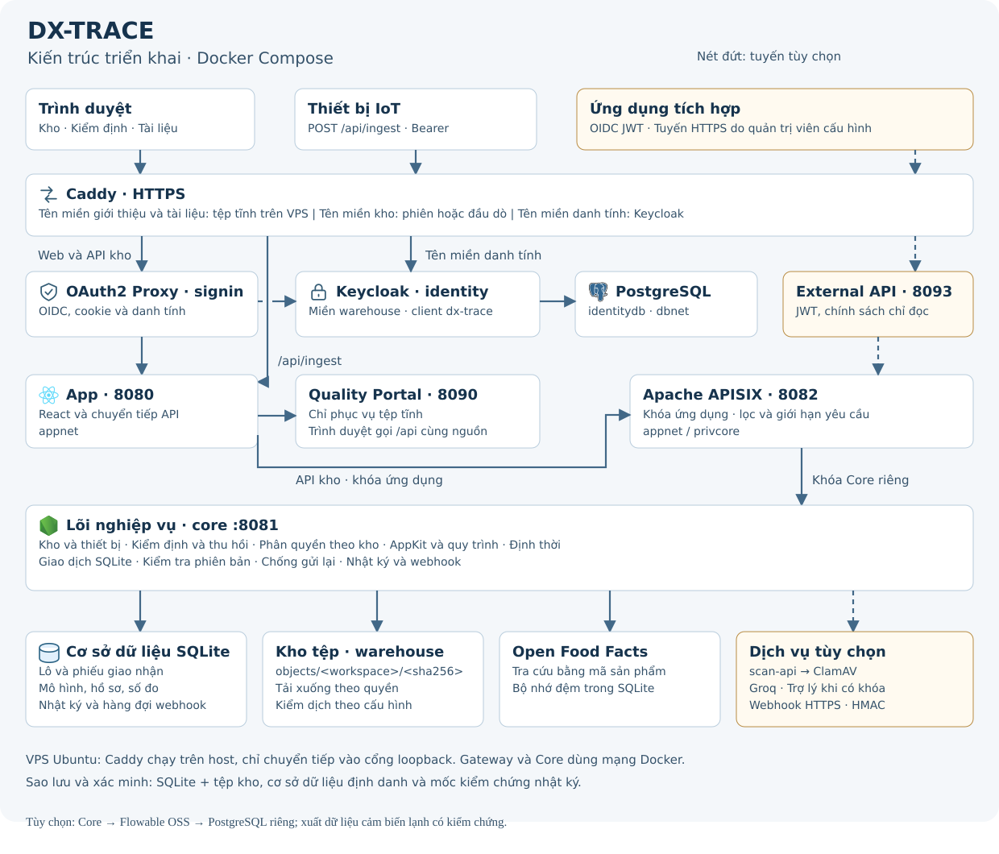

# Bản đồ kiến trúc hệ thống

## Các lớp triển khai

| Lớp | Thành phần | Ranh giới |
| --- | --- | --- |
| Edge | Caddy, TLS, OAuth2 Proxy | Điểm vào công khai, chuyển phiên đã xác thực |
| Identity | Keycloak + PostgreSQL identitydb | Quản lý danh tính; không chứa DB nghiệp vụ Core |
| Presentation | App React và Quality Portal | Không gắn volume kho trong bản tách service |
| Gateway | gateway-api | Credential riêng, chuyển yêu cầu đến Core |
| Core | Node.js, model, workflow, API | Kiểm quyền, trạng thái, phiên bản và audit |
| Storage | SQLite, content-addressed files | Volume warehouse; backup riêng |
| Optional | Scanner ClamAV, external OIDC API, webhook | Cấu hình rõ ràng; không mặc định công bố |

## Luồng yêu cầu

1. Trình duyệt đến Caddy và OAuth2 Proxy.
2. App nhận danh tính đã xác thực.
3. App gửi yêu cầu đến Gateway với credential nội bộ riêng.
4. Gateway kiểm chính sách rồi chuyển đến Core.
5. Core kiểm workspace, role và quy tắc nghiệp vụ; ghi DB và audit trong transaction.
6. Trả kết quả qua tuyến ngược lại.

Quality Portal là frontend độc lập, dùng cùng API và phiên. Không có quyền truy cập trực tiếp DB. Core runtime hiện là SQLite; migration PostgreSQL là công cụ offline riêng.

## Ranh giới và giới hạn

Không công bố Core, DB hay credential service ra Internet. Một process Core và storage cục bộ không đồng nghĩa HA. Workflow chỉ hỗ trợ tập con; data lineage hiện là ánh xạ khai báo. SSO và hiệu năng production cần xác minh riêng.

[Headless Core](../../docs/HEADLESS-CORE.md) · [Bản đồ mã nguồn](../../docs/CODEBASE.md).
