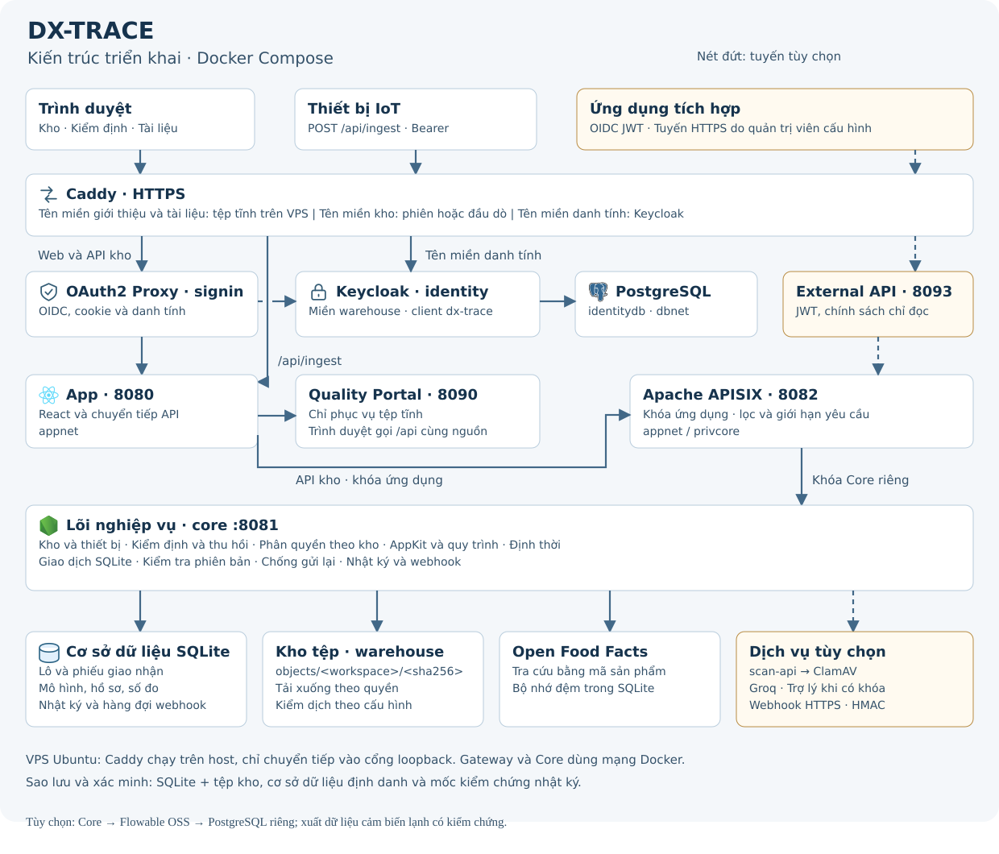

# Tài liệu DX-TRACE

**Trạng thái main (chưa phát hành):** Apache APISIX 3.21.0 là gateway mặc định trong Compose. Overlay Flowable OSS 7.2.0 thực thi quy trình thẩm định độc lập; nghiệp vụ kho và AppKit hiện hữu vẫn dùng runtime cũ. CI tích hợp PR #35 đã đạt; nghiệm thu VPS chưa xác nhận. [Tích hợp](../../docs/THIRD-PARTY-CORE-MIGRATION.md).

Nền tảng chuyển đổi số nguồn mở cho chuỗi cung ứng, truy xuất thực phẩm và điều phối thu hồi. Một lõi dùng chung cho danh tính, dữ liệu, phân quyền và quy trình nghiệp vụ.

## Bắt đầu khám phá

- [Bắt đầu nhanh](quickstart.md) — chạy demo cục bộ.
- [Headless Core](../../docs/HEADLESS-CORE.md) — hiểu kiến trúc và ranh giới tin cậy.
- [AppKit v2](../../docs/APPLICATION-BUNDLES.md) — đóng gói và cài đồng thời nhiều mô hình.
- [HTTP API](../../docs/API.md) — tích hợp ứng dụng.
- [Triển khai Docker](../../selfhost/README.md) — vận hành thực tế.

## Năng lực nền tảng

| Thành phần | Chức năng |
| --- | --- |
| Identity | Keycloak và OAuth2 Proxy |
| API Gateway | Apache APISIX, chính sách truy cập và cách ly Core |
| Headless Core | Nghiệp vụ, dữ liệu, quyền và audit |
| AppKit | Biểu mẫu khai báo, workflow và gói nghiệp vụ |
| Process Runtime | Runtime cũ + Flowable OSS tùy chọn |
| Data Governance | Catalog, truy vết cảm biến, kho lạnh kiểm SHA-256 |
| Quality Portal | Ứng dụng kiểm định độc lập |

## Phiên bản và minh chứng

Tài liệu được dựng từ mã nguồn hiện tại, không đồng nghĩa mọi tính năng thuộc bản phát hành v0.0.7 hoặc đã được triển khai trên VPS. PostgreSQL có công cụ chuyển đổi được kiểm thử; runtime vẫn dùng SQLite. SSO thực tế và vận hành ClamAV cần nghiệm thu riêng. Xem [ma trận minh chứng](../../docs/EVIDENCE.md), [CI](https://github.com/ngochieu1762005/dx_trace/actions) và [releases](https://github.com/ngochieu1762005/dx_trace/releases).

## Giấy phép

MIT · DX-TRACE contributors. [Đóng góp](../../CONTRIBUTING.md) · [Bảo mật](../../SECURITY.md).

## Tìm đúng hướng dẫn

| Việc cần làm | Bắt đầu từ đâu | Dấu hiệu hoàn tất |
| --- | --- | --- |
| Hiểu dự án qua một lô cụ thể | [HDPI trong vận hành kho](hdpi.md) | Giải thích được vì sao hàng đang giữ và hàng đã giao phải xử lý khác nhau. |
| Đưa một lô vào kho | [Nhập và giao lô](warehouse-guide.md) | Tra lại được đúng nhà cung cấp và điểm nhận bằng mã lô. |
| Nối thiết bị | [Gửi số đo](sensor-guide.md) | Một lần gửi lại cùng mẫu chỉ tương ứng với một phép đo. |
| Viết ứng dụng dùng chung Core | [Tạo mô hình](app-tutorial.md) và [quy ước API](api-auth.md) | Một người lập phiếu, người có quyền xử lý và lịch sử ghi đúng tác nhân. |
| Bàn giao máy chủ | [Kiểm tra triển khai](deployment-checklist.md) và [phục hồi](backup-restore.md) | Đăng nhập được từ trình duyệt và đọc lại được hồ sơ từ bản phục hồi riêng. |
